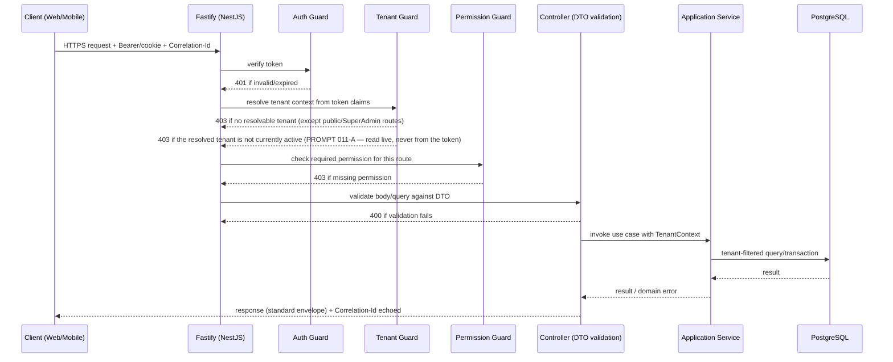

# API Architecture

Related: [ADR-0005](../decisions/0005-rest-api.md). The API is the single contract for the web
app, the Flutter mobile app ([ADR-0025](../decisions/0025-flutter-for-mobile.md),
[mobile.md](mobile.md)), and any future integration — see
[system-overview.md](system-overview.md). Mobile is not a special case: it authenticates and calls
`/api/v1` exactly like the web app, per [mobile.md#backend-as-the-sole-authority](mobile.md#backend-as-the-sole-authority)
— nothing in this document is web-specific.

## Versioning

**Decision: URL path versioning, `/api/v1/...`.** Chosen over header-based versioning
(`Accept: application/vnd.saas-inventory.v1+json`) because it's visible in logs, browser network
tabs, and OpenAPI docs without extra tooling, and it's what NestJS's built-in URI versioning
supports directly. A breaking change gets `/api/v2` for the affected resource(s); additive,
backward-compatible changes (new optional field, new endpoint) do not bump the version. There is
no committed policy yet for how long `v1` is supported once `v2` exists — `PENDING DECISION`,
revisited when a `v2` is actually needed.

## Request flow



Every failure path returns the same [error envelope](#errors); no route bypasses the guard chain
except explicitly public routes (health check, login, the QR public resolver).

**SuperAdmin routes** (FASE 11, `@PlatformOnly()` — `apps/api/src/administration/platform-tenants/`,
`apps/api/src/auth/platform-auth.controller.ts`) take a third path through the Tenant Guard,
distinct from both the ordinary flow above and `@Public()`: they require a verified
`platform_admins` principal (a structurally separate token — see
[ADR-0032](../decisions/0032-platform-admin-authentication.md)) but never resolve a tenant context
or reach the Permission Guard's tenant-RBAC check — there is no tenant permission catalog entry for
these routes, by design ([multi-tenancy.md#superadmin-vs-tenant](multi-tenancy.md#superadmin-vs-tenant)).

## Errors

A single error shape across the whole API, produced by the global exception filter (see
[backend.md](backend.md#cross-cutting-concerns)):

```json
{
  "statusCode": 404,
  "code": "PRODUCT_NOT_FOUND",
  "message": "Product not found.",
  "correlationId": "b3a1...e9f2"
}
```

- `statusCode` — standard HTTP status.
- `code` — a stable, machine-readable string clients can branch on, independent of the (possibly
  localized later) `message`.
- `message` — human-readable, safe to show a user; never a raw exception message, stack trace, or
  SQL error (see [security.md](security.md)).
- `correlationId` — ties the error back to server-side logs for support/debugging.

This shape is already reflected in `packages/types` (`ApiErrorShape`, from Prompt 00).

## Pagination, filtering, sorting, search

- **Pagination:** offset-based (`page`, `pageSize`) is the default for admin-facing list endpoints,
  matching the `PaginatedResult<T>` / `PaginationParams` shapes already defined in
  `packages/types`. High-volume, append-mostly endpoints (e.g. `InventoryMovement` history) may
  need cursor-based pagination instead for stable results under concurrent writes —
  `PENDING DECISION`, resolved per-endpoint when that endpoint is built, not globally now. The
  Prompt 02 schema's indexes on those tables (e.g. `inventory_movements(tenant_id, created_at)`, see
  [database.md#indexes](database.md#indexes)) support either choice without a schema change, so this
  decision is not blocked by the database design.
- **Filtering:** explicit, documented query parameters per endpoint (e.g. `?status=active`), not a
  generic passthrough query-language — every filterable field is deliberately exposed, not
  whatever happens to exist as a column, which also avoids leaking schema shape.
- **Sorting:** an explicit `sort` parameter with an allow-list of sortable fields per endpoint, for
  the same reason.
- **Search:** free-text search (where a resource needs it) is a distinct, documented parameter
  (e.g. `?q=`), with the underlying implementation (simple `ILIKE`, Postgres full-text search,
  something else) decided per-endpoint when that endpoint is designed.

### Date-range filters (FASE 18 reporting endpoints)

**RATIFIED — F18-01.** Every FASE 18 read-side reporting endpoint's `from`/`to` query params are a
half-open **`[from, to)`** period — `from` inclusive, `to` exclusive — both ISO-8601 datetime
strings already resolved to UTC by the caller. See
[reporting/filters-periods-and-scope.md#period-boundaries](reporting/filters-periods-and-scope.md#period-boundaries)
for the full contract (the reusable `ReportDateRangeQueryDto`/`toHalfOpenRange()` helpers, the
per-endpoint default rules, and the explicit exception below) — not duplicated here.

`GET /orders`'s pre-existing `createdFrom`/`createdTo` (SALES, FASE 12) is a deliberate exception:
it keeps its original inclusive-both-bounds semantics, unchanged by F18-01.

`GET /inventory/movements`'s `occurredFrom`/`occurredTo` (F18-03, `GAP-MOVEMENTS-DATE-FILTER`) is a
**third** date-filter shape, distinct from both of the above: it applies the same half-open
`[occurredFrom, occurredTo)` semantics as the FASE 18 convention, but on `occurred_at` (not
`created_at`) and under its own field names — deliberately not `from`/`to`, since this is an F17
operational list filter on an existing endpoint, not a new FASE 18 report. `GET
/reports/inventory-summary` (F18-03) has no date filter at all — it is a live snapshot of current
`inventory_balances` state, not a period query.

`GET /reports/sales-summary` (F18-02), `GET /reports/returns-summary` (F18-04) and
`GET /reports/approvals-summary` (F18-05) each follow the standard half-open `[from, to)` `from`/`to`
convention (both **required** — 400 when either is missing) and anchor on the single immutable,
always-present timestamp of their subject — `orders.created_at`, `sales_returns.created_at`,
`price_approvals.requested_at` respectively — resolving day/week/month bucket boundaries in the
tenant's own IANA timezone.

## Idempotency

State-changing endpoints where a client retry could otherwise duplicate an effect (most notably
order creation, once SALES exists — and, per Prompt 02-A, cart-item mutations, inventory-transfer
receiving events, and sales-return creation/disposition) accept an `Idempotency-Key` header. The API
stores the key (scoped by tenant) with the result of the first request that used it; a retried request
with the same key returns the original result instead of repeating the operation. See the
[order flow](modules.md#order-flow-conceptual--sales-not-implemented-yet) in modules.md and the full
persistence design in [database.md#idempotency](database.md#idempotency). A one-time state transition
that only ever legitimately happens once (e.g. a transfer's dispatch) instead uses a *deterministic*
idempotency key derived from the entity itself, not a client-supplied header — see
[database.md#inventory-transfers-and-in-transit-stock](database.md#inventory-transfers-and-in-transit-stock).

## Correlation ID

Every request either carries a `Correlation-Id` header from the client or has one generated by the
API if absent. It is threaded through logs, the error envelope, and outbound calls made while
handling the request (including the event written to the [outbox](events.md)), so a single request
can be traced end to end.

## Rate limiting

Enforced at the API layer, keyed by tenant and/or IP depending on the route — e.g. login/register
are limited by IP+identifier to blunt brute force (implemented in Prompt 04,
`apps/api/src/auth/guards/auth-throttler.guard.ts`, `AUTH_RATE_LIMIT_MAX`/
`AUTH_RATE_LIMIT_TTL_SECONDS`). That implementation is in-memory (single API instance) — correct
for the current single-instance deployment shape, but a `PENDING DECISION` for when the API runs
horizontally scaled, at which point a shared store (Redis, already provisioned via `REDIS_URL`) is
needed so limits are enforced across instances, not per-instance. General per-tenant API usage
limiting (protecting the platform from a single noisy tenant) is not yet implemented — no
business/domain endpoints exist yet to protect (see [security.md](security.md#rate-limiting-and-brute-force-protection)).

## Public endpoints

A small, explicit set of routes don't require the normal auth/tenant guard chain:

- `GET /health` (already scaffolded).
- Login/token-refresh endpoints (they establish the session, so they can't require one) — both the
  tenant (`/auth/*`) and platform-admin (`/platform/auth/*`, FASE 11) variants. This includes
  `POST /auth/select-tenant` (016-C): it is reached only with a short-lived tenant-selection token,
  never a session, and completes login for an identity that has more than one active tenant
  membership (see [security.md](security.md#global-identity--tenant-selection-016-c)).
- The QR public resolver (`GET /q/:code` or similar) — returns only the subset of information
  appropriate for an unauthenticated scan (see [multi-tenancy.md](multi-tenancy.md) and
  [security.md](security.md) for public-vs-private data rules); it does not require a tenant
  session and does not leak which tenant owns the scanned code beyond what's intentionally public.

Every other route requires the full guard chain shown in [Request flow](#request-flow).

## OpenAPI

Already wired up in the Prompt 00 scaffold (`@nestjs/swagger`, served at `/docs`). Every endpoint
gets `@ApiTags`/`@ApiOkResponse`/DTO-derived schemas as it's built, so the OpenAPI document stays
accurate rather than being written by hand separately.
