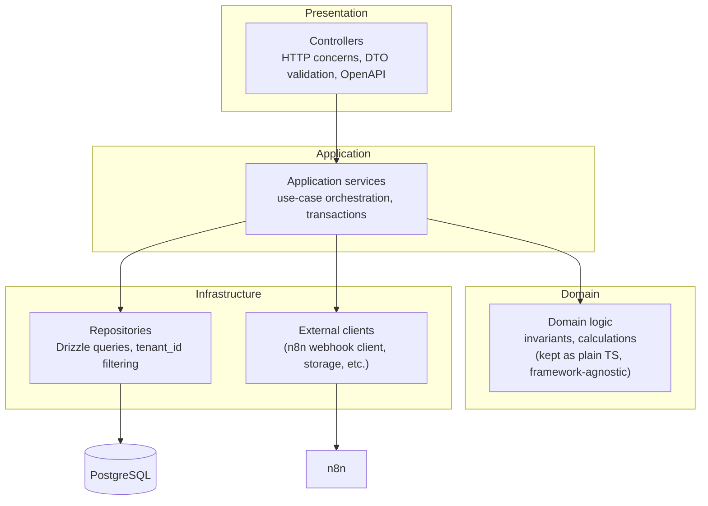

# Backend Architecture

Related: [ADR-0001](../decisions/0001-modular-monolith.md),
[ADR-0007](../decisions/0007-nestjs.md), [modules.md](modules.md).

## Style: modular monolith

One deployable NestJS application, internally organized into the bounded-context modules defined
in [modules.md](modules.md). Not microservices — see
[ADR-0001](../decisions/0001-modular-monolith.md) and [scalability.md](scalability.md) for why,
and for what would justify splitting a module out later.

A NestJS `Module` boundary is enforced the same way a service boundary would be in microservices:
a module only exports what it intends other modules to use (its public service interface), and
other modules only import that export — never a repository or entity that belongs to another
module. This is what makes future extraction possible without a rewrite: the module boundary
already *is* the future service boundary, it just isn't network-separated yet.

## Layering inside each module

- **Presentation (controllers).** Thin — per [CLAUDE.md §7.5](../../CLAUDE.md#75-backend), they
  parse/validate the request (via DTOs), call exactly one application service method, and shape
  the response. No business logic, no direct repository access.
- **Application (services).** Orchestrate a use case: check authorization, open a transaction where
  one is needed, call domain logic, call repositories, write audit/outbox entries. This is where
  "create an order" or "adjust inventory" lives as a coherent operation.
- **Domain.** Business rules and invariants that don't depend on NestJS, Fastify, or Drizzle —
  e.g. "available stock = physical − reserved − committed" is a pure calculation, not something
  that needs to know it's running inside a controller. Kept deliberately light in this phase; it
  grows as real business modules are built, it is not a mandate to build a full DDD tactical
  pattern set (entities/value objects/aggregates) speculatively ahead of need.
- **Infrastructure.** Repositories translate between the application layer and Drizzle/PostgreSQL,
  and are the one place tenant-filtering is implemented for a given table — see
  [multi-tenancy.md](multi-tenancy.md#enforcement-layers-defense-in-depth). External clients (the
  outbox → n8n webhook caller, future object-storage client) also live here, so the application
  layer never imports an HTTP client or SDK directly.

## Cross-cutting concerns

- **Tenant context.** Resolved once per request by the Tenant Guard (see
  [multi-tenancy.md](multi-tenancy.md)) and made available via NestJS's request scope /
  `AsyncLocalStorage`-backed context, not threaded manually through every function signature.
- **Error handling.** A single global exception filter maps thrown errors (domain errors,
  validation errors, not-found, etc.) to the standard API error envelope (see
  [api.md](api.md#errors)) — controllers and services throw typed exceptions, they don't format
  HTTP responses themselves.
- **Logging.** Structured (JSON) logs including `correlationId` and `tenantId` (when present),
  emitted centrally rather than via ad hoc `console.log` in business code. Secrets and full
  request bodies with sensitive fields are never logged — see [security.md](security.md).
- **Validation.** DTOs with `class-validator` decorators, `whitelist`/`forbidNonWhitelisted`
  enabled globally (already configured in `apps/api/src/main.ts`) so unexpected fields are
  rejected rather than silently ignored — closing off one path a client could use to try to smuggle
  a `tenantId` field into a request body.
- **OpenAPI.** Every endpoint documented via `@nestjs/swagger` decorators, already wired up at
  `/docs` in the scaffold from Prompt 00.

## What this phase does not decide

Concrete module contents (entities, DTOs, service methods) are not designed here — that starts
with database design in Prompt 02 and continues module-by-module. This document fixes the
*shape* implementation follows, not the implementation itself.
