# Database Architecture

**Status: design complete (Prompt 02, extended by Prompt 02-A/02-B, corrected by Prompt 02-D
post-audit).** This document is the logical data model and multi-tenant isolation strategy PostgreSQL
will implement in Prompt 03 (migrations, constraints, indexes, RLS policies). It supersedes the
conceptual placeholder written in Prompt 01. Prompt 02-A audited and extended the Prompt 02 design to
cover multi-location transfers, in-transit stock, sales returns/disposition, the shopping cart,
invoice/sales-note document selection, external invoicing, three-tier pricing with negotiated-discount
approval, and QR-displayed reference pricing. Prompt 02-B closes the dynamic, per-tenant/per-category
product attribute system (governing the `attributes` JSONB columns Prompt 02 introduced but left
ungoverned) and the staged Excel import/inventory-onboarding pipeline. Prompt 02-C audited the whole
design for cross-phase consistency (no CRITICAL findings; 3 HIGH, 5 MEDIUM, 3 LOW). Prompt 02-D closes
the required fixes: a single lowercase enum/status-value convention across every table (previously
split by phase-of-authorship — see [§Conventions](#conventions)), the concrete permission catalog for
every Prompt 02-A/02-B capability (see [§RBAC](#rbac-roles-permissions)), field-level authorization for
`cost`/`min_price` ([ADR-0028](../decisions/0028-field-level-price-authorization.md)), the corrected
`INITIAL_STOCK`-vs-`ADJUSTMENT_IN` mapping, and the Import Worker's separation from the Event Processor
([ADR-0029](../decisions/0029-import-worker-separation.md)) — see the entries added to
[§Discrepancies](#discrepancies-found-and-how-they-were-resolved) below for what specifically changed
at each phase. Nothing described here is implemented yet — no migration exists, `apps/`/`packages/`
are unchanged. Related: architecture [system-overview.md](system-overview.md),
[multi-tenancy.md](multi-tenancy.md), [security.md](security.md), [modules.md](modules.md),
[events.md](events.md), [mobile.md](mobile.md), [../security/threat-model.md](../security/threat-model.md),
and ADRs [0002](../decisions/0002-postgresql.md), [0003](../decisions/0003-single-database-multi-tenant.md),
[0004](../decisions/0004-tenant-isolation-strategy.md), [0008](../decisions/0008-drizzle-orm.md),
[0009](../decisions/0009-rbac-permissions.md), [0010](../decisions/0010-outbox-pattern.md),
[0014](../decisions/0014-demo-tenant-strategy.md), [0015](../decisions/0015-audit-log.md),
[0016](../decisions/0016-uuid-identifier-strategy.md),
[0017](../decisions/0017-product-variant-attribute-model.md),
[0018](../decisions/0018-tenant-aware-referential-integrity.md),
[0019](../decisions/0019-suppliers-ownership.md),
[0020](../decisions/0020-multi-location-inventory-transfers.md),
[0021](../decisions/0021-sales-returns-disposition.md),
[0022](../decisions/0022-pricing-tiers-and-discount-approval.md),
[0023](../decisions/0023-document-type-and-external-invoicing.md),
[0024](../decisions/0024-location-scoped-authorization.md),
[0025](../decisions/0025-flutter-for-mobile.md),
[0026](../decisions/0026-dynamic-attribute-system.md),
[0027](../decisions/0027-staged-excel-import-pipeline.md),
[0028](../decisions/0028-field-level-price-authorization.md),
[0029](../decisions/0029-import-worker-separation.md).

## Contents

1. [Discrepancies found and how they were resolved](#discrepancies-found-and-how-they-were-resolved)
2. [Conventions](#conventions)
3. [Data classification: platform-scoped vs. tenant-scoped](#data-classification-platform-scoped-vs-tenant-scoped)
4. [The `tenant_id` policy](#the-tenant_id-policy)
5. [Tenant-aware referential integrity](#tenant-aware-referential-integrity)
6. [Row-Level Security](#row-level-security)
7. [Identifiers: UUIDv7](#identifiers-uuidv7)
8. [Core: tenants, users, platform admins](#core-tenants-users-platform-admins)
9. [RBAC: roles, permissions](#rbac-roles-permissions)
10. [Catalog: products, variants, attributes](#catalog-products-variants-attributes)
11. [Dynamic attributes: governance for the catalog JSONB](#dynamic-attributes-governance-for-the-catalog-jsonb)
12. [QR codes](#qr-codes)
13. [Inventory: warehouses, locations, balance, ledger](#inventory-warehouses-locations-balance-ledger)
14. [Location-scoped authorization](#location-scoped-authorization)
15. [Inventory transfers and in-transit stock](#inventory-transfers-and-in-transit-stock)
16. [Concurrency strategy](#concurrency-strategy)
17. [Excel import pipeline](#excel-import-pipeline)
18. [Customers and suppliers](#customers-and-suppliers)
19. [Cart](#cart)
20. [Orders (conceptual — SALES not built yet)](#orders-conceptual--sales-not-built-yet)
21. [Pricing: history, tenant policy, and exceptional-discount approval](#pricing-history-tenant-policy-and-exceptional-discount-approval)
22. [Sales returns and disposition](#sales-returns-and-disposition)
23. [Audit log vs. domain events vs. application logs](#audit-log-vs-domain-events-vs-application-logs)
24. [Outbox](#outbox)
25. [Idempotency](#idempotency)
26. [Soft delete policy](#soft-delete-policy)
27. [Timestamps](#timestamps)
28. [Indexes](#indexes)
29. [Constraints](#constraints)
30. [Migration strategy](#migration-strategy)
31. [Seed and demo tenant](#seed-and-demo-tenant)
32. [ER diagrams](#er-diagrams)
33. [Open decisions carried forward](#open-decisions-carried-forward)

---

## Discrepancies found and how they were resolved

Per the mandatory process, these are not overwritten silently — each is resolved with an ADR.

| # | Discrepancy | Resolution |
| --- | --- | --- |
| 1 | [modules.md](modules.md#sales-future--not-built-in-this-phase) lists SALES as owning `customers, cart, orders`. It never mentions `suppliers` anywhere, and there is no PURCHASING module in the module map. But this prompt requires designing a `suppliers` entity. | `suppliers` is a passive reference entity (who a product/brand is sourced from), not a purchasing workflow (no purchase orders, receiving, or supplier invoices are designed — none of that is backed by the architecture). It is placed under **CATALOG**, alongside `brands`, since both are "who/what a product is associated with" reference data, not a transactional workflow. See [ADR-0019](../decisions/0019-suppliers-ownership.md). `modules.md` is updated accordingly. |
| 2 | The current uniqueness rule ("unique constraints are tenant-scoped," this document, pre-Prompt-02 version) cannot hold for `qr_codes.code`: the public QR resolver (`GET /q/:code`, [api.md](api.md#public-endpoints)) receives only the opaque code with **no tenant context** — the tenant isn't known until *after* the code is resolved. A tenant-scoped unique constraint would let two tenants mint the same code, making resolution ambiguous. | `qr_codes.code` is a documented, deliberate exception: **globally unique**, not `(tenant_id, code)`. Recorded inline in [§QR codes](#qr-codes) rather than a separate ADR — it is a direct, narrow consequence of the already-accepted QR architecture ([modules.md#qr](modules.md#qr), [api.md#public-endpoints](api.md#public-endpoints)), not a new architectural decision. |
| 3 | [CLAUDE.md §7.3](../../CLAUDE.md#73-multi-tenancy) states RLS "will be evaluated... do not assume it is active yet" — describing the current (pre-Prompt-03) reality. This document now **decides** RLS is active from the first migration. | Not a contradiction: CLAUDE.md describes what is implemented today (nothing), and this document describes what Prompt 03 will implement. CLAUDE.md §7.3 should get a one-line update **in Prompt 03**, when RLS is actually implemented and the statement would otherwise be stale — not now, since editing CLAUDE.md ahead of the code it describes would itself be inaccurate. Flagged here so Prompt 03 doesn't miss it. |
| 4 | The Prompt 01 version of this document (superseded by this rewrite; see git history at commit `8f93f6c`) left UUIDv4-vs-v7, the product/variant model, and RLS timing as `PENDING DECISION`. | All three are closed by this document; see [§Identifiers](#identifiers-uuidv7), [§Catalog](#catalog-products-variants-attributes), [§Row-Level Security](#row-level-security), and their ADRs. |
| 5 (Prompt 02-A) | Prompt 02's `product_variants` had a single `price` column. Prompt 02-A's requirement for a negotiable price (maximum/reference, base, minimum, with exceptional-discount approval below the floor) cannot be expressed with one column. | `price` is replaced by three columns — `max_price`, `base_price`, `min_price` — with `CHECK (min_price <= base_price AND base_price <= max_price)`. This is not a silent overwrite: it is recorded here, in [ADR-0022](../decisions/0022-pricing-tiers-and-discount-approval.md), and reflected everywhere `price` was previously referenced (this document, [ADR-0017](../decisions/0017-product-variant-attribute-model.md)'s scope is unaffected — the hybrid relational+JSONB *model* decision doesn't change, only this one column). No migration exists yet, so this is a design revision, not a schema migration. |
| 6 (Prompt 02-A) | Prompt 02's `modules.md` SALES description ("a customer builds a cart, which becomes an order") implied a cart but never modeled it, and had no PURCHASING-adjacent concept for inbound transfers, returns, or price negotiation at all — none of that was in scope for Prompt 02. | All are genuinely new functional scope this prompt introduces, backed by an explicit prompt requirement, not invented ahead of one: [§Inventory transfers](#inventory-transfers-and-in-transit-stock), [§Cart](#cart), [§Sales returns](#sales-returns-and-disposition), and [§Pricing](#pricing-history-tenant-policy-and-exceptional-discount-approval). Each has an ADR. `modules.md` is updated to reflect the additions under their existing owning modules (INVENTORY, SALES) — no new bounded context is introduced. |
| 7 (Prompt 02-B) | An audit for this prompt found that Prompt 02's `products.attributes`/`product_variants.attributes` JSONB columns had **no governance mechanism** — [ADR-0017](../decisions/0017-product-variant-attribute-model.md) correctly decided JSONB *over* EAV for the flexible bag, but never specified how a JSONB key is validated against a known attribute, a data type, a required/optional rule, or a closed value set. Nothing was silently wrong (ADR-0017's model decision holds), but "JSONB accepts whatever the caller sends" is not a complete design for a catalog spanning unrelated industries with real validation needs. | Closed by [§Dynamic attributes](#dynamic-attributes-governance-for-the-catalog-jsonb) and [ADR-0026](../decisions/0026-dynamic-attribute-system.md): `attribute_definitions` + `attribute_options` + `category_attributes` become the metadata that validates the JSONB at write time. This **extends** ADR-0017, it does not reopen or reverse it — JSONB remains the storage mechanism, no EAV row-per-value table is introduced. |
| 8 (Prompt 02-B) | This prompt requires that a bulk inventory import be traceable as distinct from an ordinary stock receipt (`RECEIPT`) — the existing `inventory_movements.movement_type` catalog (`RECEIPT, SALE, RETURN, ADJUSTMENT_IN, ADJUSTMENT_OUT, TRANSFER_OUT, TRANSFER_IN, RESERVATION, RESERVATION_RELEASE, COMMITMENT, COMMITMENT_RELEASE`, fixed in Prompt 02) has no value for this. | One new value, `INITIAL_STOCK`, is added to the `CHECK` list — see [§Inventory](#inventory-warehouses-locations-balance-ledger) and [ADR-0027](../decisions/0027-staged-excel-import-pipeline.md). This is an additive change to a `CHECK (col IN (...))` list, which [§Conventions](#conventions) already established as the easy, normal-migration path for exactly this kind of extension — not a redesign of the ledger. |
| 9 (Prompt 02-D) | The 02-C audit (H1) found that every status/enum column introduced in Prompt 02-A/02-B used `MAYÚSCULA` while every column from Prompt 02 itself (and the platform-catalog `permissions`/`measurement_units` tables) used lowercase — an unintentional drift by phase-of-authorship, not a deliberate second convention, visible even within one table (`orders.status` lowercase vs. `orders.document_type`/`invoice_status` uppercase). | Every 02-A/02-B enum value converted to lowercase — see [§Conventions](#conventions). `inventory_movements.movement_type` (uppercase since Prompt 02 itself, unrelated to the 02-A/02-B drift) is a deliberate, documented, out-of-scope exception, not touched — rewriting a Prompt 02 foundational column for a cosmetic reason is not what this correction pass is for. |
| 10 (Prompt 02-D) | The 02-C audit (H2) found that no concrete `permissions.code` rows were ever enumerated for any Prompt 02-A/02-B capability (price approval, transfers, attribute management, import, location assignment) — the RBAC mechanism was sound but its content was incomplete. | Closed by [§RBAC's new permission codes subsection](#new-permission-codes-for-prompt-02-a02-b-capabilities-prompt-02-d) — 14 new codes, grouped per capability, not fragmented. |
| 11 (Prompt 02-D) | The 02-C audit (H3) found that `cost`/`min_price` visibility for the *authenticated* path (Web and Mobile) was never designed — only the unauthenticated QR resolver's column-level `GRANT` protected them. | Closed by [ADR-0028](../decisions/0028-field-level-price-authorization.md): a two-layer query-projection + allow-list-DTO mechanism, gated by two new permissions (`pricing.floor.view`, `pricing.cost.view`). |
| 12 (Prompt 02-D) | The 02-C audit (M1) found `import_jobs.duplicate_handling_mode = 'update_catalog_and_inventory'` used `INITIAL_STOCK` for an **existing** SKU's inventory adjustment, contradicting `INITIAL_STOCK`'s own stated definition ("stock digitized before onboarding"). | Analyzed, not merged (per this prompt's explicit instruction) — see [§Excel import pipeline](#excel-import-pipeline): `create`-action rows keep `INITIAL_STOCK`; `update`-action rows under `update_catalog_and_inventory` now use `ADJUSTMENT_IN` (an existing, unmodified movement type). |
| 13 (Prompt 02-D) | The 02-C audit (M4) found the import pipeline's background-job execution model didn't state whether it shared a process with the Event Processor or ran separately. | Resolved: separate Import Worker process, same claiming mechanism, no new queue technology — see [ADR-0029](../decisions/0029-import-worker-separation.md). |

No other contradiction between this design and the accepted architecture was found. Two items from the
02-C audit were evaluated and **explicitly not changed**, with reasoning recorded in place rather than
here: M2 (`inventory_transfers.status` — no `rejected` state added; see the Prompt 02-D note in
[§Inventory transfers](#inventory-transfers-and-in-transit-stock)) and M3/M5 (both confirmed still
correctly POST-MVP; see [§Open decisions](#open-decisions-carried-forward)).

---

## Conventions

These apply to every table unless a section below states an explicit exception.

- **Primary keys.** `id uuid PRIMARY KEY`, UUIDv7, generated by the application — see
  [§Identifiers](#identifiers-uuidv7).
- **Timestamps.** `created_at timestamptz NOT NULL DEFAULT now()` and, for mutable tables,
  `updated_at timestamptz NOT NULL DEFAULT now()` kept current by a trigger — see
  [§Timestamps](#timestamps).
- **`tenant_id`.** Every tenant-owned table has `tenant_id uuid NOT NULL`, plus a
  `UNIQUE (tenant_id, id)` constraint that enables the composite-FK pattern — see
  [§tenant_id policy](#the-tenant_id-policy) and [§Tenant-aware referential integrity](#tenant-aware-referential-integrity).
- **Foreign keys.** `ON DELETE RESTRICT` by default; `CASCADE` only where explicitly justified
  per-relationship (stated at the table). Cross-table FKs from one tenant-owned table to another are
  always the composite `(tenant_id, x_id) REFERENCES x(tenant_id, id)` form, never a bare
  `x_id REFERENCES x(id)`.
- **Status/type columns.** `text NOT NULL` plus a named `CHECK (col IN (...))` constraint, not a
  native Postgres `ENUM` type. Rationale: extending a `CHECK` list is a normal migration
  (`DROP CONSTRAINT` / `ADD CONSTRAINT`); extending a Postgres `ENUM` (`ALTER TYPE ... ADD VALUE`)
  has more edge cases (can't run in the same transaction as its first use pre-PG12, no `IF NOT
  EXISTS` removal) for status sets that are expected to grow as modules are built (order status,
  movement type). One convention, applied everywhere, rather than two.
- **Soft delete.** `deleted_at timestamptz NULL`, only on tables listed in
  [§Soft delete policy](#soft-delete-policy). Every read repository filters `deleted_at IS NULL` by
  default (application convention, see [backend.md](backend.md#layering-inside-each-module)).
- **Money/quantity.** `numeric` (arbitrary precision), never `float`/`double precision` — avoids
  floating-point rounding in prices, costs, and stock quantities.
- **Text.** `text`, not `varchar(n)` — Postgres `text` has no performance penalty over `varchar` and
  avoids arbitrary length limits that become migrations later. Length is enforced via `CHECK` only
  where a real constraint exists (e.g. a currency code), not defensively everywhere.

---

## Data classification: platform-scoped vs. tenant-scoped

| Table | Scope | Owner (module) | `tenant_id`? | RLS? |
| --- | --- | --- | --- | --- |
| `tenants` | Platform | CORE | no | no (see note) |
| `platform_admins` | Platform | CORE | no | no |
| `permissions` | Platform (catalog) | CORE | no | no |
| `users` | Tenant | CORE | yes | yes |
| `roles` | Tenant | CORE | yes | yes |
| `role_permissions` | Tenant | CORE | yes | yes |
| `user_roles` | Tenant | CORE | yes | yes |
| `audit_log` | Mixed (nullable tenant_id) | CORE | yes, **nullable** | yes (see note) |
| `categories` | Tenant | CATALOG | yes | yes |
| `brands` | Tenant | CATALOG | yes | yes |
| `suppliers` | Tenant | CATALOG (see [ADR-0019](../decisions/0019-suppliers-ownership.md)) | yes | yes |
| `products` | Tenant | CATALOG | yes | yes |
| `product_variants` | Tenant | CATALOG | yes | yes |
| `product_images` | Tenant | CATALOG | yes | yes |
| `product_serials` | Tenant | CATALOG | yes | yes |
| `product_lots` | Tenant | CATALOG | yes | yes |
| `attribute_definitions` | Tenant | CATALOG (see [ADR-0026](../decisions/0026-dynamic-attribute-system.md)) | yes | yes |
| `attribute_options` | Tenant | CATALOG | yes | yes |
| `category_attributes` | Tenant | CATALOG | yes | yes |
| `measurement_units` | Platform (catalog) | CATALOG | no | no |
| `import_mapping_templates` | Tenant | IMPORT (see [ADR-0027](../decisions/0027-staged-excel-import-pipeline.md) and [modules.md#import-prompt-02-b](modules.md#import-prompt-02-b)) | yes | yes |
| `import_jobs` | Tenant | IMPORT | yes | yes |
| `import_job_rows` | Tenant | IMPORT | yes | yes |
| `qr_codes` | Tenant (row-owned), globally unique `code` | QR | yes | yes, plus a narrow public-read policy (see [§QR codes](#qr-codes)) |
| `warehouses` | Tenant | INVENTORY | yes | yes |
| `locations` | Tenant | INVENTORY | yes | yes |
| `inventory_balances` | Tenant | INVENTORY | yes | yes |
| `inventory_movements` | Tenant | INVENTORY | yes | yes |
| `user_location_assignments` | Tenant | CORE (RBAC extension, see [ADR-0024](../decisions/0024-location-scoped-authorization.md)) | yes | yes |
| `inventory_transfers` | Tenant | INVENTORY (see [ADR-0020](../decisions/0020-multi-location-inventory-transfers.md)) | yes | yes |
| `inventory_transfer_items` | Tenant | INVENTORY | yes | yes |
| `inventory_transfer_receipts` | Tenant | INVENTORY | yes | yes |
| `inventory_transfer_receipt_items` | Tenant | INVENTORY | yes | yes |
| `customers` | Tenant | SALES | yes | yes |
| `carts` | Tenant | SALES (see [§Cart](#cart)) | yes | yes |
| `cart_items` | Tenant | SALES | yes | yes |
| `orders` | Tenant | SALES | yes | yes |
| `order_items` | Tenant | SALES | yes | yes |
| `product_price_history` | Tenant | CATALOG (see [ADR-0022](../decisions/0022-pricing-tiers-and-discount-approval.md)) | yes | yes |
| `tenant_price_policies` | Tenant | CATALOG | yes | yes |
| `price_approvals` | Tenant | SALES | yes | yes |
| `sales_returns` | Tenant | SALES (see [ADR-0021](../decisions/0021-sales-returns-disposition.md)) | yes | yes |
| `sales_return_items` | Tenant | SALES | yes | yes |
| `event_outbox` | Mixed (nullable tenant_id) | NOTIFICATIONS | yes, **nullable** | yes (see note) |
| `idempotency_keys` | Tenant | cross-cutting (owned by whichever module's transaction writes it) | yes | yes |
| `tenant_settings` | Tenant | ADMINISTRATION (FASE 11, see [§Administration](#administration-tenant-settings-and-platform-admin-sessions)) | yes | yes |
| `platform_admin_refresh_tokens` | Platform | ADMINISTRATION (see [ADR-0032](../decisions/0032-platform-admin-authentication.md)) | no | no |

**Notes on the "mixed" rows:** `audit_log` and `event_outbox` carry `tenant_id` for almost every row
(a tenant action, an `INVENTORY_ADJUSTED` event, ...) but must also hold platform-only rows with no
tenant (`TENANT_CREATED`, a SuperAdmin action not scoped to one tenant). `tenant_id` is nullable on
these two tables only. Under the standard tenant-isolation policy (`tenant_id = current tenant`), a
`NULL` never matches, so a tenant's own connection correctly never sees platform-only rows — no
special-casing needed there. Reading the platform-only rows is a SuperAdmin-only capability, done via
the `app_platform` role (see [§Row-Level Security](#row-level-security)).

**Why `tenants`/`platform_admins`/`permissions` have no RLS:** RLS filters rows *within* a table by
comparing to a tenant context. These three tables have no tenant dimension to filter by — `tenants`
*is* the list of tenants, `platform_admins` and `permissions` are global. Access control for them is
by **role and grant**, not by policy: only `app_platform` (and `app_migrator` for schema) can touch
`tenants`/`platform_admins` at all; `permissions` is readable by every role (it's a public catalog
used to render the RBAC checklist UI) but writable only by `app_migrator` (it changes via migration,
not application code — see [§RBAC](#rbac-roles-permissions)). **Prompt 02-B adds `measurement_units`
to this same group** — a small, fixed, platform-owned catalog (`kg`, `cm`, `cc`, ...), readable by
every role, writable only by `app_migrator`, for the identical reason `permissions` is: letting tenants
invent arbitrary unit strings would break the numeric-search value `attribute_definitions.unit_id`
exists to preserve — see [§Dynamic attributes](#dynamic-attributes-governance-for-the-catalog-jsonb).

**FASE 11 adds `platform_admin_refresh_tokens` to the same no-RLS-by-GRANT-alone group** (see
[ADR-0032](../decisions/0032-platform-admin-authentication.md)) — the server-side session store for
platform-admin logins, with no tenant dimension of its own, access restricted to `app_platform`
(and `app_migrator` for schema) exactly like `platform_admins` itself.

---

## The `tenant_id` policy

Formal answers to every question this prompt requires:

- **Which tables get `tenant_id`?** Every table in the "Tenant" or "Mixed" rows above. Pure platform
  tables (`tenants`, `platform_admins`, `permissions`) do not — a `tenant_id` on `tenants` itself
  would be meaningless (self-reference).
- **How is it obtained?** Exclusively from the verified JWT's `tenantId` claim, resolved once per
  request by the Tenant Guard, per [multi-tenancy.md](multi-tenancy.md#tenant-context-where-it-comes-from).
  Never from a request body/query/header/path value. This document adds nothing to that rule — it is
  already binding — it only adds the database-side backstop (RLS, composite FKs) for when application
  code fails to honor it.
- **Who can set it?** Only application code in the service/repository layer, at row-creation time,
  from the resolved `TenantContext` — never a value a controller reads off the request body (DTOs for
  tenant-owned resources do not accept a `tenantId` field at all; `whitelist`/`forbidNonWhitelisted`
  rejects it if a client sends one anyway, per [security.md](security.md#input-validation-sql-injection-xss)).
- **Who can modify it?** No one, ever, after insert. No table's `tenant_id` is updatable — there is no
  legitimate business operation that moves a row from one tenant to another (that would itself be a
  cross-tenant data leak). This is enforced by convention (no repository exposes an update path for
  `tenant_id`) and, as a hard backstop, a `BEFORE UPDATE` trigger (`prevent_tenant_id_change()`,
  attached to every tenant-owned table in the same migration that creates it) that raises if
  `NEW.tenant_id <> OLD.tenant_id`, regardless of what application code attempts.
- **How is it validated in the application?** The Tenant Guard rejects any request without a
  resolvable tenant context (except explicitly public/SuperAdmin routes); every repository method
  that touches a tenant-owned table takes `TenantContext` as a required parameter and includes it in
  the `WHERE` clause — see [multi-tenancy.md#enforcement-layers-defense-in-depth](multi-tenancy.md#enforcement-layers-defense-in-depth).
- **How is it validated in PostgreSQL?** Three independent mechanisms, all described in full below:
  1. `NOT NULL` + `CHECK`/FK constraints reject structurally invalid rows.
  2. RLS policies make cross-tenant rows invisible/unwritable even to a query that forgot to filter
     — see [§Row-Level Security](#row-level-security).
  3. Composite foreign keys make it *impossible to insert* a row whose parent belongs to a different
     tenant, regardless of RLS or application code — see next section. This is the answer to "how is
     a FK prevented from connecting tenant A to tenant B."

---

## Tenant-aware referential integrity

**The problem this closes:** a plain `order_items.product_variant_id uuid REFERENCES product_variants(id)`
only guarantees the referenced variant *exists somewhere* — nothing stops it from belonging to a
different tenant than the order. If application code ever passes the wrong variant id (a bug, or an
attacker-supplied id that happens to resolve because the lookup query forgot its own `tenant_id`
filter), the database itself would happily create `orders(tenant A) → product_variants(tenant B)`.
This is exactly the shape of bug the [threat model](../security/threat-model.md#cross-tenant-access)
calls P0, and RLS alone does not close it as an INSERT-time guarantee — RLS's `WITH CHECK` clause
would catch the *order* row not matching the session tenant, but does not, by itself, verify the
*referenced* variant's tenant matches the *referencing* row's tenant. See
[ADR-0018](../decisions/0018-tenant-aware-referential-integrity.md) for the full record.

**The pattern, applied to every FK between two tenant-owned tables:**

```sql
-- Every tenant-owned table gets this in addition to its PK:
ALTER TABLE product_variants ADD CONSTRAINT product_variants_tenant_id_key UNIQUE (tenant_id, id);

-- Every FK to a tenant-owned table is composite, carrying tenant_id on both sides:
ALTER TABLE order_items
    ADD CONSTRAINT order_items_variant_fk
    FOREIGN KEY (tenant_id, product_variant_id)
    REFERENCES product_variants (tenant_id, id)
    ON DELETE RESTRICT;
```

With this constraint, `INSERT INTO order_items (tenant_id, product_variant_id, ...) VALUES ('A', <a
variant belonging to tenant B>, ...)` **fails at the database level** — there is no row in
`product_variants` with `(tenant_id, id) = ('A', <that variant's id>)`, because that variant's real
`tenant_id` is `'B'`. This holds even if every application-layer guard, the RLS policy, and code
review all failed simultaneously — it is a structural property of the schema, not defense that
depends on a check running correctly at request time.

This applies to every FK in this document between two tenant-owned tables: `products.category_id`,
`products.brand_id`, `product_variants.product_id`, `order_items.order_id`,
`order_items.product_variant_id`, `locations.warehouse_id`, `locations.parent_location_id`,
`inventory_balances.product_variant_id`, `inventory_balances.location_id`,
`inventory_movements.product_variant_id`, `inventory_movements.location_id`, `user_roles.user_id`,
`user_roles.role_id`, `role_permissions.role_id`, `orders.customer_id`, and so on — every such FK is
written as the composite form, not the bare form, in the actual migrations. **Prompt 02-A extends the
same pattern without exception** to every new table it adds:
`inventory_transfers.source_location_id`/`.destination_location_id`,
`inventory_transfer_items.transfer_id`/`.product_variant_id`, `sales_return_items.order_item_id`,
`price_approvals.order_id`/`.order_item_id`, `carts.location_id`/`.customer_id`/`.order_id`, and every
other FK introduced in [§Location-scoped authorization](#location-scoped-authorization),
[§Inventory transfers](#inventory-transfers-and-in-transit-stock), [§Cart](#cart),
[§Pricing](#pricing-history-tenant-policy-and-exceptional-discount-approval), and
[§Sales returns](#sales-returns-and-disposition) — this was verified per-table while writing those
sections, not assumed. **Prompt 02-B** adds the same verification for
`attribute_options.attribute_definition_id`, `category_attributes.category_id`/
`.attribute_definition_id`, `import_jobs.default_location_id`/`.mapping_template_id`,
`import_job_rows.import_job_id`/`.matched_product_variant_id` — every one composite. The one plain FK
Prompt 02-B introduces, `attribute_definitions.unit_id → measurement_units.id`, is the same
documented platform-catalog exception as `role_permissions.permission_code`, since
`measurement_units` has no `tenant_id` to compose against.

**Exceptions (documented, not accidental):**

- FKs from a tenant-owned table to a **platform-scoped** table (e.g.
  `role_permissions.permission_code REFERENCES permissions(code)`) stay a plain single-column FK —
  the target table has no `tenant_id` to compose against, and that is exactly the mechanism that
  prevents a tenant from inventing a permission outside the fixed catalog (see [§RBAC](#rbac-roles-permissions)).
- `inventory_movements.reference_id` and `.actor_id`, `audit_log.entity_id` and `.actor_id`, and
  `qr_codes.target_id` are **polymorphic** soft-references (the target table depends on a sibling
  `reference_type`/`actor_type`/`target_type` column) — Postgres cannot express a conditional FK, so
  these are intentionally not FK-constrained at all. They are validated in the application layer at
  write time. This is a standard, accepted trade-off for ledger/audit-style polymorphic references
  and is not a tenant-isolation gap by itself (the row being referenced was already written in the
  same transaction, by the same tenant-scoped code path).

---

## Row-Level Security

**Decision: RLS is enabled from the first migration that creates each tenant-owned table**, not
deferred to a later hardening pass. This closes the `PENDING DECISION` in
[ADR-0004](../decisions/0004-tenant-isolation-strategy.md) and
[multi-tenancy.md](../architecture/multi-tenancy.md#enforcement-layers-defense-in-depth). Reasoning:
turning RLS on later is safe but means the schema, seed scripts, and any early admin tooling get
built and exercised for weeks/months *without* the database-level backstop the threat model treats as
P0 — every one of those code paths would then need a retroactive audit. Building every tenant table
with RLS from day one costs nothing extra structurally (the policy is boilerplate, generated
alongside the table in the same migration) and means the backstop is never absent.

### Database roles

RLS in Postgres is bypassed by the table owner (and superusers) by default. Migrations therefore run
as a **different role** than the application, and the application itself uses more than one role so
that "who can see across tenants" is a small, explicit, auditable set of connections rather than a
flag inside the app:

| Role | Used by | RLS behavior | Table access |
| --- | --- | --- | --- |
| `app_migrator` | Drizzle Kit (CI/deploy) | owner — RLS does not apply | DDL owner of every table |
| `app_tenant` | NestJS API, all normal tenant-scoped requests | subject to RLS, `FORCE ROW LEVEL SECURITY` | every table the API needs, filtered by policy to `tenant_id = app.tenant_id` |
| `app_platform` | NestJS API, SuperAdmin-only service methods | `BYPASSRLS` | `tenants`, `platform_admins`, `platform_admin_refresh_tokens` (FASE 11), plus explicit read access to tenant tables for cross-tenant admin aggregation (never through the `app_tenant` path — see [multi-tenancy.md#administrative--cross-tenant-queries](multi-tenancy.md#administrative--cross-tenant-queries)) and `INSERT` on `audit_log` (FASE 11/ADR-0032 — auditing platform-admin actions) |
| `app_event_processor` | Event Processor worker | subject to RLS, but granted one **permissive, table-scoped** policy (below) | `event_outbox` only — no grants on any other table |
| `app_public_resolver` | QR public resolver endpoint (`GET /q/:code`) | subject to RLS, one narrow SELECT policy | `qr_codes` (SELECT only), plus SELECT on the specific columns of `products`/`locations` needed to render a public response |
| `app_import_worker` | Import Worker deployable (ADR-0029, migration 0019) | subject to RLS, granted one **permissive, table-scoped** policy per table (below) | `import_jobs`/`import_job_rows` only (SELECT, UPDATE) — the actual catalog/inventory writes for a claimed job happen over a normal, per-tenant `app_tenant` connection, never this one |

`FORCE ROW LEVEL SECURITY` on `app_tenant`'s tables is a deliberate belt-and-suspenders: it is
redundant in production (where `app_tenant` never owns the tables) but protects a local/dev setup
where a single Postgres role is sloppily reused for both migrating and querying — without `FORCE`,
that misconfiguration would silently disable the backstop exactly when it's most likely to be
misconfigured (a dev environment).

### Policy shape

Standard policy, applied to every tenant-owned table in the same migration that creates the table:

```sql
ALTER TABLE products ENABLE ROW LEVEL SECURITY;
ALTER TABLE products FORCE ROW LEVEL SECURITY;

CREATE POLICY tenant_isolation ON products
    USING (tenant_id = current_setting('app.tenant_id', true)::uuid)
    WITH CHECK (tenant_id = current_setting('app.tenant_id', true)::uuid);
```

`current_setting(..., true)` (the `missing_ok` form) returns `NULL` instead of raising when the
setting was never set for this session/transaction. `tenant_id = NULL` is never `true`, so a
connection that never established a tenant context sees **zero rows** and can insert/update **zero
rows** — the policy fails closed by construction, it does not need an explicit "no context → deny"
branch.

For the two mixed-scope tables, the same policy is sufficient without modification: `audit_log` and
`event_outbox` rows with `tenant_id IS NULL` are invisible to `app_tenant` (correct — a tenant
connection should never see platform-only entries) and visible to `app_platform` (which bypasses RLS
entirely).

`event_outbox`'s Event Processor policy, granted only to `app_event_processor`:

```sql
CREATE POLICY event_processor_access ON event_outbox
    FOR ALL TO app_event_processor
    USING (true) WITH CHECK (true);
```

This role can see every tenant's events, but the blast radius of that is `event_outbox` and nothing
else — it has no `GRANT` on any other table, so a compromised Event Processor cannot read
`products`/`orders`/etc. even though its Postgres role isn't tenant-filtered on the one table it does
touch. `qr_codes`' `app_public_resolver` policy follows the identical shape, restricted to `SELECT`.

FASE 10 (ADR-0029) added `app_import_worker` with the identical shape, sized to the two tables the
Import Worker claims/updates across every tenant in one query:

```sql
CREATE POLICY import_jobs_import_worker_access ON import_jobs
    FOR ALL TO app_import_worker
    USING (true) WITH CHECK (true);
CREATE POLICY import_job_rows_import_worker_access ON import_job_rows
    FOR ALL TO app_import_worker
    USING (true) WITH CHECK (true);
```

Unlike `app_event_processor`, this role was not created by migration 0000 (that migration predates
ADR-0027/ADR-0029) — migration 0019 creates it instead, `RESET ROLE`-ing back to the migration
session's originally-authenticated (`CREATEROLE`-privileged) identity just long enough to do so,
since by migration 0019 the session has already `SET ROLE app_migrator` (migration 0000's own
switch, held for the rest of the batch) and `app_migrator` itself has no `CREATEROLE`. Migration
0020 adds `import_jobs.claimed_at`/`claimed_by` (the same claim-tracking shape as
`event_outbox.claimed_at`/`claimed_by`) and migration 0021 adds the matching partial index
(`import_jobs_claimable_idx` on `(status, created_at) WHERE status IN ('validating',
'importing')`) the worker's cross-tenant claim query needs, mirroring
`event_outbox_pending_created_idx`.

**PROMPT 011-B adds one narrow read grant** (migration 0025): `GRANT SELECT (id, status) ON
tenants TO app_import_worker` — the claim query now `JOIN`s `tenants` to exclude any job whose
tenant is not `active`, so a suspended tenant's job is never (re-)claimed. Column-scoped, not a
blanket `GRANT SELECT ON tenants`, since the raw claim query only ever reads those two columns.
`tenants` itself still has no RLS (a platform table, access-by-`GRANT`-alone per this document's
own convention above) — this is the identical shape as `app_platform`'s own (unrestricted) read
access to the same table. The query locks only `import_jobs` (`FOR UPDATE OF ij`, not a bare `FOR
UPDATE`) specifically so this read of `tenants` can never block — or be blocked by — `POST
/platform/tenants/:id/suspend`'s own `UPDATE tenants SET status = ...`, which would otherwise
silently delay PROMPT 011-A's "suspension takes effect on the very next request" guarantee. See
[security.md#tenant-isolation](security.md#tenant-isolation) for the corresponding
`ImportValidationService`/`ImportExecutionService` batch-loop check, which reuses the existing
`TenantsPlatformRepository` (`app_platform` connection, already unrestricted on `tenants`) rather
than needing a grant of its own.

### Setting tenant context: `SET LOCAL`, transactions, and connection pooling

**The tenant context must be set with `SET LOCAL` (or the equivalent `set_config(name, value, true)`
with `is_local = true`), inside an explicit transaction, at the start of every unit of work — never
a bare session-level `SET`.**

- `SET LOCAL` (and `set_config(..., true)`) scope the setting to the **current transaction only** —
  it is automatically and unconditionally cleared on `COMMIT` or `ROLLBACK`, even if the underlying
  TCP connection is reused afterward for something else.
- A bare `SET app.tenant_id = ...` (session-scoped) would persist on the physical connection past the
  end of the logical request. Under connection pooling (PgBouncer in transaction-pooling mode, or any
  future pooler), a *different* tenant's next request could be handed that same physical connection
  and inherit the previous tenant's context — a direct cross-tenant leak caused by the pooling layer
  itself, not application code. `SET LOCAL` inside a transaction is immune to this because the pooler
  only returns a connection to the pool *after* the transaction ends, at which point the setting is
  already gone.
- Consequence: **every database operation the API performs — including a single read — happens
  inside an explicit transaction**, specifically so there is always a transaction for `SET LOCAL` to
  be scoped to. A "bare autocommit query" is not a pattern this schema's isolation guarantee
  supports; the repository/Drizzle wrapper built in Prompt 03 must open a transaction, `SET LOCAL
  app.tenant_id`, run the query/queries, then commit — for every call, not just multi-statement ones.
- Prefer `SELECT set_config('app.tenant_id', $1, true)` (parameterized) over string-interpolated
  `SET LOCAL app.tenant_id = '...'` in the Drizzle client, since `set_config` accepts a bound
  parameter and `SET` does not — avoids any string-building of a value that ends up in a SQL
  statement, even though `tenantId` here is a UUID sourced from a verified JWT claim (low risk, but
  parameterized is strictly safer and free).
- This design is agnostic to which PgBouncer mode (if any) is introduced later
  ([scalability.md](scalability.md), ~100-tenant stage) — transaction-scoped `SET LOCAL` is correct
  under session pooling, transaction pooling, or no pooler at all.

### Background workers and jobs

Any background job/cron that iterates tenants (none exist yet, but the pattern is fixed now so a
future one doesn't invent an unsafe one): it must **open a fresh transaction and `SET LOCAL
app.tenant_id` for each tenant it processes**, exactly like a request. A job that connects once and
loops over tenants inside one long-lived session-level context is the "background job iterates
tenants without re-establishing context" failure mode
[multi-tenancy.md](multi-tenancy.md#cross-tenant-access-what-wrong-looks-like) already calls out —
this document's answer is: there is no session-level context to accidentally reuse, because context
is never set at the session level in the first place.

The Event Processor specifically does **not** iterate tenants at all — it connects as
`app_event_processor` and polls `event_outbox` across every tenant in one query (that is the whole
point of the role in the table above), so this failure mode does not apply to it by construction.

### Testing RLS

Three kinds of test, all designed now for Prompt 03/07 to implement:

1. **Isolation tests** — connect as `app_tenant`, `SET LOCAL app.tenant_id` to tenant A, attempt to
   `SELECT`/`UPDATE`/`DELETE` a row known to belong to tenant B by primary key. Assert zero rows
   affected/returned. Run for every tenant-owned table, not just one representative table — a policy
   is per-table and a missing one is per-table.
2. **Fail-closed test** — connect as `app_tenant` with **no** `app.tenant_id` set at all, run a
   `SELECT` against every tenant-owned table. Assert zero rows, for every table.
3. **Coverage test (CI gate)** — a query against Postgres catalogs asserting every table in
   [§Data classification](#data-classification-platform-scoped-vs-tenant-scoped) marked "RLS: yes"
   actually has `relrowsecurity = true` in `pg_class`, and has at least one row in `pg_policies`. This
   is the mechanism that stops a future migration from adding a new tenant table and forgetting RLS —
   it fails CI, not code review, if that happens:

   ```sql
   SELECT c.relname
   FROM pg_class c
   JOIN pg_namespace n ON n.oid = c.relnamespace
   WHERE n.nspname = 'public' AND c.relkind = 'r' AND NOT c.relrowsecurity
     AND c.relname = ANY(:expected_tenant_tables);
   -- any row returned = CI failure
   ```

---

## Identifiers: UUIDv7

**Decision: UUIDv7 for every primary key**, generated in the application, not by PostgreSQL. See
[ADR-0016](../decisions/0016-uuid-identifier-strategy.md).

- **Why UUID at all (not auto-increment):** already decided pre-Prompt-02 (see the original
  conventions this document supersedes) — sequential integer PKs leak row counts/growth rate
  cross-tenant and are trivially enumerable in a URL. Unchanged.
- **Why v7 over v4:** UUIDv7 embeds a millisecond timestamp in its high bits, so values generated
  close in time sort close together. This matters concretely for this schema's highest-write-volume
  tables (`inventory_movements`, `audit_log`, `event_outbox`, `orders`) — a B-tree PK index built on
  monotonically-ish increasing values gets new rows appended at the right edge of the index instead
  of scattered across random pages, which means far less index/page fragmentation, better buffer
  cache hit rate, and smaller WAL volume under sustained insert load than UUIDv4's fully-random
  values. It also means "recent rows" and "insertion order" correlate without needing a separate
  `created_at`-based index for the common "show me the latest N" query shape, though `created_at`
  indexes are still added explicitly where that's the actual query (see [§Indexes](#indexes)) rather
  than relying on PK order as an implicit index.
- **Why generated in the application, not `DEFAULT gen_random_uuid()`:** `gen_random_uuid()`
  (`pgcrypto`) only produces v4. Native UUIDv7 generation is not reliably available across the
  PostgreSQL versions this platform targets. Generating the id in application code (a
  `generateId(): string` helper added to `packages/shared` in Prompt 03, backed by an established
  UUIDv7 library) also means the id is known *before* the `INSERT` — needed so a single request can
  reference the same id across multiple statements/tables in one transaction (e.g. an
  `inventory_movements` row and its `event_outbox` row both need the same correlation without a
  round-trip to read back a DB-generated id), and so the API can return the created resource's id
  synchronously.
- **Storage:** native Postgres `uuid` type (16 bytes, indexed and compared as a fixed-width binary
  value), never `text`/`varchar` — this is unchanged from the original convention and is what makes
  the composite-FK pattern ([§Tenant-aware referential integrity](#tenant-aware-referential-integrity))
  cheap to index.
- **Fallback default:** each PK column still gets `DEFAULT gen_random_uuid()` (requires the
  `pgcrypto` extension, enabled in the first migration) as a safety net — not the primary generation
  path, but so a manual/administrative `INSERT` that forgets to supply an id gets *a* valid random
  UUID rather than a `NOT NULL` violation. Every application code path always supplies its own
  UUIDv7 explicitly; the default is a backstop for the rare hand-run script, and its v4-ness there is
  an accepted trade-off since that is not the write-heavy path this decision optimizes for.

---

## Core: tenants, users, platform admins

```
tenants
  id                uuid PK
  name              text NOT NULL
  slug              text NOT NULL, UNIQUE
  status            text NOT NULL CHECK IN ('active','suspended','archived'), DEFAULT 'active'
  is_demo           boolean NOT NULL DEFAULT false
  created_at        timestamptz NOT NULL DEFAULT now()
  updated_at        timestamptz NOT NULL DEFAULT now()
```

No `deleted_at` — see [§Soft delete policy](#soft-delete-policy) for why a tenant's lifecycle is
`status`, not deletion. No `tenant_id` (it is the platform-scoped root). Not RLS-enabled (see
[§Data classification](#data-classification-platform-scoped-vs-tenant-scoped)) — access is by role
(`app_platform`/`app_migrator` only; `app_tenant` has no grant on this table at all, it never needs
one — a tenant never lists other tenants).

```
platform_admins
  id                uuid PK
  email             text NOT NULL, UNIQUE
  password_hash     text NOT NULL
  full_name         text NOT NULL
  status            text NOT NULL CHECK IN ('active','disabled'), DEFAULT 'active'
  created_at        timestamptz NOT NULL DEFAULT now()
  updated_at        timestamptz NOT NULL DEFAULT now()
```

Structurally separate from `users` per [ADR-0004](../decisions/0004-tenant-isolation-strategy.md) and
[multi-tenancy.md#superadmin-vs-tenant](multi-tenancy.md#superadmin-vs-tenant) — no `tenant_id`
column exists on this table, so there is no value to accidentally set/misread. `email` is **globally**
unique (unlike `users.email`, see below) — a platform admin isn't scoped to any tenant, so there is
no tenant dimension to scope uniqueness by. No `deleted_at`; a departing platform admin is
`status = 'disabled'`, never deleted (their historical `audit_log` actor references must remain
resolvable).

```
users
  id                uuid PK
  tenant_id         uuid NOT NULL FK -> tenants(id), UNIQUE (tenant_id, id)
  email             text NOT NULL
  password_hash     text NOT NULL
  full_name         text NOT NULL
  status            text NOT NULL CHECK IN ('invited','active','disabled'), DEFAULT 'invited'
  last_login_at     timestamptz NULL
  created_at        timestamptz NOT NULL DEFAULT now()
  updated_at        timestamptz NOT NULL DEFAULT now()
  deleted_at        timestamptz NULL

  UNIQUE (tenant_id, email)
```

`email` uniqueness is **per-tenant**, not global — two different companies each having a staff member
at `ana@gmail.com` is normal and must not collide (see [§Constraints](#constraints)). No password
reset/session tables here — those belong to FASE 4 (Authentication), out of this prompt's scope; this
table only carries what identity/RBAC needs.

---

## RBAC: roles, permissions

Implements [ADR-0009](../decisions/0009-rbac-permissions.md) exactly: a fixed platform catalog of
permission strings, tenant-owned roles that bundle a subset of that catalog, and users assigned to
roles. The mechanism that stops a tenant inventing a permission outside the catalog is a plain
(non-composite — see the documented exception in
[§Tenant-aware referential integrity](#tenant-aware-referential-integrity)) foreign key from
`role_permissions.permission_code` to the platform-owned `permissions.code`: there is no code path,
buggy or malicious, that can `INSERT` a `role_permissions` row whose `permission_code` doesn't already
exist in the catalog — the database rejects it, independent of any application-layer check.

```
permissions                                  -- platform-scoped, migration-managed data
  code              text PK                  -- e.g. 'products.view', 'inventory.adjust'
  module            text NOT NULL            -- e.g. 'catalog', 'inventory' (grouping for the checklist UI)
  description       text NOT NULL
  created_at        timestamptz NOT NULL DEFAULT now()
```

Rows are inserted by migrations (`INSERT ... ON CONFLICT (code) DO NOTHING`) as new capabilities are
built — see [§Migration strategy](#migration-strategy) — not by a seed script and never by application
code at runtime. No `tenant_id`; no RLS (readable by every role, writable only by `app_migrator`).

```
roles
  id                uuid PK
  tenant_id         uuid NOT NULL FK -> tenants(id), UNIQUE (tenant_id, id)
  name              text NOT NULL
  description       text NULL
  is_system_default boolean NOT NULL DEFAULT false   -- seeded at tenant creation, editable after
  created_at        timestamptz NOT NULL DEFAULT now()
  updated_at        timestamptz NOT NULL DEFAULT now()
  deleted_at        timestamptz NULL

  UNIQUE (tenant_id, name)
```

`is_system_default` marks the roles copied from a fixed application-level template
(Administrator/Vendedor/Bodega/Supervisor) when a tenant is provisioned — it is a label, not a
protection mechanism; a tenant's Administrator can still edit or delete these rows (per
[ADR-0009](../decisions/0009-rbac-permissions.md), tenants own their role definitions). The template
itself lives in application code (or a small static config), not a database table — it is not tenant
data, and copying it into per-tenant rows at provisioning time (rather than referencing a shared row)
is what lets a tenant customize its "Vendedor" role without touching every other tenant's.

```
role_permissions
  tenant_id         uuid NOT NULL
  role_id           uuid NOT NULL
  permission_code   text NOT NULL FK -> permissions(code)   -- plain FK, see note above
  granted_at        timestamptz NOT NULL DEFAULT now()

  PK (role_id, permission_code)
  FK (tenant_id, role_id) -> roles(tenant_id, id)
```

```
user_roles
  tenant_id         uuid NOT NULL
  user_id           uuid NOT NULL
  role_id           uuid NOT NULL
  assigned_at       timestamptz NOT NULL DEFAULT now()
  assigned_by       uuid NULL          -- users.id of the admin who assigned it; soft reference

  PK (user_id, role_id)
  FK (tenant_id, user_id) -> users(tenant_id, id)
  FK (tenant_id, role_id) -> roles(tenant_id, id)
```

Both join tables are **hard-deleted** on unassignment (removing a role from a user, or a permission
from a role, is not something that needs a tombstone row — the *fact* that it changed is what
`audit_log` records, per [§Soft delete policy](#soft-delete-policy)).

### New permission codes for Prompt 02-A/02-B capabilities (Prompt 02-D)

The RBAC *mechanism* above (fixed platform catalog, tenant-toggleable role assignment, no tenant-
invented codes) was fully designed in Prompt 02 and unchanged since. What Prompt 02-A/02-B never did
was enumerate the concrete `permissions.code` rows their new capabilities need — closing that gap,
per the 02-C audit's H2 finding, using the existing `module.action` (or, where a capability has a
distinct sub-resource, `module.resource.action`) naming pattern already established by
`products.view`/`inventory.adjust`. These are **catalog content** (migration-inserted rows, exactly
like the existing two examples), not a mechanism change — no ADR is needed for this table, the same
way none was needed when `products.view` was originally named.

**Grouped deliberately, not fragmented per capability**, per this prompt's explicit instruction: the
full attribute-governance surface (definitions, options, category assignment) is one permission, since
in practice one role (Administrator) configures all three together; the multi-step Excel import
workflow (upload/map/validate/preview/commit) is one permission, since one authorized user drives the
whole pipeline end to end.

| Code | Capacidad | Alcance | Riesgo | Observación |
| --- | --- | --- | --- | --- |
| `catalog.attributes.manage` | Crear/editar/desactivar `attribute_definitions`, `attribute_options`, `category_attributes` | Configuración | Medio | Agrupa las tres tablas de gobernanza de atributos — ver [§Dynamic attributes](#dynamic-attributes-governance-for-the-catalog-jsonb) |
| `catalog.qr.manage` | Generar/revocar `qr_codes` de producto o ubicación | Configuración | Bajo | — |
| `pricing.policy.manage` | Configurar `tenant_price_policies` (umbral de aprobación, piso de descuento) | Configuración / Sensible | Alto | Gobierna el rango de negociación de **todo** el tenant, no una venta — ver [§Pricing](#pricing-history-tenant-policy-and-exceptional-discount-approval) |
| `pricing.floor.view` | Ver `product_variants.min_price` | Sensible | Medio | Necesario para negociar (el vendedor debe conocer su piso) — separado de `pricing.cost.view` porque un vendedor típicamente sí necesita esto |
| `pricing.cost.view` | Ver `product_variants.cost` | Sensible | Alto | Dato de margen — típicamente restringido a Administrador/Supervisor, no al Vendedor base. Ver [ADR-0028](../decisions/0028-field-level-price-authorization.md) |
| `pricing.discount.request` | Solicitar una excepción de descuento por debajo de `min_price` | Operativo | Medio | Crea una fila `price_approvals` — rol Vendedor típico |
| `pricing.discount.approve` | Aprobar/rechazar una solicitud de excepción de descuento | Sensible | Alto | Por convención de negocio nunca el mismo usuario que solicitó (no forzado por el schema) |
| `inventory.transfers.request` | Crear una transferencia (`draft`) | Operativo | Bajo | — |
| `inventory.transfers.approve` | Aprobar una transferencia (autoriza la reserva de stock) | Sensible | Alto | — |
| `inventory.transfers.dispatch` | Despachar una transferencia (decrementa físico en origen) | Operativo / Sensible | Alto | Combinado con autorización por ubicación ([ADR-0024](../decisions/0024-location-scoped-authorization.md)) sobre `source_location_id` |
| `inventory.transfers.receive` | Registrar recepción total o parcial de una transferencia | Operativo / Sensible | Alto | Combinado con autorización por ubicación sobre `destination_location_id` |
| `inventory.returns.manage` | Recibir una devolución e inspeccionar/disponer (`restock`/`quarantine`/`damaged`/`scrap`) | Operativo / Sensible | Alto | Afecta disponibilidad de stock — ver [§Sales returns](#sales-returns-and-disposition) |
| `import.execute` | Ejecutar el pipeline de importación completo (upload → mapping → validate → preview → commit) mientras `duplicate_handling_mode` sea `update_catalog_only`, `skip_existing`, o `reject_on_duplicate` | Operativo | Medio | Nunca escribe inventario por sí solo — agrupa upload/mapeo/validación/preview/confirmación como un único flujo, no cinco permisos |
| `import.inventory` | Adicional a `import.execute` — requerido cuando `duplicate_handling_mode = 'update_catalog_and_inventory'` | Sensible | Alto | Separa explícitamente "actualizar catálogo" de "tocar inventario" — ver [§Excel import pipeline](#excel-import-pipeline) y M1 arriba |
| `core.users.locations.manage` | Asignar/quitar restricciones de ubicación a un usuario (`user_location_assignments`) | Configuración | Alto | Administrador únicamente, por convención de negocio |

**Prompt 05-A** adds the tenant/user/role administration surface's permission codes (migration
`0014`), following the same `module.action`/`module.resource.action` pattern — no ADR needed for
the catalog rows themselves, same precedent as above; the one new authorization *rule* they enable
(`core.roles.assign`'s unconditional self-block) is [ADR-0031](../decisions/0031-role-assignment-escalation-prevention.md).

| Code | Capacidad | Alcance | Riesgo | Observación |
| --- | --- | --- | --- | --- |
| `core.tenant.update` | Actualizar los datos editables del tenant actual (`name`) | Configuración | Alto | `slug`/`status`/`isDemo` no son editables por este medio — ver [security.md#authorization-rbac--permissions](security.md#authorization-rbac--permissions) |
| `core.users.read` | Listar y ver el detalle de los usuarios del tenant actual | Configuración | Bajo | Nunca expone `password_hash` |
| `core.users.create` | Crear un nuevo usuario dentro del tenant actual | Configuración | Alto | Asignar un rol al crear requiere además `core.roles.assign` |
| `core.users.update` | Actualizar el perfil (`full_name`) o estado (`invited`/`active`/`disabled`) de un usuario del tenant actual | Configuración | Medio | Cambiar `role_id` requiere `core.roles.assign`, no este permiso — ver ADR-0031 |
| `core.roles.read` | Listar los roles del tenant actual y sus permisos | Configuración | Bajo | Solo lectura — no hay CRUD de roles/permisos en esta fase |
| `core.roles.assign` | Asignar o cambiar el rol de un usuario del tenant actual | Configuración / Sensible | Alto | Nunca suficiente para que un usuario cambie su propio rol — ver [ADR-0031](../decisions/0031-role-assignment-escalation-prevention.md) |

**Prompt 06** adds the products/categories CRUD permission codes (migration `0015`), filling a gap
where this section's own `products.view` example (used illustratively since Prompt 02-D) had never
actually been inserted by any migration — found auditing Prompt 06. Same `module.action` pattern,
no ADR needed.

| Code | Capacidad | Alcance | Riesgo | Observación |
| --- | --- | --- | --- | --- |
| `products.view` | Listar y ver productos y variantes del tenant actual | Operativo | Bajo | `cost`/`min_price` requieren además `pricing.cost.view`/`pricing.floor.view` — [ADR-0028](../decisions/0028-field-level-price-authorization.md) |
| `products.manage` | Crear/actualizar productos y variantes, activar/desactivar | Operativo | Medio | Incluye crear variantes adicionales y cambiar precios (registra `product_price_history`) |
| `categories.view` | Listar y ver categorías del tenant actual y su configuración de atributos (`category_attributes`) | Operativo | Bajo | — |
| `categories.manage` | Crear/actualizar categorías del tenant actual | Configuración | Medio | Asignar/editar qué atributos gobiernan una categoría sigue requiriendo `catalog.attributes.manage` |

**Prompt 07** adds the warehouses/locations administration permission codes (migration `0016`),
scoped strictly to roadmap.md's FASE 7 (`warehouses`, `locations`, `user_location_assignments`) —
`inventory_balances`/`inventory_movements`/adjustments/transfers remain FASE 8, not built this
prompt. Same `module.action` pattern, no ADR needed. `core.users.locations.manage` (above) already
existed since migration `0001` and is reused as-is for the user↔location assignment endpoints — no
new code needed for that action, even though the endpoints live in `apps/api/src/inventory/`
(INVENTORY owns `user_location_assignments`, modules.md's dependency rule — CORE never depends on
INVENTORY, even though this permission's `core.` prefix names the action, not the module that hosts
its code).

| Code | Capacidad | Alcance | Riesgo | Observación |
| --- | --- | --- | --- | --- |
| `warehouses.view` | Listar y ver almacenes del tenant actual | Operativo | Bajo | — |
| `warehouses.manage` | Crear/actualizar almacenes del tenant actual | Configuración | Medio | Crear un almacén también crea su ubicación "General" por defecto (invariante de este documento, §Inventory) |
| `locations.view` | Listar y ver ubicaciones (jerarquía) del tenant actual | Operativo | Bajo | — |
| `locations.manage` | Crear/actualizar ubicaciones del tenant actual | Configuración | Medio | Reparentar solo dentro del mismo almacén; mover una ubicación entre almacenes queda fuera de alcance |

**FASE 11** adds the ADMINISTRATION tenant-configuration permission codes (migration `0023`). Same
`module.action` pattern, no ADR needed for the catalog rows themselves — the authorization *design*
they sit inside (structural separation from platform-admin routes) is
[ADR-0032](../decisions/0032-platform-admin-authentication.md). No permission code is added for
platform-admin (SuperAdmin) endpoints — those are gated structurally (`@PlatformOnly()`, a verified
`platform_admins` principal), never through this tenant-scoped catalog — see
[multi-tenancy.md#superadmin-vs-tenant](multi-tenancy.md#superadmin-vs-tenant).

| Code | Capacidad | Alcance | Riesgo | Observación |
| --- | --- | --- | --- | --- |
| `administration.settings.view` | Ver `tenant_settings` (zona horaria, horario de atención) del tenant actual | Configuración | Bajo | — |
| `administration.settings.manage` | Actualizar `tenant_settings` del tenant actual | Configuración | Medio | Upsert transparente — la primera escritura crea la fila |

**FASE 12** adds the SALES customers/cart/orders permission codes (migration `0026`), same
`module.resource.action` pattern, no ADR. `pricing.floor.view` and `pricing.discount.request`
(migration 0001) are reused as-is — no new pricing codes.

| Code | Capacidad | Alcance | Riesgo | Observación |
| --- | --- | --- | --- | --- |
| `sales.customers.view` | Listar y ver los clientes del tenant actual | Operativo | Bajo | — |
| `sales.customers.manage` | Crear y actualizar clientes del tenant actual | Operativo | Medio | `tax_id` único por tenant; soft-delete, nunca borrado físico |
| `sales.carts.manage` | Operar el carrito de venta (crear, ítems, negociar precio) | Operativo | Bajo | Un carrito abierto por vendedor |
| `sales.orders.view` | Listar y ver las órdenes de venta del tenant actual | Operativo | Bajo | — |
| `sales.orders.create` | Checkout y confirmación de una orden (reserva y compromete inventario) | Operativo / Sensible | Alto | Agrupa `POST /orders` y `POST /orders/:id/confirm` |
| `sales.orders.cancel` | Cancelar una orden antes de la confirmación (libera la reserva) | Operativo | Medio | Una orden `confirmed` sólo se revierte con una devolución |

**FASE 13** adds the SALES sales-returns lifecycle permission codes (migration `0027`), same
pattern, no ADR. The stock-affecting half of the return lifecycle (inspect + resolve) reuses
`inventory.returns.manage` (migration 0001); the exceptional-pricing workflow reuses
`pricing.discount.request` / `pricing.discount.approve` (migration 0001) — no new pricing codes.

| Code | Capacidad | Alcance | Riesgo | Observación |
| --- | --- | --- | --- | --- |
| `sales.returns.view` | Listar y ver las devoluciones de venta del tenant actual | Operativo | Bajo | — |
| `sales.returns.create` | Crear y cancelar una solicitud de devolución (contra una orden confirmada) | Operativo | Medio | Separado de `inventory.returns.manage` (inspección/disposición física) — separación de funciones, ADR-0021 |

Default role templates (`packages/shared/src/index.ts`): `sales.returns.view` + `sales.returns.create`
go to Administrador / Supervisor / Vendedor; Bodega additionally receives `inventory.returns.manage`
(physical return processing at its assigned locations, alongside its existing
`inventory.transfers.*` / `inventory.adjust`) plus `sales.returns.view`.

**No mobile-specific permission codes exist, or are needed.** Per
[mobile.md#backend-as-the-sole-authority](mobile.md#backend-as-the-sole-authority), Flutter calls the
identical permission-gated `/api/v1` endpoints web does — the same code above governs both clients.
Inventing a parallel "mobile" permission dimension would contradict the "no duplicated business rules
between Web and Mobile" rule this document already commits to.

**Read/history access** (e.g. "see this tenant's past import jobs") is not given its own new
permission — it rides on whatever general catalog/reporting view permission already gates that kind of
list, consistent with not fragmenting capabilities the existing model already covers.

---

## Catalog: products, variants, attributes

**Decision: a hybrid relational + JSONB model — one `products` "model" row per sellable concept, one
or more `product_variants` rows per actually-stocked/sellable unit.** See
[ADR-0017](../decisions/0017-product-variant-attribute-model.md) for the full record.

**Why not pure JSONB (no variants table):** inventory and orders need to reference a single, precise,
independently-priced, independently-stocked unit ("red, 400L fridge" vs. "white, 400L fridge") — that
is a first-class row INVENTORY and SALES both join against, index, and lock ([§Concurrency
strategy](#concurrency-strategy)). Folding that into a JSONB array on `products` would mean no SKU
uniqueness constraint, no indexable price/status column, and no FK target for `inventory_balances`.

**Why not pure EAV (entity-attribute-value):** every attribute read/write becomes an extra join or a
key-value scan; reporting/filtering across attributes gets slow and awkward in Postgres compared to a
handful of real columns plus a JSONB bag; and EAV buys flexibility this domain doesn't need for the
fields that actually matter for indexing (SKU, price, status, category).

**The hybrid, concretely:** the handful of fields every vertical needs to filter/sort/join on (SKU,
barcode, price, cost, status, category, brand) are real typed columns with real constraints and
indexes. Everything that varies per category (color, capacity, dimensions, material, ...) lives in a
JSONB `attributes` column — adding a new attribute for a new category is a data change, not a schema
migration, which is exactly the constraint the Prompt 01 architecture committed to (see
[ADR-0017](../decisions/0017-product-variant-attribute-model.md)).

```
categories
  id                uuid PK
  tenant_id         uuid NOT NULL FK -> tenants(id), UNIQUE (tenant_id, id)
  parent_category_id uuid NULL FK -> categories(tenant_id, id)   -- composite, self-referencing
  name              text NOT NULL
  slug              text NOT NULL
  status            text NOT NULL CHECK IN ('active','inactive'), DEFAULT 'active'
  created_at        timestamptz NOT NULL DEFAULT now()
  updated_at        timestamptz NOT NULL DEFAULT now()
  deleted_at        timestamptz NULL

  UNIQUE (tenant_id, slug)
```

```
brands
  id                uuid PK
  tenant_id         uuid NOT NULL FK -> tenants(id), UNIQUE (tenant_id, id)
  name              text NOT NULL
  status            text NOT NULL CHECK IN ('active','inactive'), DEFAULT 'active'
  created_at        timestamptz NOT NULL DEFAULT now()
  updated_at        timestamptz NOT NULL DEFAULT now()
  deleted_at        timestamptz NULL

  UNIQUE (tenant_id, name)
```

```
products
  id                uuid PK
  tenant_id         uuid NOT NULL FK -> tenants(id), UNIQUE (tenant_id, id)
  category_id       uuid NULL FK -> categories(tenant_id, id)
  brand_id          uuid NULL FK -> brands(tenant_id, id)
  supplier_id       uuid NULL FK -> suppliers(tenant_id, id)   -- see §Customers and suppliers
  name              text NOT NULL
  description       text NULL
  status            text NOT NULL CHECK IN ('draft','active','discontinued'), DEFAULT 'draft'
  warranty_months   integer NULL CHECK (warranty_months IS NULL OR warranty_months >= 0)
  attributes        jsonb NOT NULL DEFAULT '{}'::jsonb   -- descriptive, non-differentiating attributes
  created_at        timestamptz NOT NULL DEFAULT now()
  updated_at        timestamptz NOT NULL DEFAULT now()
  deleted_at        timestamptz NULL
```

```
product_variants
  id                uuid PK
  tenant_id         uuid NOT NULL FK -> tenants(id), UNIQUE (tenant_id, id)
  product_id        uuid NOT NULL FK -> products(tenant_id, id)
  sku               text NOT NULL
  barcode           text NULL
  unit              text NOT NULL DEFAULT 'unit'      -- 'unit', 'kg', 'm', ...
  max_price         numeric NOT NULL CHECK (max_price >= 0)   -- reference/list price — shown on the QR, see §Pricing
  base_price        numeric NOT NULL CHECK (base_price >= 0)  -- default suggested selling price
  min_price         numeric NOT NULL CHECK (min_price >= 0)   -- floor before an exceptional-discount approval is required
  cost              numeric NULL CHECK (cost IS NULL OR cost >= 0)
  status            text NOT NULL CHECK IN ('active','discontinued'), DEFAULT 'active'
  is_serialized     boolean NOT NULL DEFAULT false
  is_lot_tracked    boolean NOT NULL DEFAULT false
  attributes        jsonb NOT NULL DEFAULT '{}'::jsonb  -- differentiating attributes: {color, capacity, size, ...}
  created_at        timestamptz NOT NULL DEFAULT now()
  updated_at        timestamptz NOT NULL DEFAULT now()
  deleted_at        timestamptz NULL

  UNIQUE (tenant_id, sku)
  UNIQUE (tenant_id, barcode) WHERE barcode IS NOT NULL   -- partial: many NULLs allowed
  CHECK (NOT (is_serialized AND is_lot_tracked))           -- a variant is tracked one way or the other, not both
  CHECK (min_price <= base_price AND base_price <= max_price)   -- the three tiers must stay ordered
```

**Prompt 02-A note:** Prompt 02 originally had a single `price` column. Splitting it into three
columns is a documented, non-silent revision — see [discrepancy #5](#discrepancies-found-and-how-they-were-resolved)
and [ADR-0022](../decisions/0022-pricing-tiers-and-discount-approval.md) — driven by the requirement
that a vendor negotiate within an authorized range, with anything below `min_price` requiring
approval. `max_price`/`base_price`/`min_price` here are the **current** values (fast reads, no join);
every change to them is additionally recorded in `product_price_history`
([§Pricing](#pricing-history-tenant-policy-and-exceptional-discount-approval)), so a past price can
always be reconstructed for an audit or a dispute — the same "current materialized value + append-only
ledger" shape already used for inventory balance/movement, applied here to pricing.

Every product has **at least one** variant, even a product with no real variation ("just this one
SKU") — application logic always creates a single default variant alongside the product, so
INVENTORY and SALES have exactly one kind of thing to reference (`product_variant_id`), never a
"sometimes it's a product, sometimes it's a variant" polymorphism. This directly satisfies the Prompt
01 constraint that the model "must not assume every product is a physical unit with a fixed set of
columns."

```
product_images
  id                uuid PK
  tenant_id         uuid NOT NULL FK -> tenants(id), UNIQUE (tenant_id, id)
  product_id        uuid NOT NULL FK -> products(tenant_id, id)
  product_variant_id uuid NULL FK -> product_variants(tenant_id, id)  -- set for a variant-specific image
  storage_key       text NOT NULL     -- object-storage key, see security.md#file-upload-security
  position          integer NOT NULL DEFAULT 0
  created_at        timestamptz NOT NULL DEFAULT now()
```

No `deleted_at` — an image is removed by deleting the row (it carries no independent audit value once
gone; the product/variant it belonged to is what matters historically, and that stays soft-deleted).
The invariant "`product_variant_id`, when set, must belong to `product_id`" is enforced in the
application layer, not a DB constraint — expressing it in SQL would need a trigger for a case this
schema doesn't consider high-risk enough to warrant one (unlike tenant isolation, a wrong image on a
variant is a data-quality bug, not a security one).

Optional serialization/lot tracking, for the subset of products where unit-level traceability
matters (kept intentionally light per this prompt's scope — the movement-level linkage to a specific
serial/lot is elaborated when INVENTORY (FASE 8) is actually built, not fully pinned here):

```
product_serials
  id                uuid PK
  tenant_id         uuid NOT NULL FK -> tenants(id), UNIQUE (tenant_id, id)
  product_variant_id uuid NOT NULL FK -> product_variants(tenant_id, id)
  serial_number     text NOT NULL
  status            text NOT NULL CHECK IN ('in_stock','sold','returned'), DEFAULT 'in_stock'
  created_at        timestamptz NOT NULL DEFAULT now()
  updated_at        timestamptz NOT NULL DEFAULT now()

  UNIQUE (tenant_id, serial_number)

product_lots
  id                uuid PK
  tenant_id         uuid NOT NULL FK -> tenants(id), UNIQUE (tenant_id, id)
  product_variant_id uuid NOT NULL FK -> product_variants(tenant_id, id)
  lot_number        text NOT NULL
  manufactured_date date NULL
  expiry_date       date NULL
  created_at        timestamptz NOT NULL DEFAULT now()

  UNIQUE (tenant_id, product_variant_id, lot_number)
```

**Attribute querying:** a `GIN (attributes jsonb_path_ops)` index on `products.attributes`/
`product_variants.attributes` is *not* created in the initial migration — per [CLAUDE.md
§7.7](../../CLAUDE.md#77-database), indexes are added for real query patterns, and "filter products by
an arbitrary attribute" isn't a built endpoint yet. The column is designed to support that index
cheaply the moment such a query pattern exists (Prompt 03+ adds it when the CATALOG module actually
implements attribute filtering). Which JSONB keys are even valid, and how they're validated, is
answered next.

---

## Dynamic attributes: governance for the catalog JSONB

**Prompt 02-B.** Full record: [ADR-0026](../decisions/0026-dynamic-attribute-system.md). This closes
[discrepancy #7](#discrepancies-found-and-how-they-were-resolved): `products.attributes`/
`product_variants.attributes` are not a free-form bag — every key that can legally appear in them is
governed by a tenant-owned, per-category-assignable metadata layer. **JSONB remains the storage.** No
`attribute_values` row-per-value table is introduced — that would be EAV, which
[ADR-0017](../decisions/0017-product-variant-attribute-model.md) already rejected with reasoning that
still holds; this section adds *metadata that validates* the JSONB, not a second storage mechanism
alongside it.

### Why the catalog is dynamic per tenant, not just per column

A tenant selling furniture, one selling motorcycles, and one selling clothing have almost no attribute
overlap (`material`/`alto`/`ancho` vs. `cilindraje`/`año`/`combustible` vs. `talla`/`color`). Prompt 02
already committed to JSONB specifically so a new attribute for a new category is a *data* change, not a
migration — this section is what makes that JSONB actually **structured** rather than merely flexible:
every key is traceable to a definition with a real data type, an optional unit, and (for closed sets) a
controlled list of values, and every category can require a different subset of a tenant's attributes.

```
attribute_definitions
  id                    uuid PK
  tenant_id             uuid NOT NULL FK -> tenants(id), UNIQUE (tenant_id, id)
  code                  text NOT NULL          -- stable JSONB key, e.g. 'cilindraje', 'color'
  name                  text NOT NULL          -- display label, e.g. 'Cilindraje'
  description           text NULL
  data_type             text NOT NULL CHECK IN ('text','number','decimal','boolean','date','datetime','select','multi_select')
  applies_to            text NOT NULL CHECK IN ('product','variant')
  unit_id               uuid NULL FK -> measurement_units(id)   -- plain FK, platform-catalog exception, see below
  is_required_default   boolean NOT NULL DEFAULT false
  min_value             numeric NULL           -- number/decimal only
  max_value             numeric NULL           -- number/decimal only
  status                text NOT NULL CHECK IN ('active','inactive'), DEFAULT 'active'
  display_order         integer NOT NULL DEFAULT 0
  created_at            timestamptz NOT NULL DEFAULT now()
  updated_at            timestamptz NOT NULL DEFAULT now()
  deleted_at            timestamptz NULL

  UNIQUE (tenant_id, code)
  CHECK (min_value IS NULL OR max_value IS NULL OR min_value <= max_value)
  CHECK (data_type IN ('number','decimal') OR (min_value IS NULL AND max_value IS NULL))
  CHECK (data_type IN ('number','decimal') OR unit_id IS NULL)
```

```
attribute_options                      -- the controlled value catalog for select / multi_select
  id                        uuid PK
  tenant_id                 uuid NOT NULL FK -> tenants(id), UNIQUE (tenant_id, id)
  attribute_definition_id   uuid NOT NULL FK -> attribute_definitions(tenant_id, id)
  code                      text NOT NULL      -- stable value key, e.g. 'black'
  label                     text NOT NULL      -- display: 'Negro'
  display_order             integer NOT NULL DEFAULT 0
  status                    text NOT NULL CHECK IN ('active','inactive'), DEFAULT 'active'
  created_at                timestamptz NOT NULL DEFAULT now()
  updated_at                timestamptz NOT NULL DEFAULT now()

  UNIQUE (tenant_id, attribute_definition_id, code)
```

```
category_attributes                   -- which attributes apply to which category, and whether required there
  tenant_id                  uuid NOT NULL
  category_id                 uuid NOT NULL
  attribute_definition_id      uuid NOT NULL
  is_required                   boolean NULL    -- override; NULL = inherit attribute_definitions.is_required_default
  display_order                  integer NOT NULL DEFAULT 0
  created_at                       timestamptz NOT NULL DEFAULT now()

  PK (category_id, attribute_definition_id)
  FK (tenant_id, category_id) -> categories(tenant_id, id)
  FK (tenant_id, attribute_definition_id) -> attribute_definitions(tenant_id, id)
```

**Reuse without duplication, tenant-isolated (per this prompt's explicit requirement).** An attribute
like "Color" is defined **once per tenant** in `attribute_definitions`, then attached to as many
categories as that tenant needs via `category_attributes` — Furniture, Motorcycles, and Clothing can
all reuse the same `color` definition (and its `attribute_options` catalog: Black/White/Red/Blue) rather
than each category getting its own copy. There is no platform-global attribute catalog shared *across*
tenants — every `attribute_definitions` row is tenant-owned, isolated exactly like every other
tenant-scoped table in this document (RLS, composite FKs, no exception). "Reusable across categories"
and "isolated across tenants" are two different axes, both satisfied: reuse happens *within* a tenant,
across that tenant's own categories.

**No category-tree inheritance — a deliberate, documented decision, not an oversight.** `categories`
already self-references (`parent_category_id`, per [§Catalog](#catalog-products-variants-attributes)),
which raises the question of whether a parent category's attributes should automatically apply to its
children (e.g. "Vehículos" → "Motocicletas"). **This design does not implement that.** Each category's
effective attribute set is exactly what's directly assigned to it in `category_attributes` — nothing
implicit from an ancestor. Reasoning: the reuse goal from the paragraph above is already satisfied by
attaching the *same* `attribute_definition` to both the parent and child category directly (two rows in
`category_attributes`, one `attribute_definitions` row) — tree inheritance would only additionally save
that one extra join-table row, at the cost of a materially more complex "what does this category
actually require" query (walking the ancestor chain, resolving `is_required` overrides that might
disagree at different tree levels) for every product-edit form and every Excel-import validation pass.
Per this prompt's explicit permission not to build inheritance if it adds unneeded complexity, it isn't
built — flagged in [§Open decisions](#open-decisions-carried-forward) as revisitable if a concrete need
appears.

**"Required" is a category-relationship property, not an attribute-intrinsic one.** The same `color`
attribute can be required for Clothing and merely optional for Furniture — `attribute_definitions`
carries only a *default* (`is_required_default`, used when an attribute is attached to a category
without an explicit override, and shown as the starting value in the tenant's configuration UI);
`category_attributes.is_required` overrides it per category when set. `applies_to` (`product` vs.
`variant`), by contrast, is **not** overridable per category — whether "Color" differentiates a SKU
(variant-level) or is merely descriptive (product-level) is treated as intrinsic to how a tenant defines
that attribute, kept single-valued so the same JSONB key always means the same structural thing across
every category that uses it (a query, an import mapping, or a report reading `color` never has to
special-case which category it came from to know where to look for it).

### Data types

`text`, `number`, `decimal`, `boolean`, `date`, `datetime`, `select`, `multi_select` — the eight this
prompt lists as the minimum. `currency`, `url`, `color`, and `measurement` were evaluated and **not**
added as distinct types:

- **`currency`** — a tenant-defined attribute is never itself a price (prices are the dedicated
  `max_price`/`base_price`/`min_price` columns, [§Catalog](#catalog-products-variants-attributes) and
  [§Pricing](#pricing-history-tenant-policy-and-exceptional-discount-approval)); a genuinely dynamic
  monetary attribute (rare) is representable as `decimal` with a currency-dimensioned unit if that ever
  comes up, not a new top-level type.
- **`url`** — representable as `text` with application-layer format validation; a distinct DB-level
  type would add a case to every switch statement in the codebase for a validation rule, not a
  structural difference in storage or querying.
- **`color`** — this prompt's own example ("Color: Negro/Blanco/Rojo/Azul") is a **closed catalog**,
  i.e. exactly what `select` already is. A free-form color picker (arbitrary hex values) is a `text`
  attribute if a tenant ever wants one — no new type needed either way.
- **`measurement`** — this is what `number`/`decimal` **plus `unit_id`** already is (see below), not a
  separate type; adding one would just be `number` with extra ceremony.

Each type's validation rule (checked by application code, see [§Validation](#validation-jsonb-what-the-database-checks-vs-what-the-backend-checks) below):
`number`/`decimal` — numeric, within `min_value`/`max_value` when set; `boolean` — strictly `true`/
`false`; `date`/`datetime` — parses as a valid date/timestamp; `select` — the value's code exists in
that attribute's active `attribute_options`; `multi_select` — a JSON array where every element's code
exists in that attribute's active `attribute_options`; `text` — any string (the least constrained type,
deliberately, for the fields that don't need more).

### Units — attached to the definition, never to the value

Directly answering this prompt's question: **the unit belongs to the attribute definition, not to each
individual value.** `attribute_definitions.unit_id` fixes, once, what unit *every* value of that
attribute is in — a tenant's `cilindraje` attribute is always in `cc`, full stop. The JSONB value is
therefore always the bare numeric magnitude (`"cilindraje": 250`), never a unit-suffixed string
(`"250 cc"`) — exactly what this prompt asks to avoid, since a mixed-format text value can't be
compared/searched numerically. If a value carried its own unit instead, two rows for the same attribute
could legitimately disagree on unit (`300` vs. `0.3` for the same physical quantity in different units),
which would silently break every numeric range query and every cross-row comparison — fixing the unit
at the definition eliminates that failure mode structurally rather than requiring every reader to
normalize units at query time.

```
measurement_units                     -- platform-scoped, migration-managed data — same shape as `permissions`
  id           uuid PK
  code         text NOT NULL, UNIQUE   -- 'kg', 'cm', 'm', 'cc', 'w', 'l', ...
  label        text NOT NULL           -- 'Kilogramos'
  dimension    text NOT NULL           -- 'weight', 'length', 'volume', 'displacement', 'power', ... — grouping only
  created_at   timestamptz NOT NULL DEFAULT now()
```

Platform-scoped (like `measurement_units`' sibling `permissions`), not tenant-defined: letting a tenant
invent an arbitrary unit string would reintroduce exactly the "is this the same unit?" ambiguity fixing
the unit at the definition was meant to eliminate. `dimension` is a grouping label only (not enforced by
a constraint) — its purpose is letting a future UI warn if someone tries to set a `length`-dimensioned
unit on an attribute clearly measuring `weight`; it is not a hard compatibility rule in this design.

### Validation (JSONB): what the database checks vs. what the backend checks

Directly answering this prompt's explicit split requirement:

| Check | Layer | Why |
| --- | --- | --- |
| `attributes` is a valid JSON object | **Database** | `NOT NULL DEFAULT '{}'::jsonb` on the column already guarantees this structurally — there's no way to store a non-object without the application explicitly trying to, which a `jsonb_typeof` `CHECK` closes as a backstop if ever needed. |
| Every real, indexed catalog column (`price`, `quantity`, `status`, ...) | **Database** | Already covered by the typed columns' own `CHECK`/`NOT NULL` constraints — unchanged, unrelated to JSONB. |
| A JSONB key corresponds to an active `attribute_definitions.code` for this tenant | **Backend** | Requires resolving `tenant_id` + `code` against `attribute_definitions` — a lookup a `CHECK` constraint cannot perform without a trigger, and (per the same judgment call already made for `product_images`' variant-product consistency and the price-approval floor check) this is a data-quality/business-rule guard, not a tenant-isolation-critical invariant that would justify one. |
| The value's shape matches the attribute's `data_type` | **Backend** | Same reason — needs the definition looked up first. |
| A required attribute (per `category_attributes`/`is_required_default`) is present | **Backend** | Requires resolving the product's category, then that category's required-attribute set — inherently multi-table, multi-step logic. |
| A `select`/`multi_select` value's code exists in `attribute_options` and is `active` | **Backend** | Same reasoning; also needs to reject a code that exists but is `inactive` (a retired option shouldn't be assignable to *new* products, even though existing products keeping it is fine — an application-layer nuance a `CHECK` can't express). |
| A `number`/`decimal` value is within `min_value`/`max_value` | **Backend** | Same reasoning. |

**This validation logic is written once and shared** by both the interactive product-create/edit form
*and* the Excel-import row validator ([§Excel import pipeline](#excel-import-pipeline)) — one
validation service, two callers — so "a required attribute is missing" produces the identical error
code/message whether it's caught editing one product in the UI or row 4,102 of a 10,000-row import.
This is why the split favors backend logic even where a trigger *could* technically express some of it:
a Postgres trigger's error can't be the same reusable, field-level, user-facing message the import
preview ([§Excel import pipeline](#excel-import-pipeline)) needs to show per-row.

### Search and indexing

No JSONB attribute index — GIN or otherwise — is added in the initial migration, unchanged from
[§Catalog](#catalog-products-variants-attributes)'s existing stance and per [CLAUDE.md
§7.7](../../CLAUDE.md#77-database): none of "motocicletas de 250cc," "televisores de 55 pulgadas," etc.
are built query endpoints yet. Two patterns are available, chosen per attribute **when a real query
need exists**, not preemptively for every `attribute_definitions` row a tenant happens to create:

- **`GIN (attributes jsonb_path_ops)`** — supports equality/containment (`attributes @> '{"color":
  "black"}'`) across many attributes at once with one index; the right choice for "any of these
  attributes might be filtered on" scenarios.
- **A targeted B-tree expression index on one specific attribute** (e.g.
  `((attributes->>'cilindraje')::numeric)`), added deliberately when *that* attribute specifically needs
  efficient **range** queries (GIN/`jsonb_path_ops` doesn't do `<`/`>` well) — e.g. once "motorcycles
  between 200–300cc" is a real, frequent filter for tenants in that vertical.

**A known, stated limitation, not glossed over:** because `attribute_definitions.code` is tenant-chosen
data, not a fixed schema column, a targeted expression index keyed on one literal code (e.g.
`'cilindraje'`) only helps tenants whose attribute happens to use that exact code — a tenant who named
the same concept `'displacement'` gets no benefit from it. Mitigating this generally (e.g. a curated,
suggested attribute-code library per vertical, or per-tenant targeted indexes provisioned
individually) is not designed here — flagged in [§Open decisions](#open-decisions-carried-forward).

---

## QR codes

Resolves the `PENDING DECISION` left in the Prompt 01 version of this document. One table, owned by
the QR module ([modules.md#qr](modules.md#qr)):

```
qr_codes
  id                uuid PK
  tenant_id         uuid NOT NULL FK -> tenants(id)
  code              text NOT NULL       -- opaque token, see uniqueness note below
  target_type       text NOT NULL CHECK IN ('product_variant','location')
  target_id         uuid NOT NULL       -- polymorphic soft reference, see below
  status            text NOT NULL CHECK IN ('active','revoked'), DEFAULT 'active'
  expires_at        timestamptz NULL
  created_at        timestamptz NOT NULL DEFAULT now()
  updated_at        timestamptz NOT NULL DEFAULT now()

  UNIQUE (code)   -- GLOBAL, not (tenant_id, code) — see discrepancy #2 above
```

**Uniqueness exception, justified:** every other tenant-owned table's uniqueness is
`(tenant_id, x)`, per [§Conventions](#conventions). `qr_codes.code` cannot follow that rule: the
public resolver ([api.md#public-endpoints](api.md#public-endpoints)) receives only the scanned code,
with no tenant context yet — resolving it *is* how the tenant becomes known. A tenant-scoped unique
constraint would let two different tenants mint the identical code, making resolution ambiguous by
construction. `code` is therefore a globally-unique, high-entropy opaque token (generated in
application code, not a sequential value — see [security.md](security.md) for the general "don't leak
structure" principle already established for PKs, applied here to a value that is, unlike a PK, meant
to be publicly presented).

`target_id` is a polymorphic soft reference (target table depends on `target_type`), for the same
reason `inventory_movements.reference_id` is (see the documented exception in
[§Tenant-aware referential integrity](#tenant-aware-referential-integrity)). The application validates
`target.tenant_id == qr_codes.tenant_id` at write time as defense-in-depth, since the two rows are
always created by the same tenant-scoped request.

**RLS:** `qr_codes` gets the standard tenant-isolation policy for `app_tenant` (management —
generating/revoking codes is an authenticated, tenant-scoped operation) **plus** a second, narrow
policy granted only to `app_public_resolver`:

```sql
CREATE POLICY qr_public_resolve ON qr_codes
    FOR SELECT TO app_public_resolver
    USING (status = 'active' AND (expires_at IS NULL OR expires_at > now()));
```

`app_public_resolver` has no `app.tenant_id` to set (there is no authenticated session on this route)
— its policy doesn't check tenant at all, by design, and its blast radius is bounded the same way
`app_event_processor`'s is: no `GRANT` exists on any table besides `qr_codes` and the specific
read-only columns of `products`/`product_variants`/`locations` the public response needs.

**Prompt 09 finding, closed:** this section and the [§Database roles](#database-roles) table above
both already described `app_public_resolver` as needing row access to `products`/`product_variants`/
`locations` — but migration 0003 (Prompt 02) only ever added the column-level `GRANT`s for the first
two, and no migration ever added a `CREATE POLICY` naming `app_public_resolver` on any of the three
tables. RLS defaults to deny when zero permissive policies match the querying role for a command, so
the public resolver could never actually read a `products`/`product_variants` row at the database
level despite the column `GRANT`s being in place since Prompt 02 — the `GRANT` was necessary but not
sufficient. `locations` had neither the policy nor the `GRANT`. Migration `0018` (Prompt 09) closes
both halves of the gap: a `*_public_resolve` `SELECT` policy on all three tables (`USING (deleted_at
IS NULL)` — no restriction beyond excluding soft-deleted rows, since row/column access is already
bounded by the pre-existing `GRANT`s), plus the missing `GRANT SELECT (id, tenant_id, name, code,
status) ON locations TO app_public_resolver`. Nothing about the documented design changed — this
closes an implementation gap between what was already decided and what migration 0003 actually
shipped, the same category of correction as discrepancies #10/#11/#13 above (Prompt 02-D), just found
one implementation phase later.

**Prompt 02-A: QR displays the reference price, never the negotiation floor.** Per this prompt's
requirement, resolving a `target_type = 'product_variant'` QR must return `max_price` (the
maximum/reference price a customer can be shown) — and must **never** return `base_price`,
`min_price`, or `cost`, all of which are negotiation-sensitive internal data. This is enforced with a
Postgres **column-level `GRANT`**, not just application-layer response shaping (defense-in-depth,
consistent with how tenant isolation itself isn't left to a single layer):

```sql
GRANT SELECT (id, tenant_id, product_id, name, max_price, status)
    ON product_variants TO app_public_resolver;
```

`app_public_resolver` has no `SELECT` grant on `base_price`, `min_price`, or `cost` at all — a query
against those columns fails at the database level regardless of what the resolver's application code
tries to select, so a bug in the resolver's response-shaping logic cannot leak them.

**Versioning, without a version column on the QR itself:** the QR row never stores a price or a
pointer to one — `qr_codes.target_id` only ever points at the `product_variant`, and the resolver
always reads whatever `max_price` is *current* at scan time. This means there is nothing on the QR
row that can go stale. The prompt's real concern — "an old QR souldn't create ambiguity about what
the price was" — is a *dispute/audit* question ("what was `max_price` on the date in question"), not
a *display* question, and is answered by `product_price_history`
([§Pricing](#pricing-history-tenant-policy-and-exceptional-discount-approval)), not by anything on
`qr_codes`. The "Price Version" and "Vigencia" (validity period) this prompt asks for are exactly
`product_price_history`'s `effective_from`/`effective_to` columns — a deliberate choice not to
duplicate that concept onto `qr_codes` as well.

**Never the final price:** the resolver's response is documented (here and in
[api.md#public-endpoints](api.md#public-endpoints)) as a *reference* price for the customer to see
before negotiating, not an offer or a binding price — the actual transaction price is whatever ends
up on `order_items.unit_price_snapshot`
([§Orders](#orders-conceptual--sales-not-built-yet)), which can legitimately differ (down, within
policy) from what the QR showed.

---

## Inventory: warehouses, locations, balance, ledger

The single most important invariant in this schema, restated from
[modules.md](modules.md#inventory-and-locations-summary): **inventory is never a `quantity` column on
`products`.** It is a materialized balance derived from an append-only ledger.

```
warehouses
  id                uuid PK
  tenant_id         uuid NOT NULL FK -> tenants(id), UNIQUE (tenant_id, id)
  name              text NOT NULL
  code              text NOT NULL
  address           jsonb NULL
  status            text NOT NULL CHECK IN ('active','inactive'), DEFAULT 'active'
  created_at        timestamptz NOT NULL DEFAULT now()
  updated_at        timestamptz NOT NULL DEFAULT now()
  deleted_at        timestamptz NULL

  UNIQUE (tenant_id, code)
```

```
locations
  id                uuid PK
  tenant_id         uuid NOT NULL FK -> tenants(id), UNIQUE (tenant_id, id)
  warehouse_id      uuid NOT NULL FK -> warehouses(tenant_id, id)
  parent_location_id uuid NULL FK -> locations(tenant_id, id)   -- composite, self-referencing
  name              text NOT NULL
  code              text NOT NULL
  is_sellable       boolean NOT NULL DEFAULT true   -- false for quarantine/damaged/scrap locations, see §Sales returns
  status            text NOT NULL CHECK IN ('active','inactive'), DEFAULT 'active'
  created_at        timestamptz NOT NULL DEFAULT now()
  updated_at        timestamptz NOT NULL DEFAULT now()
  deleted_at        timestamptz NULL

  UNIQUE (tenant_id, warehouse_id, code)
```

**Prompt 02-A: `is_sellable`.** A location flagged `is_sellable = false` (a "Quarantine," "Damaged," or
"Scrap" location, one per warehouse or one tenant-wide — a tenant's choice) still participates fully in
the balance/ledger machinery below — `inventory_balances` rows exist there, `inventory_movements` are
written there — but SALES/availability queries exclude non-sellable locations from what a customer can
buy. This is what lets [§Sales returns](#sales-returns-and-disposition) represent "quarantined" or
"damaged" stock as real, traceable, ledger-backed inventory (not vanished, not silently sellable)
without inventing a new movement type or a parallel tracking mechanism — it reuses the exact same
balance/ledger tables every other location uses, just flagged non-sellable.

**Design invariant: every warehouse always has at least one location, created automatically alongside
it** (a default "General" location if the tenant doesn't set up sub-locations). This is what lets
`inventory_balances.location_id` below be `NOT NULL` unconditionally instead of nullable-meaning-
"warehouse-level" — a nullable `location_id` would break the balance table's natural uniqueness
constraint, since Postgres treats multiple `NULL`s in a unique constraint as distinct from each other
(two "warehouse-level, no location" rows for the same product+warehouse would **not** violate a plain
`UNIQUE (tenant_id, product_variant_id, warehouse_id, location_id)` — silently allowing the exact
double-balance-row bug this design exists to prevent). Requiring a location always, with a
zero-effort default, closes that gap structurally instead of needing a partial-unique-index
workaround.

```
inventory_balances                       -- MATERIALIZED READ MODEL — not the source of truth
  id                    uuid PK
  tenant_id             uuid NOT NULL FK -> tenants(id), UNIQUE (tenant_id, id)
  product_variant_id    uuid NOT NULL FK -> product_variants(tenant_id, id)
  location_id           uuid NOT NULL FK -> locations(tenant_id, id)
  quantity_physical      numeric NOT NULL DEFAULT 0 CHECK (quantity_physical >= 0)
  quantity_reserved      numeric NOT NULL DEFAULT 0 CHECK (quantity_reserved >= 0)
  quantity_committed     numeric NOT NULL DEFAULT 0 CHECK (quantity_committed >= 0)
  quantity_available     numeric GENERATED ALWAYS AS
                            (quantity_physical - quantity_reserved - quantity_committed) STORED
  version                integer NOT NULL DEFAULT 0     -- optimistic-lock counter, see §Concurrency
  created_at             timestamptz NOT NULL DEFAULT now()
  updated_at             timestamptz NOT NULL DEFAULT now()

  UNIQUE (tenant_id, product_variant_id, location_id)
  CHECK (quantity_reserved + quantity_committed <= quantity_physical)
```

The last `CHECK` is the database-enforced version of "available stock = physical − reserved −
committed, and can't go negative" from [backend.md](backend.md#layering-inside-each-module) — it is
a real constraint here, not only a domain-layer calculation, so even a bug that skips domain
validation cannot leave the balance in an impossible state.

```
inventory_movements                      -- SOURCE OF TRUTH — append-only, never updated or deleted
  id                    uuid PK
  tenant_id             uuid NOT NULL FK -> tenants(id), UNIQUE (tenant_id, id)
  product_variant_id    uuid NOT NULL FK -> product_variants(tenant_id, id)
  location_id           uuid NOT NULL FK -> locations(tenant_id, id)
  movement_type         text NOT NULL CHECK IN (
                          'RECEIPT','SALE','RETURN',
                          'ADJUSTMENT_IN','ADJUSTMENT_OUT',
                          'TRANSFER_OUT','TRANSFER_IN',
                          'RESERVATION','RESERVATION_RELEASE',
                          'COMMITMENT','COMMITMENT_RELEASE',
                          'INITIAL_STOCK')
  quantity              numeric NOT NULL CHECK (quantity <> 0)   -- signed, relative to the bucket it affects
  balance_after         numeric NOT NULL       -- quantity_physical snapshot immediately after this movement
  reference_type        text NULL              -- 'order', 'transfer', 'sales_return_item', 'import_job', 'manual_adjustment', ...
  reference_id          uuid NULL              -- polymorphic soft reference, see §Tenant-aware referential integrity
  reason                text NULL
  actor_type            text NOT NULL CHECK IN ('user','system','platform_admin')
  actor_id              uuid NULL              -- soft reference, resolved against actor_type
  idempotency_key       text NULL
  correlation_id        uuid NULL
  occurred_at           timestamptz NOT NULL DEFAULT now()   -- when the physical movement happened (backdatable)
  created_at            timestamptz NOT NULL DEFAULT now()   -- when the row was written (never backdated)

  UNIQUE (tenant_id, idempotency_key) WHERE idempotency_key IS NOT NULL
```

**`INITIAL_STOCK` (Prompt 02-B):** distinct from `RECEIPT` on purpose — `RECEIPT` represents an actual
operational event (a supplier delivery, a transfer's receiving leg); `INITIAL_STOCK` represents
digitizing stock a tenant already had on hand before onboarding onto this platform, written by the
Excel import pipeline ([§Excel import pipeline](#excel-import-pipeline)). Keeping them distinct lets a
future report answer "how much has this tenant actually received operationally since go-live" without
the one-time data migration inflating that number. No other new movement type was needed for this
prompt's scope.

`occurred_at` vs. `created_at`: the one deliberate case in this schema where "when it happened" and
"when we recorded it" genuinely differ — a warehouse worker correcting yesterday's count enters an
adjustment today but the movement's real-world timestamp is yesterday. Every other table in this
document uses `created_at` alone because that distinction doesn't apply to it (an order is placed
when the row is written; an audit entry is system-generated, not user-backdatable).

No `updated_at`, no `deleted_at` — see [§Soft delete policy](#soft-delete-policy). The row is
immutable from the moment it's committed; a correction is a **new, compensating movement**, never an
edit.

---

## Location-scoped authorization

**Prompt 02-A.** Answers this prompt's requirement that a permission like `inventory.receive` is
necessary but not sufficient — a user must also be authorized for the *specific location* a
transfer/receipt targets. See [ADR-0024](../decisions/0024-location-scoped-authorization.md).

```
user_location_assignments
  tenant_id         uuid NOT NULL
  user_id           uuid NOT NULL
  location_id       uuid NOT NULL
  assigned_at       timestamptz NOT NULL DEFAULT now()
  assigned_by       uuid NULL          -- users.id of the admin who assigned it; soft reference

  PK (user_id, location_id)
  FK (tenant_id, user_id) -> users(tenant_id, id)
  FK (tenant_id, location_id) -> locations(tenant_id, id)
```

**Default semantics, stated explicitly so Prompt 03 doesn't have to guess:** a user with **zero** rows
in this table is **unrestricted** — they may operate on any location in the tenant, subject to their
RBAC permissions as normal. A user with **one or more** rows is restricted to exactly those locations.
This is opt-in restriction, not opt-in access: it matches how this kind of constraint is used in
practice — an Administrator is simply never given rows here (and stays unrestricted by that
convention, not by a special flag), while operational roles (Bodega, Vendedor) are expected to always
receive explicit rows as part of user provisioning. This convention is enforced by application
provisioning logic, not by a schema constraint (a `CHECK` can't express "this role always gets rows,
that one never does") — flagged here so it's a documented decision, not tribal knowledge.

**How this combines with RBAC:** a permission check (`inventory.receive`, checked via
[ADR-0009](../decisions/0009-rbac-permissions.md)'s RBAC model) answers "can this user receive
transfers at all." A second, independent check — "does `user_location_assignments` contain
`(user, transfer.destination_location_id)`, or does the user have zero rows (unrestricted)" — answers
"can this user receive *this* transfer." Both checks are required; neither substitutes for the other.
This is application/guard-layer logic built in Prompt 07/08, not something this schema enforces via
constraint (unlike tenant isolation, this is a business authorization rule, not a security boundary
whose failure crosses tenants — a location-authorization bug at worst lets one of a tenant's own
employees touch another of that same tenant's locations, which is a real but lower-severity class of
bug than cross-tenant leakage, and is reviewable via `audit_log` after the fact regardless).

No `deleted_at` — this is a join table, hard-deleted on unassignment, same pattern as `user_roles`/
`role_permissions` (see [§Soft delete policy](#soft-delete-policy)).

---

## Inventory transfers and in-transit stock

**Prompt 02-A.** Full record: [ADR-0020](../decisions/0020-multi-location-inventory-transfers.md).

**Rule, stated explicitly per this prompt:** a transfer is not "Bodega → Almacén." It is
**any authorized `location` → any other authorized `location` belonging to the same tenant** —
`source_location_id`/`destination_location_id`, never a named pair of location *types*. Bodega ↔
Almacén, Almacén ↔ Almacén, Bodega ↔ Bodega are all the same operation; `location` (already a single,
type-agnostic hierarchy per [§Inventory](#inventory-warehouses-locations-balance-ledger)) is already
the correct unit for this — no new "warehouse-to-store" concept is introduced.

```
inventory_transfers
  id                        uuid PK
  tenant_id                 uuid NOT NULL FK -> tenants(id), UNIQUE (tenant_id, id)
  source_location_id        uuid NOT NULL FK -> locations(tenant_id, id)
  destination_location_id   uuid NOT NULL FK -> locations(tenant_id, id)
  status                    text NOT NULL CHECK IN (
                              'draft','approved','preparing','dispatched',
                              'partially_received','received','cancelled'), DEFAULT 'draft'
  requested_by              uuid NOT NULL FK -> users(tenant_id, id)
  approved_by               uuid NULL FK -> users(tenant_id, id)
  dispatched_by             uuid NULL FK -> users(tenant_id, id)
  notes                     text NULL
  created_at                timestamptz NOT NULL DEFAULT now()
  updated_at                timestamptz NOT NULL DEFAULT now()
  approved_at               timestamptz NULL
  dispatched_at             timestamptz NULL
  received_at               timestamptz NULL     -- set once status reaches 'received' (fully closed)
  cancelled_at              timestamptz NULL

  CHECK (source_location_id <> destination_location_id)
```

```
inventory_transfer_items
  id                    uuid PK
  tenant_id             uuid NOT NULL FK -> tenants(id), UNIQUE (tenant_id, id)
  transfer_id           uuid NOT NULL FK -> inventory_transfers(tenant_id, id)
  product_variant_id    uuid NOT NULL FK -> product_variants(tenant_id, id)
  quantity_requested    numeric NOT NULL CHECK (quantity_requested > 0)
  quantity_dispatched   numeric NOT NULL DEFAULT 0 CHECK (quantity_dispatched >= 0)   -- set once, at 'dispatched'
  quantity_received     numeric NOT NULL DEFAULT 0 CHECK (quantity_received >= 0)     -- materialized running total, see below
  created_at            timestamptz NOT NULL DEFAULT now()
  updated_at            timestamptz NOT NULL DEFAULT now()

  UNIQUE (tenant_id, transfer_id, product_variant_id)
  CHECK (quantity_dispatched <= quantity_requested)
  CHECK (quantity_received <= quantity_dispatched)
```

**Status meanings, defined precisely:** `draft` — being assembled, no inventory effect. `approved` —
authorized to proceed, still no inventory effect (a pure authorization gate). `preparing` — a
warehouse worker has started picking; stock is **reserved** at the source (see the movement mapping
below). `dispatched` — physically left the source; per this prompt's explicit requirement, the goods
are **not yet available at the destination** — see "In-transit stock" below.
`partially_received`/`received` — one or more receiving events have been recorded (see
`inventory_transfer_receipts` below); `received` means fully closed (received ≥ dispatched for every
item). `cancelled` — only valid from `draft`/`approved`/`preparing`; a transfer already `dispatched`
cannot be cancelled at the schema level (the goods are already in motion — reversing that is a new,
opposite-direction transfer, not a cancellation of this one). Valid-transition enforcement is
application/domain logic (a state-transition table), not a `CHECK` constraint — consistent with how
`orders.status` transitions are handled elsewhere in this document.

**Prompt 02-D — `rejected` evaluated, not added.** The 02-C audit flagged that `price_approvals` has a
`rejected` status distinct from `cancelled` while `inventory_transfers` does not, and asked whether that
asymmetry is a real gap. Analysis: `price_approvals` genuinely models an asynchronous request/decision
workflow — a `pending` row sits waiting, with `requested_at` separate from `resolved_at`, for someone
else to act on it. `inventory_transfers`, as documented above, does **not** have an equivalent
"submitted, awaiting a decision" state — `draft` transitions straight to `approved`, describing a
single authorization gate (which may or may not involve a different person from the requester; the
schema supports but doesn't require that), not a tracked async approval queue. `rejected` needs
something to be rejected *from*; without a distinct "awaiting approval" state, adding it would add a
status with no corresponding transition into it — exactly what this prompt warns against ("no agregues
el estado solo para completar un enum"). A transfer that shouldn't proceed simply stays in `draft` and
is eventually `cancelled` (by the requester or an administrator) — already fully covered by the
existing status list. **Decision: no change.** If a future requirement introduces a genuine async
approval queue for transfers (mirroring `price_approvals`' shape), that is a new, deliberately-scoped
design pass, not a one-line enum addition made now.

**Movement mapping — no new `movement_type` values needed.** Every transfer state transition maps onto
`inventory_movements` types already in the Prompt 02 catalog
([§Inventory](#inventory-warehouses-locations-balance-ledger)):

| Transition | Movement(s) written | Effect |
| --- | --- | --- |
| → `preparing` | `RESERVATION` at source, qty = `quantity_requested` | Source `quantity_reserved` ↑, `quantity_available` ↓. Physical stock is held so it can't be sold out from under the transfer while it's being picked. |
| → `dispatched` | `RESERVATION_RELEASE` at source (undoes the above) **and** `TRANSFER_OUT` at source, both qty = `quantity_dispatched` | Source `quantity_reserved` ↓ back to 0 for this transfer's hold, `quantity_physical` ↓ by the dispatched amount. If `quantity_dispatched < quantity_requested` (couldn't send it all), the shortfall's reservation is simply released with no corresponding `TRANSFER_OUT`. |
| each receiving event | `TRANSFER_IN` at destination, qty = that event's received amount | Destination `quantity_physical` ↑, `quantity_available` ↑ — **only now**, never before. |
| `cancelled` from `preparing` | `RESERVATION_RELEASE` at source | Releases the hold; nothing was ever dispatched, so nothing to reverse there. |
| `cancelled` from `draft`/`approved` | none | No inventory effect existed yet. |

Both `RESERVATION`/`RESERVATION_RELEASE`/`TRANSFER_OUT` movements use `reference_type = 'transfer'`,
`reference_id = inventory_transfers.id`. Each `TRANSFER_IN` uses `reference_type = 'transfer_receipt'`,
`reference_id = inventory_transfer_receipts.id` (the specific receiving event that caused it) — more
precise traceability than pointing at the whole transfer, since a transfer can have several receiving
events.

**In-transit stock, without a new balance bucket.** Walking through this prompt's example (100
available at source; dispatch 30; receive 30):

```
Before dispatch:      source.available = 100   destination.available = 0
After dispatched:     source.available = 70    destination.available = 0    (30 "in transit")
After receipt of 30:  source.available = 70    destination.available = 30   (0 "in transit")
```

This falls out of the movement mapping above **without any new column on `inventory_balances`**:
source's `quantity_available` already correctly drops at `dispatched` (physical decremented, no
receiving-side effect yet), and destination's `quantity_available` already correctly stays at 0 until
a `TRANSFER_IN` is actually written at receipt. "In transit" is not a stored balance at all — it is
**derived** from the open transfer itself:

```sql
SELECT ti.product_variant_id, SUM(ti.quantity_dispatched - ti.quantity_received) AS quantity_in_transit
FROM inventory_transfer_items ti
JOIN inventory_transfers t ON t.tenant_id = ti.tenant_id AND t.id = ti.transfer_id
WHERE t.tenant_id = :tenant_id AND t.status IN ('dispatched', 'partially_received')
GROUP BY ti.product_variant_id;
```

This keeps `inventory_balances` exactly as simple as Prompt 02 defined it — the ledger (here, the
transfer tables themselves) remains the one source of truth for "in transit," with no second place
that needs to stay in sync with it.

**Full and partial receipt, without overwriting history.** Receiving is a genuinely repeatable event
(a transfer can be received across several trucks/days), so — unlike dispatch, a one-time event —
receiving needs its own append-only ledger, not a single mutable column:

```
inventory_transfer_receipts             -- one row per receiving EVENT (a transfer may have several)
  id                uuid PK
  tenant_id         uuid NOT NULL FK -> tenants(id), UNIQUE (tenant_id, id)
  transfer_id       uuid NOT NULL FK -> inventory_transfers(tenant_id, id)
  received_by       uuid NOT NULL FK -> users(tenant_id, id)
  notes             text NULL
  created_at        timestamptz NOT NULL DEFAULT now()
```

```
inventory_transfer_receipt_items        -- append-only, one row per product per receiving event
  id                    uuid PK
  tenant_id             uuid NOT NULL FK -> tenants(id), UNIQUE (tenant_id, id)
  receipt_id            uuid NOT NULL FK -> inventory_transfer_receipts(tenant_id, id)
  transfer_item_id      uuid NOT NULL FK -> inventory_transfer_items(tenant_id, id)
  quantity_received     numeric NOT NULL CHECK (quantity_received > 0)
  incident_type         text NULL CHECK (incident_type IS NULL OR incident_type IN ('shortage','damage','excess'))
  incident_notes        text NULL
  created_at            timestamptz NOT NULL DEFAULT now()
```

`inventory_transfer_items.quantity_received` (defined above) is a **materialized running total** —
the same balance-vs-ledger split used everywhere else in this schema — kept current by incrementing it
inside the same transaction as each new `inventory_transfer_receipt_items` insert:
`UPDATE inventory_transfer_items SET quantity_received = quantity_received + :qty WHERE id = :id`,
row-locked via the identical `FOR UPDATE` convoy described in
[§Concurrency strategy](#concurrency-strategy). A receipt that came up short or over is recorded via
`incident_type`/`incident_notes` **on the receipt line itself** — the discrepancy is preserved
permanently as part of that receiving event's own row, never resolved by editing
`quantity_dispatched` or any other historical figure. After each receipt, application logic recomputes
the transfer's `status` (`received` once every item's `quantity_received` reaches its
`quantity_dispatched`, `partially_received` otherwise) — domain logic, not a trigger.

**Idempotency:** the one-time `dispatched` transition's `TRANSFER_OUT` movement uses a **deterministic**
idempotency key (`'transfer-dispatch:' || transfer_id`, not a client-supplied one — a transfer has
exactly one legitimate dispatch, so the key can be derived rather than requested) against
`inventory_movements.idempotency_key`'s existing partial-unique index
([§Idempotency](#idempotency)). Each receiving-event *submission* (a genuinely repeatable user action
that could be retried over HTTP) uses the general `idempotency_keys` table, `scope = 'transfer.receive'`.

**Concurrency and multi-tenancy:** identical mechanisms to the rest of this schema — row-locking on
`inventory_balances` per [§Concurrency strategy](#concurrency-strategy) (with the fixed lock-ordering
rule already stated there covering the two-balance-row case a transfer creates), composite
tenant-aware FKs on every column above, and RLS on every new table. It is structurally impossible for
`source_location_id`/`destination_location_id` to reference another tenant's location, for the same
reason [§Tenant-aware referential integrity](#tenant-aware-referential-integrity) already prevents any
other cross-tenant FK.

---

## Concurrency strategy

Answers "how do we stop double deduction, lost updates, overselling, and inconsistent balances,"
elaborating the pattern already fixed at the architecture level in
[modules.md#order-flow-conceptual--sales-not-implemented-yet](modules.md#order-flow-conceptual--sales-not-implemented-yet).
Every operation that changes stock (an adjustment, a reservation, a sale, a transfer) follows this
shape, inside one database transaction:

1. `SELECT * FROM inventory_balances WHERE tenant_id = $1 AND product_variant_id = $2 AND
   location_id = $3 FOR UPDATE` — takes a row lock on the specific balance row. If the row doesn't
   exist yet (first movement ever for this product+location), `INSERT ... ON CONFLICT DO NOTHING`
   then re-run the `SELECT ... FOR UPDATE` — this closes the race of two concurrent first-touches
   both trying to create the row.
2. A second, concurrent transaction requesting the same balance row **blocks** at this point until
   the first transaction commits or rolls back — this is what makes "two simultaneous orders for the
   last unit of stock" safe: the second transaction only proceeds once it can see the first
   transaction's already-applied change.
3. Application/domain logic ([backend.md](backend.md#layering-inside-each-module)) computes the new
   `quantity_physical`/`reserved`/`committed` values and validates the operation is legal (e.g.
   enough available stock) — pre-validated here for a clean domain error, with the table's `CHECK
   (quantity_reserved + quantity_committed <= quantity_physical)` as the final backstop if that
   validation is ever wrong or bypassed.
4. `INSERT INTO inventory_movements (...)` — the ledger row, including `balance_after` computed from
   the value the lock just gave us.
5. `UPDATE inventory_balances SET quantity_physical = ..., version = version + 1, updated_at = now()
   WHERE id = $balance_id AND version = $version_read_in_step_1` — the optimistic-lock check here is
   redundant with the row lock from step 1 under normal operation (nothing else could have changed
   the row between steps 1 and 5, since the lock is held the whole time) but is kept as a second,
   independent guard for any future code path that touches `inventory_balances` outside this exact
   lock-then-update convoy (e.g. a batch reconciliation job) — if such code ever exists and races,
   the `version` mismatch makes it fail loudly (`0 rows updated`) instead of silently overwriting.
6. `COMMIT`. The event write to `event_outbox` (e.g. `INVENTORY_ADJUSTED`) happens in this same
   transaction, per [events.md#why-outbox](events.md#why-outbox) — unchanged from the existing
   architecture, restated here because it's the same transaction this section's locking applies to.

**Lock ordering for multi-row operations:** a transfer touches two balance rows (source and
destination). To avoid deadlock between two concurrent transfers that happen to touch the same two
rows in opposite order, balance rows are always locked in a fixed order — ascending `id` — regardless
of which one is logically "source" or "destination" in the business operation. This is a rule for
Prompt 03's transfer implementation, recorded here since it's a direct consequence of the locking
design.

**Idempotency as a second, independent safeguard:** the `SELECT ... FOR UPDATE` sequence above
prevents two *different, concurrent* operations from corrupting the balance. It does not, by itself,
stop the *same* logical operation from being applied twice if a client retries after a timeout (the
first attempt may have already committed by the time the retry arrives, sequentially, not
concurrently). That is what `inventory_movements.idempotency_key`'s partial unique index handles —
see [§Idempotency](#idempotency).

**Prompt 02-A additions, same convoy pattern reused:**

- **Cart mutations** ([§Cart](#cart)) — `SELECT * FROM carts WHERE id = $1 FOR UPDATE` before any
  `cart_items` insert/update/delete, serializing two concurrent mutations of the same cart (e.g. two
  browser tabs, or a user action racing an abandonment-cleanup job). `carts.version` is an additional
  optimistic check for any future code path that touches a cart outside this lock convoy, mirroring
  `inventory_balances.version`.
- **Price approval resolution** ([§Pricing](#pricing-history-tenant-policy-and-exceptional-discount-approval)) —
  `UPDATE price_approvals SET status = 'approved', approved_by = $1, resolved_at = now() WHERE id = $2
  AND status = 'pending'`. A double-click or retried approval affects 0 rows the second time
  (already resolved), surfaced as a domain conflict rather than double-applying — no row lock needed
  beyond the `WHERE status = 'pending'` guard itself.
- **Transfer dispatch/receipt** — see the dedicated write-up in
  [§Inventory transfers](#inventory-transfers-and-in-transit-stock), which reuses this exact
  balance-locking convoy for the `TRANSFER_OUT`/`TRANSFER_IN` movements.

---

## Excel import pipeline

**Prompt 02-B.** Full record: [ADR-0027](../decisions/0027-staged-excel-import-pipeline.md). Answers
this prompt's requirement for a guided, in-app "Importar inventario" flow — never a raw
Excel-to-production-tables path. Three tables implement a staged pipeline: upload → map → validate →
preview → commit, with every intermediate state durable and queryable, never held only in server
memory (which wouldn't survive a large import running across multiple requests/background-job ticks).

```
import_mapping_templates            -- saved, reusable column mappings ("Excel proveedor X")
  id                uuid PK
  tenant_id         uuid NOT NULL FK -> tenants(id), UNIQUE (tenant_id, id)
  name              text NOT NULL
  category_id       uuid NULL FK -> categories(tenant_id, id)   -- optional: template tied to one category's attribute set
  column_mapping    jsonb NOT NULL      -- { "CODIGO": "sku", "DESCRIPCION": "name", "CC": "attr:cilindraje", ... }
  created_by        uuid NOT NULL FK -> users(tenant_id, id)
  created_at        timestamptz NOT NULL DEFAULT now()
  updated_at        timestamptz NOT NULL DEFAULT now()

  UNIQUE (tenant_id, name)
```

```
import_jobs
  id                          uuid PK
  tenant_id                   uuid NOT NULL FK -> tenants(id), UNIQUE (tenant_id, id)
  created_by                  uuid NOT NULL FK -> users(tenant_id, id)
  default_location_id         uuid NULL FK -> locations(tenant_id, id)   -- used when the file has no per-row location column
  mapping_template_id         uuid NULL FK -> import_mapping_templates(tenant_id, id)
  column_mapping               jsonb NOT NULL     -- the mapping actually used — a frozen copy, even when sourced from a template
  duplicate_handling_mode      text NOT NULL CHECK IN (
                                'update_catalog_only','update_catalog_and_inventory',
                                'skip_existing','reject_on_duplicate'), DEFAULT 'update_catalog_only'
  storage_key                   text NOT NULL      -- object storage, see §Security below
  original_filename              text NOT NULL
  status                          text NOT NULL CHECK IN (
                                  'uploaded','mapping','validating','ready',
                                  'importing','completed','completed_with_errors','failed','cancelled'), DEFAULT 'uploaded'
  total_rows                       integer NULL
  valid_rows                        integer NULL
  invalid_rows                       integer NULL
  warning_rows                        integer NULL
  imported_rows                        integer NULL
  error_report_storage_key              text NULL   -- downloadable report, generated after validation
  started_at                             timestamptz NULL
  completed_at                            timestamptz NULL
  created_at                               timestamptz NOT NULL DEFAULT now()
  updated_at                                timestamptz NOT NULL DEFAULT now()
```

```
import_job_rows                     -- staging — one row per Excel row; NEVER writes directly to catalog/inventory tables
  id                            uuid PK
  tenant_id                     uuid NOT NULL FK -> tenants(id), UNIQUE (tenant_id, id)
  import_job_id                  uuid NOT NULL FK -> import_jobs(tenant_id, id)
  row_number                      integer NOT NULL     -- original Excel row number, for user-facing error messages
  raw_data                          jsonb NOT NULL        -- the row exactly as read, column-header-keyed
  mapped_data                        jsonb NULL            -- after column mapping is applied, target-field-keyed
  status                              text NOT NULL CHECK IN ('pending','valid','warning','invalid','imported','skipped'), DEFAULT 'pending'
  match_action                        text NULL CHECK (match_action IS NULL OR match_action IN ('create','update','skip'))
  matched_product_variant_id           uuid NULL FK -> product_variants(tenant_id, id)   -- set once this row is matched to an existing SKU
  errors                                jsonb NOT NULL DEFAULT '[]'::jsonb    -- [{ field, code, message }]
  warnings                               jsonb NOT NULL DEFAULT '[]'::jsonb
  created_at                              timestamptz NOT NULL DEFAULT now()
  updated_at                               timestamptz NOT NULL DEFAULT now()

  UNIQUE (tenant_id, import_job_id, row_number)
```

**Why a per-row staging table, not one JSONB blob on `import_jobs`:** a 100,000-row file
([§Large imports](#large-imports) below) needs paginated preview ("show me rows 4,000–4,050"), targeted
error queries ("show me only the 16 `invalid` rows"), and resumable/batched commit processing — none of
which a single large JSONB array supports without loading the whole thing into application memory at
once. A real table gets indexed, paginated, and partially-updated for free.

### The flow, end to end

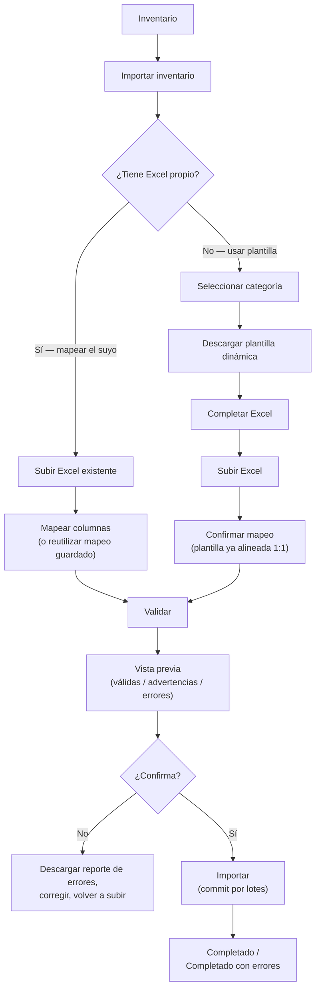

### Dynamic template generation

Directly answering this prompt's requirement that the template is **not** a static file: generated on
demand from `category_attributes` (joined to `attribute_definitions`) for whatever category the user
selects, plus the fixed common columns every category needs (`SKU`, `Nombre`, `Marca`, `Precio mínimo`,
`Precio base`, `Precio máximo`, `Cantidad`, `Ubicación`). A required attribute becomes a required
template column (marked as such in the generated file); an optional one becomes an optional column. Two
categories therefore produce visibly different templates — "Motocicletas" gets `Cilindraje`, `Año`,
`Combustible`; "Muebles" gets `Material`, `Alto`, `Ancho`, `Profundidad` — with no template-specific
table needed to store this: the template is a deterministic projection of
`category_attributes`/`attribute_definitions`, generated fresh each time, never persisted as its own
artifact.

**Serialized categories get a structurally different template shape.** For a category whose variants
are `is_serialized = true`, the template is one row **per physical unit** (its own `Serial`/`Chasis`/
`Motor` columns, quantity implicitly 1) rather than one row per SKU with a `Cantidad` column — matching
how serialized stock is actually counted in the real world (one VIN per motorcycle). A category with
`is_lot_tracked = true` variants instead gets `Lote`, `Fecha de fabricación`, `Fecha de expiración`
columns alongside a `Cantidad` for that lot. A plain, untracked category gets the simple
one-row-per-SKU-with-quantity shape. All three shapes are generated from the same
`product_variants.is_serialized`/`is_lot_tracked` flags the category's products already carry — not a
new configuration surface.

### Mapping an existing Excel

For a tenant with their own pre-existing spreadsheet (`CODIGO`, `DESCRIPCION`, `CC`, `COLOR`, `STOCK`,
...), the user maps each source column to a target field — a system column (`sku`, `name`, `quantity`,
`location`, ...) or a dynamic attribute (`attr:cilindraje`, `attr:color`) — captured in
`import_jobs.column_mapping`, the same JSONB shape `import_mapping_templates.column_mapping` uses. A
named mapping can be **saved** (`import_mapping_templates`, tenant-scoped, `UNIQUE (tenant_id, name)`)
and reused on a future import from the same source ("Excel proveedor X") without re-mapping — the job's
own `column_mapping` is always a **frozen copy** at the moment the job runs, not a live reference to the
template, so editing a saved template later never silently changes what an already-completed job did.

### Validation

Every `import_job_rows.mapped_data` value is checked by **the same validation service** the interactive
product form uses ([§Dynamic attributes' validation split](#dynamic-attributes-governance-for-the-catalog-jsonb)),
covering: unknown/unmapped columns, missing headers, wrong types, missing SKU, duplicate SKU *within
the file itself* (not just against the database), unresolvable category/brand/supplier references,
unknown or inactive attribute values, prices where `min > base` or `base > max`, negative/non-numeric
quantities, unauthorized location ([§Ubicaciones](#ubicaciones-import) below), variant-identity
conflicts, duplicate serial numbers, and lot data completeness. Each finding is classified as either an
`error` (blocks that row from `valid`) or a `warning` (row stays importable but is flagged for review)
— e.g. "category will be auto-created" is a warning, "price is missing" is an error. Findings accumulate
in `import_job_rows.errors`/`.warnings` (structured, not free text: `{ field, code, message }`), and the
row's `status` becomes `valid`, `warning`, or `invalid` accordingly. **Prompt 02-D note:** this shape is
a deliberate, minimal convention for *this* table specifically — no equivalent shape for interactive
DTO/`class-validator` field errors exists elsewhere in this docs set yet to reconcile it against; left
open, not blocking, and worth revisiting when Prompt 03/04 defines the concrete DTO validation error
format.

### Preview

`import_jobs.total_rows`/`valid_rows`/`invalid_rows`/`warning_rows` give the summary this prompt asks
for ("1,250 filas — 1,214 válidas, 20 advertencias, 16 errores") without a full table scan on every
page load — maintained incrementally as rows are validated, not recomputed live. The preview UI pages
through `import_job_rows` filtered by `status`. `import_jobs.error_report_storage_key` points at a
generated, downloadable report of every `invalid` (and, optionally, `warning`) row with its specific
errors — object storage, same pattern as every other file this schema handles, **never** a large text
blob stuffed into a database column. Given the potentially large row count (up to 100,000 per
[§Large imports](#large-imports) below), this preview is exactly the kind of high-volume, paginated
list [api.md#pagination-filtering-sorting-search](api.md#pagination-filtering-sorting-search) already
flags as a candidate for cursor (not offset) pagination — the `(tenant_id, import_job_id, status)`
index below supports either, the same stance already taken for `inventory_movements`/`audit_log`.

### Committing (transactional strategy, duplicates, rollback)

**Batched, not one giant transaction — an explicit, honest trade-off.** The commit phase processes
`import_job_rows` where `status IN ('valid', 'warning')` in fixed-size batches (illustratively 500 rows;
exact size is a tuning parameter), each batch its own database transaction, following the identical
`SELECT ... FOR UPDATE` balance-locking convoy every other inventory-affecting operation in this schema
uses ([§Concurrency strategy](#concurrency-strategy)) — the import pipeline has **no separate,
parallel write path** into `products`/`product_variants`/`inventory_balances`/`inventory_movements`; it
calls the same one every other flow does. For a **small** import (below the batch-size threshold), the
whole commit *is* one transaction — small imports get true all-or-nothing rollback. For a **large**
import, true single-transaction atomicity across the whole file is not the strategy — holding row locks
across tens of thousands of rows in one transaction would be its own operational problem. What *is*
guaranteed at any size: **inventory is never left partially corrupt**, because every write that
happened was a complete, valid, correctly-ledgered batch — a failure mid-import means *fewer rows
succeeded than requested*, precisely reported via `import_job_rows.status` per row and
`import_jobs.status = 'completed_with_errors'`/`'failed'`, never silently-wrong balances. Retrying a
`failed` job re-invokes the exact same commit process, which naturally resumes from
`WHERE status IN ('valid', 'warning') AND status <> 'imported'` — already-imported rows are skipped, no
new idempotency mechanism needed beyond this status field itself.

**Duplicates (SKU already exists) — recommendation, not a silent default**, per this prompt's explicit
instruction. `import_jobs.duplicate_handling_mode` makes the choice explicit per job:

| Mode | Existing SKU's catalog fields | Existing SKU's inventory quantity |
| --- | --- | --- |
| `update_catalog_only` (**recommended default**) | Updated (name, price tiers, attributes) | **Untouched** — the row is skipped for inventory purposes |
| `update_catalog_and_inventory` | Updated | An `ADJUSTMENT_IN` movement adjusts it — opt-in only (see the Prompt 02-D note below on why not `INITIAL_STOCK`) |
| `skip_existing` | Untouched | Untouched |
| `reject_on_duplicate` | Row marked `invalid` (blocks the whole row) | — |

**Prompt 02-D — `INITIAL_STOCK` vs. `ADJUSTMENT_IN`, analyzed, not merged.** The 02-C audit flagged
that `update_catalog_and_inventory` used `INITIAL_STOCK` for this row and asked whether `ADJUSTMENT_IN`
was more correct. These are legitimately different real-world operations and are **not** being merged
— `INITIAL_STOCK` means "digitizing stock that already physically existed, recorded in this system for
the first time"; `ADJUSTMENT_IN` means "an operational correction to a balance the system already
tracks." A `create`-action row (brand-new SKU, never before in the system) is unambiguously the first
case — it keeps `INITIAL_STOCK`, unchanged, see [§Inventory](#inventory-warehouses-locations-balance-ledger).
An `update`-action row under `update_catalog_and_inventory` (an **existing**, already-tracked SKU,
touched by a second or later import) is unambiguously the second case: the balance already exists in
the system, so adjusting it is a correction, not a first-time digitization — using `INITIAL_STOCK` here
would inflate that report's "stock digitized before/at onboarding" figure with data that was never
actually part of the original onboarding, contradicting the exact distinction `INITIAL_STOCK` exists
to preserve ([§Inventory](#inventory-warehouses-locations-balance-ledger)). **Decision:** `create`-action
rows always write `INITIAL_STOCK`; `update`-action rows under `update_catalog_and_inventory` always
write `ADJUSTMENT_IN` (already an existing, unmodified movement type — no schema change beyond this
corrected mapping).

**Reasoning for the recommended default:** updating catalog data (name, price, attributes) for an
existing SKU when a tenant re-uploads a corrected file is the expected, low-risk behavior — the user is
explicitly trying to fix their catalog. Silently **adjusting inventory quantity** for an existing SKU is
materially riskier: a re-uploaded file with stale quantities could double-count stock, or overwrite a
count that has since changed from real sales. Separating "catalog update" from "inventory movement" —
this prompt's own explicit instruction — is exactly what this table does: catalog fields update by
default, inventory quantity requires the tenant to deliberately opt into
`update_catalog_and_inventory` for that specific job.

**Product vs. variant matching.** Primary match key is `sku` (exact, tenant-scoped, per
[§Catalog](#catalog-products-variants-attributes)'s existing `UNIQUE (tenant_id, sku)`). A row whose SKU
doesn't exist yet becomes `match_action = 'create'` — a new product (with its one default variant,
[§Catalog](#catalog-products-variants-attributes)'s existing rule) unless the template/mapping includes
a product-grouping column (e.g. a shared "Product Reference" value across several rows), in which case
those rows become **new variants under one existing/new product** instead of several separate
single-variant products — the template design consideration this prompt asks for when a category
commonly has multi-variant products (e.g. a TV model sold in 55"/65"/75").

### Initial stock and the ledger — no bypass

Directly answering this prompt's explicit requirement: **a quantity column in the Excel never becomes
an `inventory_balances` row by itself.** Every imported quantity is written exactly like every other
stock-affecting operation — an `inventory_movements` row first (`INITIAL_STOCK` for a `create`-action
row, `ADJUSTMENT_IN` for an `update`-action row under `update_catalog_and_inventory`, per the mapping
fixed in [§Committing](#committing-transactional-strategy-duplicates-rollback)), `reference_type =
'import_job'`, `reference_id = import_jobs.id`, with `inventory_balances` derived from it via the same
locked read-then-write convoy. There is no code path in this design that writes a starting balance
without a corresponding ledger entry — the same invariant [§Seed and demo tenant](#seed-and-demo-tenant)
already holds itself to for seed data.

### Ubicaciones (import)

A row's target location comes from a mapped `location` column, or `import_jobs.default_location_id`
when the template/mapping has none. Before any row targeting a given location can reach `valid`, the
importing user (`import_jobs.created_by`) must be authorized for that location per
[§Location-scoped authorization](#location-scoped-authorization) — an unauthorized location on a row is
an `error`, not a warning, checked at validation time (not deferred to commit, so the preview honestly
reflects what will actually be importable).

### Serialized and lot-tracked rows

No new tables — the import pipeline writes directly into `product_serials`/`product_lots`
([§Catalog](#catalog-products-variants-attributes)), exactly like it writes into `product_variants`/
`inventory_movements`. A duplicate `serial_number` within the file, or against an existing tenant
record, is caught at **validation** time (checked against the file's own rows *and* the existing
`UNIQUE (tenant_id, serial_number)` data) and surfaced as an `error` per row — never allowed to reach a
raw constraint-violation exception at commit time, which would be a poor, late, unclear failure for
something the validation pass can and should catch early with a specific message.

### Large imports

100 / 1,000 / 10,000 / 100,000 rows, per this prompt's explicit sizing. Below an illustrative 500-row
threshold (a tuning parameter, not fixed here — the same "not fixed here" precedent as rate-limit
thresholds elsewhere in this docs set), validation and commit can both complete synchronously within one
HTTP request. Above it, both the `validating` and `importing` phases run as a **background job**,
executed by a **separate Import Worker process — not the same worker/deployable as the Event
Processor.** Full reasoning: [ADR-0029](../decisions/0029-import-worker-separation.md).

**Same pattern, different process — Prompt 02-D closes this explicitly.** Both workers use the
identical Postgres-backed mechanism already established for the Event Processor
([events.md#event-processor](events.md#event-processor)) — no new queue technology, no message broker:
a `SELECT ... FOR UPDATE SKIP LOCKED` claim query, a status column tracking progress, retry/backoff on
failure. The Import Worker claims rows from `import_jobs`/`import_job_rows`; the Event Processor claims
rows from `event_outbox`; neither reads the other's table. They are two small, independently-deployable
processes sharing one proven pattern, not one worker doing two jobs — kept separate because their
resource profiles and latency needs genuinely differ:

- **Event Processor:** low-latency, I/O-bound (a webhook call to n8n per event), expected to stay
  responsive so Telegram notifications arrive promptly.
- **Import Worker:** potentially long-running (minutes, for a 100,000-row file), CPU/DB-bound (parsing,
  validating, batched writes) — per [scalability.md#when-to-split-a-module-out](scalability.md#when-to-split-a-module-out)'s
  own stated criterion for extraction ("a different deployment cadence or failure-isolation boundary"),
  a large import hanging or crashing must never delay or take down notification delivery, and vice
  versa — sharing one process would couple two workloads that have no reason to be coupled.

**Reclaiming and retries:** an Import Worker instance polls `import_jobs` with `status = 'validating'`
or `status = 'importing'`, claims via `FOR UPDATE SKIP LOCKED` (safe with multiple worker instances,
identical to the Event Processor's claiming query), and processes in the batches already described
above. A crashed worker simply stops claiming; a stuck job is detected via `claimed_at`
(`import_jobs.claimed_at`/`claimed_by`, migration 0020 — the same shape as `event_outbox`'s own
claim columns) — a job is only claimable when `claimed_at IS NULL OR claimed_at <
now() - IMPORT_WORKER_STALE_CLAIM_MS`, so it can be picked up by another instance once that
threshold passes. **Idempotency on retry** is the same `import_job_rows.status` resumability already
described in [§Committing](#committing-transactional-strategy-duplicates-rollback) — re-running the
job (whether by the same or a different worker instance) never reprocesses an already-`imported`
row. **Observability** follows the existing, unchanged convention
([backend.md#cross-cutting-concerns](backend.md#cross-cutting-concerns)): structured logs carrying
`correlationId`/`tenantId`, no new logging mechanism introduced for this worker specifically.

FASE 10 implemented this exactly as designed: `apps/api/src/import-worker/main.ts` is the Import
Worker's own process entry point (`NestFactory.createApplicationContext`, never `.listen()` — it
serves no HTTP route), driving `ImportWorkerService.pollOnce()` in a loop
(`IMPORT_WORKER_POLL_INTERVAL_MS` between empty polls) against `ImportWorkerClaimRepository`'s claim
query (the `app_import_worker` connection, `import-worker-client.ts`) — see
[§Row-Level Security](#row-level-security) above for the role/policy/index details. `IMPORT_SYNC_ROW_THRESHOLD`
and `IMPORT_BATCH_SIZE` are the tunable env vars implementing the "illustratively 500" thresholds
this section describes; `ImportJobService.triggerValidate`/`triggerConfirm` run the same
`ImportValidationService`/`ImportExecutionService` synchronously inline when the job is at or under
the threshold, or simply flip `import_jobs.status` and return when above it — the worker's
`pollOnce()` calls those exact same two methods for the async path, so there is genuinely one
implementation of "validate a job"/"commit a job," never two.

The frontend polls `import_jobs.status`/row counts rather than holding an HTTP connection open for a
potentially-minutes-long operation. (Provisioning a second worker process/container is an infrastructure
concern for Prompt 03+ deployment work — `docker-compose.yml` and equivalent are not touched by this
design-only prompt.)

### Security of the uploaded file

Extends [security.md#file-upload-security](security.md#file-upload-security) (already established for
product images) to Excel specifically:

- **Extension allow-list:** `.xlsx` only — not legacy `.xls`, not macro-enabled `.xlsm` (macros are a
  real execution-risk vector this design closes by never accepting a format that can carry one).
- **MIME-type validated against actual file content**, not the declared header — unchanged principle
  from the existing image-upload rule.
- **Size limit** — an illustrative default (not fixed here, a tuning decision like the batch-size and
  sync/async thresholds above).
- **The parser reads cell *values* only**, never evaluates formulas as live/executable and never enables
  macros (structurally impossible once `.xlsm` is rejected) — this is the mitigation for "fórmulas
  peligrosas."
- **The generated error report sanitizes any echoed cell content** before writing it back into a
  downloadable spreadsheet — a leading `=`/`+`/`-`/`@` in a value being echoed into the report is
  neutralized (e.g. a leading apostrophe prefix), closing the classic CSV/Excel formula-injection path
  where a malicious input cell, once echoed into an output file an administrator later opens, executes a
  formula in *their* spreadsheet application.
- **Object storage, never local disk** — identical to every other upload in this schema
  ([security.md#file-upload-security](security.md#file-upload-security)) — with a defined-but-not-fixed
  retention window after which the uploaded file (not the `import_jobs`/`import_job_rows` audit record
  itself) is deleted.
- **Corrupted files** fail parsing cleanly, surfaced as `import_jobs.status = 'failed'` with a
  structured, non-stack-trace error message, per the existing global-exception-filter/error-envelope
  convention ([api.md#errors](api.md#errors)).

### Auditability

`import_jobs` is itself a detailed, tenant-scoped, queryable record (who, when, which file, which
mapping/duplicate-handling configuration, full result counts) — but per the established
[§Audit log vs. domain events vs. application logs](#audit-log-vs-domain-events-vs-application-logs)
distinction, a **terminal** job state (`completed`/`completed_with_errors`/`failed`) also writes an
`audit_log` entry (`action_code = 'INVENTORY_IMPORT_COMPLETED'` or similar, `entity_type =
'import_job'`, `entity_id = import_jobs.id`) — the same permanent, standardized "who did what" trail
every other CATALOG/INVENTORY mutation gets, not a special case for imports.

---

## Administration: tenant settings and platform-admin sessions

FASE 11 (roadmap.md) — [modules.md#administration](modules.md#administration)'s "tenant-level
configuration ... and system-level configuration that only a SuperAdmin can change," implemented
as two independently-scoped tables:

```
tenant_settings                -- singleton row per tenant — tenant-level configuration
  id                uuid PK
  tenant_id         uuid NOT NULL FK -> tenants(id), UNIQUE, UNIQUE(tenant_id, id)
  timezone          text NOT NULL DEFAULT 'UTC'          -- IANA name, validated server-side
  business_hours    jsonb NOT NULL DEFAULT '[]'           -- governed array, see below
  created_at        timestamp with time zone NOT NULL
  updated_at        timestamp with time zone NOT NULL

platform_admin_refresh_tokens  -- SuperAdmin session store (ADR-0032), no tenant_id, no RLS
  id                    uuid PK
  platform_admin_id     uuid NOT NULL FK -> platform_admins(id)
  token_hash            text NOT NULL UNIQUE   -- same HMAC-SHA256 scheme as auth_refresh_tokens
  rotated_from_id       uuid NULL
  created_at            timestamp with time zone NOT NULL
  expires_at            timestamp with time zone NOT NULL
  revoked_at            timestamp with time zone NULL
  user_agent            text NULL
  ip_address            inet NULL
```

`tenant_settings` is a "mutable config, never deleted" singleton per tenant — the same lifecycle
category as `tenant_price_policies` (§Soft delete policy). Only `timezone`/`business_hours` are
modeled: `branding` is explicitly named "later" in modules.md itself, and per-tenant
`notification_preferences`' exact mechanism is a `PENDING DECISION` events.md defers to "when
tenant-configurable notifications are actually built" (FASE 15) — neither is invented here.
`business_hours` is a governed JSONB array (not an open key/value bag, per §Dynamic attributes'
"validated schema, filtered properties" posture applied to a simpler domain): each entry is
`{ dayOfWeek: 0-6, isClosed?, opensAt?: "HH:mm", closesAt?: "HH:mm" }`, validated by DTO
(class-validator) — at most one entry per `dayOfWeek`, `opensAt` strictly before `closesAt` unless
`isClosed`, checked in `TenantSettingsService` (a cross-field rule a `CHECK` constraint alone
cannot express). No system/tenant-override table pair exists — the "effective value" (§10 of the
FASE 11 prompt) is resolved in application code: the stored row if one exists, else a hardcoded
system default (`timezone = 'UTC'`, `business_hours = []`), never persisted as a separate row.

`platform_admin_refresh_tokens` exists because `auth_refresh_tokens` (migration 0013,
[ADR-0030](../decisions/0030-authentication-foundation.md)) has `NOT NULL` `tenant_id`/`user_id` by
design — see that migration's own header comment anticipating this exact follow-up. Platform-admin
sessions reuse every other piece of Prompt 04's session machinery (opaque token, HMAC-SHA256
storage, rotation, reuse-detection) through a structurally separate table and cookie set — see
[ADR-0032](../decisions/0032-platform-admin-authentication.md) for the full authentication design,
including why `app_platform` needed a new `GRANT INSERT ON audit_log` (it previously had
`SELECT`-only, since no platform-level write path existed before this phase).

Migration `0022` creates both tables; `0023` adds the `administration.settings.*` permission
catalog rows (data-only); `0024` adds `tenant_settings`' `UNIQUE (tenant_id, id)` composite-FK-target
constraint (§Tenant-aware referential integrity's universal convention, applied even though nothing
currently composite-FKs into this table — closed as a follow-up migration, not a retroactive edit
to `0022`, per this document's own "an applied migration is never edited" convention).

---

## Customers and suppliers

Both tenant-scoped, both intentionally minimal — no billing/payment storage, no document scans, per
this prompt's "avoid storing unnecessary data." `suppliers` is placed under CATALOG per
[ADR-0019](../decisions/0019-suppliers-ownership.md) (see [discrepancy #1](#discrepancies-found-and-how-they-were-resolved)).

```
customers
  id                uuid PK
  tenant_id         uuid NOT NULL FK -> tenants(id), UNIQUE (tenant_id, id)
  type              text NOT NULL CHECK IN ('individual','business')
  display_name      text NOT NULL
  tax_id            text NULL
  email             text NULL
  phone             text NULL
  address           jsonb NULL
  status            text NOT NULL CHECK IN ('active','inactive'), DEFAULT 'active'
  notes             text NULL
  created_at        timestamptz NOT NULL DEFAULT now()
  updated_at        timestamptz NOT NULL DEFAULT now()
  deleted_at        timestamptz NULL

  UNIQUE (tenant_id, tax_id) WHERE tax_id IS NOT NULL
```

```
suppliers
  id                uuid PK
  tenant_id         uuid NOT NULL FK -> tenants(id), UNIQUE (tenant_id, id)
  display_name      text NOT NULL
  tax_id            text NULL
  email             text NULL
  phone             text NULL
  address           jsonb NULL
  status            text NOT NULL CHECK IN ('active','inactive'), DEFAULT 'active'
  notes             text NULL
  created_at        timestamptz NOT NULL DEFAULT now()
  updated_at        timestamptz NOT NULL DEFAULT now()
  deleted_at        timestamptz NULL

  UNIQUE (tenant_id, tax_id) WHERE tax_id IS NOT NULL
```

No purchase-order/receiving workflow is designed here — that would be a PURCHASING bounded context
the accepted architecture doesn't define yet (see [ADR-0019](../decisions/0019-suppliers-ownership.md)).
`products.supplier_id` (see [§Catalog](#catalog-products-variants-attributes)) is the only relationship
`suppliers` currently participates in: attribution ("who this product is sourced from"), not a
transaction.

---

## Cart

**Prompt 02-A.** A pre-checkout working area — add/remove items, adjust quantities, negotiate a price
per line — that becomes an `orders`/`order_items` pair once checkout completes. Design goal per this
prompt: support adding, changing quantity, removing, revisiting price/availability, and recalculating
subtotal/total, without inventing cart-specific inventory-locking machinery.

```
carts
  id                uuid PK
  tenant_id         uuid NOT NULL FK -> tenants(id), UNIQUE (tenant_id, id)
  location_id       uuid NOT NULL FK -> locations(tenant_id, id)   -- where the sale is being made from
  user_id           uuid NOT NULL FK -> users(tenant_id, id)        -- the vendor operating this cart
  customer_id       uuid NULL FK -> customers(tenant_id, id)        -- set once the customer is identified
  order_id          uuid NULL FK -> orders(tenant_id, id)            -- set once checkout succeeds
  status            text NOT NULL CHECK IN ('open','checked_out','abandoned'), DEFAULT 'open'
  version           integer NOT NULL DEFAULT 0    -- optimistic lock, see §Concurrency strategy
  created_at        timestamptz NOT NULL DEFAULT now()
  updated_at        timestamptz NOT NULL DEFAULT now()
  expires_at        timestamptz NULL              -- abandonment cutoff for a cleanup job, see §Open decisions
```

```
cart_items
  id                    uuid PK
  tenant_id             uuid NOT NULL FK -> tenants(id), UNIQUE (tenant_id, id)
  cart_id               uuid NOT NULL FK -> carts(tenant_id, id)
  product_variant_id    uuid NOT NULL FK -> product_variants(tenant_id, id)
  quantity              numeric NOT NULL CHECK (quantity > 0)
  negotiated_unit_price numeric NULL CHECK (negotiated_unit_price IS NULL OR negotiated_unit_price >= 0)
  created_at            timestamptz NOT NULL DEFAULT now()
  updated_at            timestamptz NOT NULL DEFAULT now()

  UNIQUE (tenant_id, cart_id, product_variant_id)
```

`negotiated_unit_price` is `NULL` while the line simply uses the variant's current `base_price` (looked
up live, not stored — a cart is a working draft, not a historical record); it is set only once the
vendor overrides it during negotiation. Nothing here is frozen yet — freezing happens at checkout, when
`order_items` is written with its `*_snapshot` columns
([§Orders](#orders-conceptual--sales-not-built-yet)).

**Identity of a line — product vs. variant.** `cart_items.product_variant_id` is always a
*variant*, never a bare `product_id` — consistent with
[§Catalog](#catalog-products-variants-attributes)'s rule that every product has at least one variant.
This is what makes `UNIQUE (tenant_id, cart_id, product_variant_id)` correct: two different variants of
the same product (e.g. two different colors) are two distinct cart lines, never merged, while adding
the *same* variant again is structurally prevented from creating a duplicate row — the repository does
an upsert (`ON CONFLICT (tenant_id, cart_id, product_variant_id) DO UPDATE SET quantity =
cart_items.quantity + :delta`) rather than a plain insert, so "add this variant again" always resolves
to one row with an updated quantity, never two rows for the same variant. A product with no real
variants still has its one default variant's id here — there is no separate "identify by product"
path, avoiding exactly the "sometimes product, sometimes variant" ambiguity this prompt asks to avoid.

**Deliberately no stock reservation while items merely sit in a cart.** Two options exist: reserve
stock the moment an item is added (via a `RESERVATION` movement), or check availability live and only
reserve/commit at checkout. This design chooses the latter — availability is checked against
`inventory_balances.quantity_available` at each cart mutation (a fast read, no lock needed) and
re-verified authoritatively, under lock, at checkout (see [§Orders](#orders-conceptual--sales-not-built-yet)
and the [§Concurrency strategy](#concurrency-strategy) convoy). Reserving on add-to-cart would mean an
abandoned cart silently holds real stock unavailable to every other sale until some expiry mechanism
releases it — for a vendor-driven, in-person negotiation flow (not a self-service web cart sitting open
for hours), the added complexity of reservation-on-add and its expiry/release bookkeeping isn't
justified by a concrete need, so it isn't built. A cart's `expires_at` exists for **housekeeping**
(letting an abandoned cart's row eventually be cleaned up), not for releasing a reservation that was
never taken in the first place.

**Idempotency:** adding the *same logical* "add 2 units" request twice (a genuine client retry, not two
separate deliberate clicks) goes through the general `idempotency_keys` table
([§Idempotency](#idempotency)), `scope = 'cart.item.add'` — the upsert above is correct for "the same
variant added again as a new, distinct action" but is not on its own a safe answer to "this exact HTTP
request was retried," which is a different problem idempotency keys solve.

No `deleted_at` on either table — a cart is ephemeral pre-transactional data, not historical once
abandoned; `abandoned` carts are hard-deleted by a periodic cleanup job after `expires_at` (cadence
not decided here — see [§Open decisions](#open-decisions-carried-forward)). Once checkout succeeds, the
cart's `status` becomes `checked_out` and `order_id` is set (kept briefly for support/debugging
traceability back to the order it produced) — the row is not deleted immediately, but it carries no
independent historical value once the order exists, so its retention window is an operational, not a
schema, decision.

**Migration-ordering note:** `carts.order_id` references `orders`, which this document places *after*
`carts` for narrative reasons (cart naturally precedes checkout). Within the actual migration file (both
land in the same "Sales" migration step, [§Migration strategy](#migration-strategy)), `orders` and
`order_items` are created first, then `carts`/`cart_items`, so the `REFERENCES` target already exists
— a plain statement-ordering detail, not a design ambiguity.

---

## Orders (conceptual — SALES not built yet)

> **Implemented in FASE 12** (`apps/api/src/sales/`) — the section title is kept for anchor
> stability; the schema below is unchanged and is now backed by application code. See
> [modules.md#sales](modules.md#sales) for the module overview and the **FASE 12 application
> behavior** note at the end of this section for the order lifecycle, totals formula, and order
> numbering. `price_approvals`, `sales_returns`/`sales_return_items` remain schema-only (FASE 13).

The schema below was fixed in Prompt 02-A; FASE 12 implements the application layer on top of it
without modifying it.

```
orders
  id                          uuid PK
  tenant_id                   uuid NOT NULL FK -> tenants(id), UNIQUE (tenant_id, id)
  location_id                 uuid NOT NULL FK -> locations(tenant_id, id)   -- where the sale is fulfilled from
  customer_id                 uuid NULL FK -> customers(tenant_id, id)
  customer_name_snapshot      text NOT NULL
  customer_tax_id_snapshot    text NULL
  customer_email_snapshot     text NULL
  customer_phone_snapshot     text NULL
  customer_address_snapshot   jsonb NULL
  order_number                text NOT NULL        -- human-readable, per-tenant sequence — generation is a FASE 10 detail
  document_type               text NOT NULL CHECK IN ('invoice','sales_note')
  invoice_status               text NULL CHECK IN ('pending','issued','failed')
  status                      text NOT NULL CHECK IN ('draft','pending','confirmed','fulfilled','cancelled'), DEFAULT 'draft'
  subtotal                    numeric NOT NULL CHECK (subtotal >= 0)
  discount_total               numeric NOT NULL DEFAULT 0 CHECK (discount_total >= 0)
  tax_total                    numeric NOT NULL DEFAULT 0 CHECK (tax_total >= 0)
  total                        numeric NOT NULL CHECK (total >= 0)
  currency                     char(3) NOT NULL       -- ISO 4217; single-currency-per-tenant assumed, PENDING if that changes
  placed_by_user_id            uuid NULL FK -> users(tenant_id, id)
  correlation_id                uuid NULL
  created_at                    timestamptz NOT NULL DEFAULT now()
  updated_at                    timestamptz NOT NULL DEFAULT now()

  UNIQUE (tenant_id, order_number)
  CHECK ((document_type = 'invoice' AND invoice_status IS NOT NULL)
      OR (document_type = 'sales_note' AND invoice_status IS NULL))
```

**No `deleted_at`.** An order is never soft-deleted — cancellation is the `status = 'cancelled'`
transition, exactly like [modules.md#order-flow-conceptual--sales-not-implemented-yet](modules.md#order-flow-conceptual--sales-not-implemented-yet)
already specifies ("cancellation releases the reservation via a compensating InventoryMovement, never
by deleting history"). A financial/historical record disappearing from a default list query the way a
soft-deleted product does would be the wrong behavior for an order — it stays visible, just in a
terminal status. See [§Soft delete policy](#soft-delete-policy).

**Prompt 02-A: customer snapshot.** `customer_id` stays for traceability/analytics joins, but display
and legal-record purposes use `customer_name_snapshot`/`customer_tax_id_snapshot`/
`customer_email_snapshot`/`customer_phone_snapshot`/`customer_address_snapshot` — copied from
`customers` **at order-creation time** and never updated again. This is the exact same "frozen
historical data" pattern `order_items`' product snapshot already uses below, applied to the customer
side per this prompt's explicit requirement: a later edit to the `customers` row (a corrected phone
number, a changed address) must not alter what a historical order shows it collected. `customer_id`
alone is not sufficient to reconstruct this — the row it points at is mutable.

**Prompt 02-A: `document_type` and `invoice_status`, kept distinct.** `document_type` records what the
customer *asked for* at checkout (`invoice` or `sales_note`) — a closed, two-value choice, deliberately
not a boolean `is_invoice` (see [ADR-0023](../decisions/0023-document-type-and-external-invoicing.md)
for why). `invoice_status` tracks the **external** invoicing process's state and only applies when
`document_type = 'invoice'` (enforced by the `CHECK` above — a `sales_note` order has no invoicing
process to track, so the column is `NULL`, not a meaningless default). Per this prompt's architectural
rule, **the platform never issues the invoice itself** — `invoice_status = 'pending'` means "requested,
not yet handled externally," `issued`/`failed` are updated later, by application code, once
whatever external process/integration exists reports back — no fiscal-provider integration is designed
or implied by these two values existing. Full boundary:
[ADR-0023](../decisions/0023-document-type-and-external-invoicing.md).

**Prompt 02-A: `location_id`.** Which location the sale is fulfilled from — determines which
`inventory_balances` row(s) get decremented at confirmation (one location per order; splitting a single
order's fulfillment across multiple locations is not designed here, see
[§Open decisions](#open-decisions-carried-forward)) and is the field
[§Location-scoped authorization](#location-scoped-authorization) checks a vendor's assignment against.

```
order_items
  id                        uuid PK
  tenant_id                 uuid NOT NULL FK -> tenants(id), UNIQUE (tenant_id, id)
  order_id                  uuid NOT NULL FK -> orders(tenant_id, id)
  product_variant_id        uuid NOT NULL FK -> product_variants(tenant_id, id) ON DELETE RESTRICT
  sku_snapshot              text NOT NULL
  product_name_snapshot     text NOT NULL
  max_price_snapshot        numeric NOT NULL CHECK (max_price_snapshot >= 0)
  base_price_snapshot       numeric NOT NULL CHECK (base_price_snapshot >= 0)
  min_price_snapshot        numeric NOT NULL CHECK (min_price_snapshot >= 0)
  unit_price_snapshot       numeric NOT NULL CHECK (unit_price_snapshot >= 0)   -- the negotiated/final price actually charged
  unit_cost_snapshot        numeric NULL
  quantity                  numeric NOT NULL CHECK (quantity > 0)
  discount_amount           numeric NOT NULL DEFAULT 0 CHECK (discount_amount >= 0)
  is_exceptional_discount   boolean NOT NULL DEFAULT false
  line_total                numeric NOT NULL CHECK (line_total >= 0)
  created_at                timestamptz NOT NULL DEFAULT now()
```

**Frozen historical data:** `sku_snapshot`, `product_name_snapshot`, the three price-tier snapshots,
and `unit_cost_snapshot` are copied from the product/variant **at order-creation time** and never
updated again. If the product is later renamed, repriced, or discontinued, this row's display values
are unaffected — an old order reads exactly as it did the day it was placed. `product_variant_id` is
kept alongside the snapshot (not instead of it) purely for traceability/analytics joins ("show me every
order for this variant") — it is never used to *render* a historical order's name or price. This is
the direct answer to this prompt's requirement that a historical order must not be reconstructed from
the current product. `ON DELETE RESTRICT` on `product_variant_id` means a variant referenced by any
order can never be hard-deleted (only soft-deleted, per [§Soft delete
policy](#soft-delete-policy)) — the FK stays valid forever.

**Prompt 02-A: pricing snapshot fields, kept minimal.** Per this prompt's explicit instruction to use
only the fields genuinely needed and avoid duplication, there is no separate "negotiated price" column
distinct from `unit_price_snapshot` — that column *is* the negotiated/final price, unchanged in
meaning from Prompt 02. What's new is `max_price_snapshot`/`base_price_snapshot`/`min_price_snapshot`,
needed so a historical order can answer "was this a normal negotiation or an exceptional one" without
looking at `product_variants`' *current* (and possibly since-changed) values — the same
frozen-at-order-time principle already applied to `sku_snapshot`/`product_name_snapshot`, extended to
price. `discount_amount` (unchanged from Prompt 02: the line's total discount amount, i.e.
`(max_price_snapshot - unit_price_snapshot) * quantity`) and the new `is_exceptional_discount` boolean
(`true` when `unit_price_snapshot < min_price_snapshot` at the time of sale) are what
[§Pricing](#pricing-history-tenant-policy-and-exceptional-discount-approval)'s approval workflow and
this prompt's Telegram notification payload both read directly, without recomputing anything against
current product data. Full record: [ADR-0022](../decisions/0022-pricing-tiers-and-discount-approval.md).

No `deleted_at` on `order_items` either — a line is part of its order's immutable history; removing a
line from a draft order (before it's confirmed) is a real `DELETE`, not a soft delete, since a draft
has no historical value yet.

Order status transitions (draft → pending → confirmed → fulfilled, or → cancelled at various points)
are **not** fully specified here — that is SALES domain logic, designed when FASE 10 actually builds
it. This document only fixes the schema-level `CHECK` list of valid status values.

**Prompt 02-A: confirmation is gated on price approvals.** `orders.status` cannot move from `pending`
to `confirmed` while any of its `order_items` has an unresolved (`pending`) row in `price_approvals`
([§Pricing](#pricing-history-tenant-policy-and-exceptional-discount-approval)) — domain logic, checked
via `price_approvals`' `(tenant_id, order_id, status)` index
([§Indexes](#indexes)), not a new schema construct. FASE 12 does not create `price_approvals` rows
at all; FASE 13 does — see [§FASE 13 application behavior](#fase-13-application-behavior) below.

### FASE 12 application behavior

The order lifecycle the schema left "not fully specified" is implemented as **two phases**, derived
from [modules.md#order-flow](modules.md#order-flow-conceptual--sales-not-implemented-yet)'s
"reserve at creation, release on cancel" diagram:

| Command | Transition | Inventory effect (via `StockLedgerService`, never a direct `inventory_balances` write) |
| --- | --- | --- |
| `POST /orders` (checkout, `Idempotency-Key` required) | — → `pending` | one `RESERVATION` movement per line at `orders.location_id` (`reserved` ↑, `physical` untouched) — the reservation boundary |
| `POST /orders/:id/confirm` | `pending` → `confirmed` | `RESERVATION_RELEASE` + `SALE` per line (`reserved` ↓, `physical` ↓) — the inventory **commit** boundary |
| `POST /orders/:id/cancel` | `draft`/`pending` → `cancelled` | `RESERVATION_RELEASE` per line (a `pending` order only). A `confirmed` order **cannot** be cancelled — reversing a committed sale is a sales return (FASE 13). |

`fulfilled` is a valid schema status but has no FASE 12 transition into it (no goods-handover
tracking is designed yet).

**Transition concurrency (PROMPT 012-A).** `confirm` and `cancel` both begin their
`withTenantTransaction` with `SELECT ... FOR UPDATE` on the single `orders` row
(`OrdersRepository.lockById`) — the row lock is the serialization point:

```
BEGIN
  SELECT * FROM orders WHERE (tenant_id, id) FOR UPDATE   -- a concurrent transition blocks here
  re-read status under the lock
    status = 'confirmed'  → confirm returns idempotently / cancel → 409
    status = 'cancelled'  → cancel returns idempotently / confirm → 409
    status = 'pending'    → assertAccess, then the RESERVATION_RELEASE / SALE loop, then UPDATE status
  write audit
COMMIT   -- lock released; the blocked transition now re-reads the terminal status
```

The order-row lock is taken **before** any `inventory_balances` row lock, and `cancel` follows the
same order — so `confirm` vs `cancel` on one order never deadlocks (one is blocked on the order row
before the other touches a balance). Effects are exactly-once: two concurrent `confirm`s produce
one `SALE` + one `RESERVATION_RELEASE` per line and one `order.confirmed` audit; `confirm` vs
`cancel` yields exactly one terminal transition, never a `confirmed`-then-`cancelled` order or a
double `RESERVATION_RELEASE`. The whole transition (status re-read → inventory movements → status
update → audit) is one transaction — a failure at any step rolls back every write in that call, so
a `RESERVATION_RELEASE` is never left without its `SALE`. This is the same PostgreSQL-managed
serialization (no in-memory locks — works across API instances/processes) that
`inventory/transfers` already uses for its state transitions.

**Totals** (`order_items` and `orders`), one rounding policy — half-up to 2 decimals, applied to
every monetary result (there is no tax engine — `tax_total` is always `0`):

```
order_items.line_total        = unit_price_snapshot * quantity              (the amount charged for the line)
order_items.discount_amount    = max(0, (max_price_snapshot - unit_price_snapshot) * quantity)   (informational, vs. the reference price)
orders.subtotal                = Σ line_total
orders.discount_total          = Σ discount_amount        (informational — NOT re-subtracted from total)
orders.tax_total               = 0
orders.total                   = subtotal + tax_total
```

`is_exceptional_discount` is always `false` in FASE 12 (below-`min_price` lines are rejected, never
sold); FASE 13 sets it `true` for a below-`min_price` line and gates confirmation on an approval —
see [§FASE 13 application behavior](#fase-13-application-behavior).

**Order numbering** (`orders.order_number`) — `ORD-` + a 6-digit zero-padded per-tenant sequence,
generated inside the checkout transaction as `pg_advisory_xact_lock(hashtext('sales.order_number:' ||
tenant_id))` then `COUNT(*) + 1` over that tenant's `orders` (never `SELECT MAX(...)+1` without a
lock, per this document's concurrency rules; orders are never hard-deleted, so the count is
monotonic). If write volume ever makes the count expensive, a dedicated per-tenant sequence row is
the migration path — not needed at current scale.

**Currency** — `orders.currency` is set to `'USD'` (a documented FASE 12 assumption: no tenant
currency configuration exists yet; the schema already assumes single-currency-per-tenant).

**Customer data for a sale (PROMPT 012-A).** A checkout of **either** `document_type` requires the
cart's customer to have the complete commercial record — `tax_id`, `email`, `phone`, a non-empty
`address`, plus the always-present `display_name` (i.e. nombre completo, identificación, correo,
teléfono, dirección). `invoice` and `sales_note` differ **only** by `document_type` /
`invoice_status`, never by how much buyer data the sale requires. A missing field fails the checkout
with `422` (naming the fields) **before** any order / `order_items` / inventory reservation /
idempotency-success write. Once the order is created, `customer_name_snapshot` /
`customer_tax_id_snapshot` / `customer_email_snapshot` / `customer_phone_snapshot` /
`customer_address_snapshot` are frozen from the validated `customers` row and never change if the
customer is later edited.

**Serialized / lot-tracked variants** — selling them is **rejected** (`422`) in FASE 12/13: no
approved model links `order_items` to `product_serials`/`product_lots`, and `inventory_movements`
has no serial/lot column (the same "not fully pinned" gap [§Serialized and lot-tracked
rows](#serialized-and-lot-tracked-rows) and FASE 8/10 already flag). A future phase needs its own
design pass (an `order_item_serials` link + a movement-level column, or equivalent) before this can
be lifted — it is not assigned to any phase yet.

### FASE 13 application behavior

FASE 13 adds the two SALES-dependent workflows this schema has carried since Prompt 03. Both write
`audit_log` records only — no `event_outbox` write (FASE 14), no Telegram/n8n (FASE 15).

**Exceptional-discount approvals (`price_approvals`), order-first.** The `price_approvals` schema
FK-references `order_id` + `order_item_id` (both `NOT NULL`), so an approval cannot exist before the
order — the workflow is:

| Command | Transition / effect |
| --- | --- |
| `POST /orders` with a line where `unit_price < min_price` | The line is **no longer rejected**. `resolveUnitPrice` classifies it `below_min`; `assertWithinHardFloor` rejects it outright (`422`, no order) only if it is more than `tenant_price_policies.max_discount_below_min_percent` under the floor (a `NULL` policy value = no extra floor). Otherwise the order is created `pending` with `order_items.is_exceptional_discount = true` and the normal `RESERVATION` per line. |
| `POST /api/v1/price-approvals` (`pricing.discount.request`, body `{ orderItemId, reason, requestedPrice? }`) | Locks the parent `orders` row (a concurrent `confirm` / second request serializes here), requires it `pending` and the line exceptional, then inserts a `pending` `price_approvals` row. `requested_price` / `min_price_at_request` / `max_price_at_request` are copied from the frozen `order_items` snapshot — the optional client `requestedPrice` is only a cross-check (`422` on mismatch), never the authority. `discount_amount = (max_price_at_request − requested_price) × quantity` (computed against `max_price`, so a caller without `pricing.floor.view` cannot back out the floor). The partial unique index `(tenant_id, order_item_id) WHERE status = 'pending'` is the DB backstop against a duplicate open request. |
| `POST /api/v1/price-approvals/:id/approve` \| `/reject` (`pricing.discount.approve`) | Conditional `UPDATE price_approvals SET status = ?, approved_by = ?, resolved_at = now() WHERE id = ? AND status = 'pending'` — 0 rows on a double-click (already resolved) → idempotent return or `409`. The **requester can never resolve their own request** (`403`) — separation of duties, enforced in the service (the schema does not force it, per ADR-0022). |
| `POST /orders/:id/confirm` | After locking the `orders` row, `assertExceptionalDiscountsApproved` reads `tenant_price_policies.exceptional_discount_requires_approval` (default `true`, **read-only this phase** — no configuration endpoint) and, when set, `lockByOrder`-row-locks every `price_approvals` row for the order: a `pending` one → `409`; an exceptional line with no `approved` row whose `requested_price` matches the frozen `unit_price_snapshot` → `409`. Never a permission-based bypass. Lock order: `orders` → `price_approvals` → `inventory_balances`. |
| `POST /orders/:id/cancel` | Also marks any still-`pending` `price_approvals` for the order `cancelled` (nothing left to authorize). |

**Sales returns / disposition (`sales_returns` / `sales_return_items`).** A reversal traced to a
**`confirmed`** order — never a second negative order, never a cancellation (a `pending` order is
cancelled, not returned).

| Command | Transition / effect |
| --- | --- |
| `POST /api/v1/sales-returns` (`sales.returns.create`, `Idempotency-Key`, scope `sales_return.create`) | Locks the `orders` row, then for each line checks `requested ≤ returnable`, where `returnable = order_items.quantity − Σ(sales_return_items.quantity_returned for returns whose status ≠ 'cancelled')` — the aggregate check ADR-0021 leaves to application code, evaluated under the order-row lock so two concurrent requests that together over-return cannot both win. → `requested`, no inventory effect. |
| `POST /api/v1/sales-returns/:id/inspect` (`inventory.returns.manage`) | Sets each line's `disposition` + `disposition_location_id` (+ `inspected_by`/`inspected_at`/`notes`, and `received_by` on the header). ADR-0021 enforced: `restock` requires an `is_sellable = true` location, every other disposition requires a non-sellable one. Location authorization (`LocationAuthorizationService`) checked against each `disposition_location_id`. → `inspecting`. |
| `POST /api/v1/sales-returns/:id/resolve` (`inventory.returns.manage`, `Idempotency-Key`, scope `sales_return.disposition`) | Locks the return row (concurrent processing is exactly-once), requires every line inspected, re-checks location authorization, then writes **one `RETURN` `inventory_movements` row per line** through `StockLedgerService.applyMovement` at `disposition_location_id` (`reference_type = 'sales_return_item'`, deterministic ledger key `sales-return:<itemId>`) — SALES never writes `inventory_balances` directly. `restock` → the sellable location's physical stock rises; `quarantine`/`damaged`/`scrap` → a non-sellable location's physical stock rises (fully ledgered, never counted as available anywhere). → `resolved`. |
| `POST /api/v1/sales-returns/:id/cancel` (`sales.returns.create`) | `requested`/`inspecting` → `cancelled` (a `resolved` return cannot be cancelled). Frees the returned quantity back to `returnable`. |

Returns never `UPDATE` `orders` / `order_items` (the latter has no `UPDATE` grant) — the original
sale's snapshot and quantities are immutable.

**State-transition concurrency (PROMPT 013-A).** `inspect`, `resolve` and `cancel` each begin their
`withTenantTransaction` with `SalesReturnsRepository.lockById` — `SELECT ... FOR UPDATE` on the one
`sales_returns` row (for `resolve`, after the per-`Idempotency-Key` advisory lock + idempotency-table
check, which are per-key, not per-row). The status is re-read **under that lock**, so two
incompatible transitions on one return are serialized by PostgreSQL: the loser blocks, re-reads the
now-terminal status, and either fails (`409`) or no-ops idempotently (`cancel` on an
already-`cancelled` return, `resolve` on an already-`resolved` one). Consequences, all verified
against real PostgreSQL by repeating each race: `resolve` vs `cancel` yields exactly one winner —
`resolved` with exactly one `RETURN` movement per line **or** `cancelled` with zero, never a mix,
never `cancelled` + inventory applied; a `resolved` return can never be `cancelled` and a
`cancelled` return can never be `inspect`ed or `resolve`d; `inspect` is atomic (every line of the
request gets its full `disposition`/`disposition_location_id`/`inspected_by`/`inspected_at` set, or
the whole call rolls back — never line A's location with line B's disposition); a `resolve` that
throws part-way through its per-line loop (e.g. a location-authorization failure on a later line)
rolls back every `RETURN` it had already written and leaves the return `inspecting`. Same
serialization for `price_approvals`: `approve`/`reject` take `PriceApprovalsRepository.lockById`
(`FOR UPDATE`) **and** a `UPDATE ... WHERE status = 'pending' RETURNING` CAS in `resolveIfPending`,
writing the `audit_log` row only when the CAS returns a row — so `approve` vs `reject` on one
request resolves to exactly one terminal status with exactly one resolution audit, a terminal
approval can never be re-resolved, and (with `confirm` locking the approvals via `lockByOrder`) a
`SALE` never commits while the line's approval is `pending` or `rejected`.

---

## Pricing: history, tenant policy, and exceptional-discount approval

**Prompt 02-A.** Full record: [ADR-0022](../decisions/0022-pricing-tiers-and-discount-approval.md).
Three concerns, kept as three distinct tables rather than merged into one — a **values-over-time**
ledger, a **tenant governance** config, and a **workflow**:

```
product_price_history          -- append-only ledger of price changes; mirrors inventory's balance/ledger split
  id                    uuid PK
  tenant_id             uuid NOT NULL FK -> tenants(id), UNIQUE (tenant_id, id)
  product_variant_id    uuid NOT NULL FK -> product_variants(tenant_id, id)
  max_price             numeric NOT NULL CHECK (max_price >= 0)
  base_price            numeric NOT NULL CHECK (base_price >= 0)
  min_price             numeric NOT NULL CHECK (min_price >= 0)
  changed_by            uuid NULL FK -> users(tenant_id, id)
  effective_from        timestamptz NOT NULL DEFAULT now()
  effective_to          timestamptz NULL         -- NULL = still current
  created_at            timestamptz NOT NULL DEFAULT now()

  CHECK (min_price <= base_price AND base_price <= max_price)
```

`product_variants.max_price`/`base_price`/`min_price` (§Catalog) remain the **current** values, read
directly by every hot path (catalog list, QR resolve, cart) with no join. Every time they change,
application code closes the previous `product_price_history` row (`effective_to = now()`) and inserts
a new one — this is what answers this prompt's "what was the price on date X" requirement (a QR
dispute, an audit query) without ever needing to touch the QR row itself
([§QR codes](#qr-codes)) or reconstruct history from `order_items` snapshots (which record the price
*at the moment of one specific sale*, not the full timeline of every price the variant ever had).

```
tenant_price_policies          -- one row per tenant — discount-governance configuration
  id                                     uuid PK
  tenant_id                              uuid NOT NULL FK -> tenants(id)
  exceptional_discount_requires_approval boolean NOT NULL DEFAULT true
  max_discount_below_min_percent         numeric NULL CHECK (max_discount_below_min_percent IS NULL OR max_discount_below_min_percent >= 0)
  created_at                             timestamptz NOT NULL DEFAULT now()
  updated_at                             timestamptz NOT NULL DEFAULT now()

  UNIQUE (tenant_id, id)   -- convention, see §Conventions
  UNIQUE (tenant_id)       -- enforces the singleton: exactly one policy row per tenant
```

Per this prompt's explicit instruction not to assume every tenant has identical commercial rules, this
is tenant-configurable, not a platform-wide constant. `max_discount_below_min_percent` is the "blocked
entirely" floor this prompt asks for (e.g. "never allow a request more than 20% under `min_price`, no
matter who's asking or who'd approve it") — `NULL` means no additional floor beyond `min_price` itself.
This is deliberately a handful of fixed columns for a fixed rule shape (within range / below min /
below a hard floor), not a generic rule engine — a richer per-category or per-role policy model is not
designed here (see [§Open decisions](#open-decisions-carried-forward)) because nothing in this prompt's
requirements asks for one yet.

```
price_approvals
  id                        uuid PK
  tenant_id                 uuid NOT NULL FK -> tenants(id), UNIQUE (tenant_id, id)
  order_id                  uuid NOT NULL FK -> orders(tenant_id, id)
  order_item_id              uuid NOT NULL FK -> order_items(tenant_id, id)
  requested_price             numeric NOT NULL CHECK (requested_price >= 0)
  min_price_at_request        numeric NOT NULL CHECK (min_price_at_request >= 0)
  max_price_at_request        numeric NOT NULL CHECK (max_price_at_request >= 0)
  discount_amount             numeric NOT NULL CHECK (discount_amount >= 0)
  reason                      text NOT NULL
  requested_by                 uuid NOT NULL FK -> users(tenant_id, id)
  approved_by                  uuid NULL FK -> users(tenant_id, id)
  status                       text NOT NULL CHECK IN ('pending','approved','rejected','cancelled'), DEFAULT 'pending'
  requested_at                  timestamptz NOT NULL DEFAULT now()
  resolved_at                   timestamptz NULL

  UNIQUE (tenant_id, order_item_id) WHERE status = 'pending'   -- at most one open request per line
```

**Normal negotiation vs. exceptional discount, distinguished precisely.** Any `unit_price_snapshot`
between `min_price` and `max_price` is a normal negotiation — no `price_approvals` row, no gate on
order confirmation, per this prompt's explicit instruction not to treat every discount off list price
as an exception request. A `price_approvals` row is created **only** when the vendor requests a price
below `min_price`. Before it's even created as `pending`, application code checks it against
`tenant_price_policies.max_discount_below_min_percent` — a request below that hard floor is rejected
outright (never becomes a `pending` row at all, since even approval couldn't authorize it); this
cross-table arithmetic check is application-layer, not a `CHECK` constraint (a `CHECK` can't reference
another table without a trigger, and this isn't a tenant-isolation-critical invariant that would
justify one — a data-quality/business-rule guard, not a security boundary, matching the same judgment
call already made for `product_images`' variant-product consistency).

**The partial unique index is the idempotency mechanism here** — a second exceptional-discount request
for the same line while one is still `pending` is rejected by the constraint itself, not by an
application-layer duplicate check. Resolving a request (`approved`/`rejected`) is idempotent by the
`WHERE status = 'pending'` guard on the resolving `UPDATE`, per
[§Concurrency strategy](#concurrency-strategy).

**Auditability, answered directly by this table's columns:** for any negotiated sale, `max_price`,
`min_price`, `base_price` (on `order_items`), `requested_price`/`discount_amount`/`reason` (on
`price_approvals`, when exceptional), `requested_by`/`approved_by`, and `requested_at`/`resolved_at`
are all durable columns — no reconstruction from current product/user state is ever needed to answer
"what was authorized, by whom, and why."

---

## Sales returns and disposition

**Prompt 02-A.** Full record: [ADR-0021](../decisions/0021-sales-returns-disposition.md).

```
sales_returns
  id                uuid PK
  tenant_id         uuid NOT NULL FK -> tenants(id), UNIQUE (tenant_id, id)
  order_id          uuid NOT NULL FK -> orders(tenant_id, id)
  location_id       uuid NOT NULL FK -> locations(tenant_id, id)    -- where the returned goods are physically received
  status            text NOT NULL CHECK IN ('requested','inspecting','resolved','cancelled'), DEFAULT 'requested'
  requested_by       uuid NOT NULL FK -> users(tenant_id, id)
  received_by         uuid NULL FK -> users(tenant_id, id)
  reason             text NOT NULL
  created_at         timestamptz NOT NULL DEFAULT now()
  updated_at         timestamptz NOT NULL DEFAULT now()
```

```
sales_return_items
  id                        uuid PK
  tenant_id                 uuid NOT NULL FK -> tenants(id), UNIQUE (tenant_id, id)
  return_id                 uuid NOT NULL FK -> sales_returns(tenant_id, id)
  order_item_id             uuid NOT NULL FK -> order_items(tenant_id, id)
  product_variant_id        uuid NOT NULL FK -> product_variants(tenant_id, id)
  quantity_returned         numeric NOT NULL CHECK (quantity_returned > 0)
  disposition               text NULL CHECK (disposition IS NULL OR disposition IN ('restock','quarantine','damaged','scrap'))
  disposition_location_id   uuid NULL FK -> locations(tenant_id, id)
  inspected_by               uuid NULL FK -> users(tenant_id, id)
  inspected_at                timestamptz NULL
  notes                       text NULL
  created_at                   timestamptz NOT NULL DEFAULT now()
```

**Traced back to the original sale.** `order_item_id` links a return line directly to the specific
line it returns (not just the order), which is what makes "quantity sold" (`order_items.quantity`) vs.
"quantity returned" answerable precisely, including when an order has several lines of the same
product. `product_variant_id` is denormalized here too for query convenience, but `order_item_id` is
the authoritative link. More than one `sales_return_items` row can reference the same `order_item_id`
over time (a customer returning units from the same purchase on separate occasions) — this is not
constrained to one row per line, deliberately; enforcing `SUM(quantity_returned) <= order_item.quantity`
across those rows is an application-layer check (the same kind of cross-row aggregate this document
elsewhere leaves to application code rather than a trigger, e.g. the transfer-quantity checks in
[§Inventory transfers](#inventory-transfers-and-in-transit-stock)).

**Returned stock is never automatically sellable — inspection decides.** `disposition` is `NULL` until
someone inspects the returned item; only then does it become one of `restock` / `quarantine` /
`damaged` / `scrap`. This is a deliberate scope simplification: one disposition per return line (not
split across multiple dispositions for a single line's quantity) — sufficient for what this prompt
asks for, and avoids a `sales_return_item_dispositions` sub-table this prompt's requirements don't
call for. Once `disposition` is set, application code writes an `inventory_movements` row (`RETURN`
type — reused, not a new movement type, see [§Inventory](#inventory-warehouses-locations-balance-ledger))
at `disposition_location_id`, with `reference_type = 'sales_return_item'`,
`reference_id = sales_return_items.id`:

- `restock` → `disposition_location_id` is a normal, `is_sellable = true` location — the stock becomes
  available again.
- `quarantine` / `damaged` → `disposition_location_id` is an `is_sellable = false` location
  ([§Inventory](#inventory-warehouses-locations-balance-ledger)) — the stock is fully tracked (physical
  count, ledger entry, traceability) but never counted as available-for-sale anywhere, without needing
  a new balance bucket or movement type.
- `scrap` → same mechanism as `quarantine`/`damaged` (a non-sellable location) — this document doesn't
  model a further "written off/disposed" accounting step beyond that; see
  [§Open decisions](#open-decisions-carried-forward).

**Pricing on a return never uses the current product price.** A return's value is whatever
`order_items.unit_price_snapshot` says the original sale charged — never
`product_variants.base_price`/`max_price` as they stand today, per this prompt's explicit instruction.
Since `sales_return_items` links to `order_item_id`, this falls out automatically: nothing here stores
or recomputes a price at all — the historical price is simply read from the row this return references.

No `deleted_at` on either table — a return, once created, is part of the permanent record of what
happened to that sale, same reasoning as `orders` itself
([§Soft delete policy](#soft-delete-policy)); `status` carries the lifecycle instead.

**Idempotency:** return creation and disposition recording both go through the general
`idempotency_keys` table (`scope = 'sales_return.create'` / `'sales_return.disposition'`), matching
every other genuinely user-retriable action in this schema.

Application behavior (the command lifecycle, the returnable-quantity check, the ADR-0021 sellable /
non-sellable location enforcement, the exactly-once `RETURN` movement) is implemented in FASE 13 —
see [§FASE 13 application behavior](#fase-13-application-behavior).

---

## Audit log vs. domain events vs. application logs

Three distinct things, per this prompt's explicit requirement not to conflate them:

| | Audit log | Domain events (outbox) | Application logs |
| --- | --- | --- | --- |
| **Purpose** | Permanent, queryable "who did what" record for compliance/incident response | Trigger for an async side effect (notify n8n) | Operational debugging |
| **Consumer** | Humans investigating an incident, via a query | The Event Processor, once, then irrelevant | Log aggregator, ops tooling |
| **Storage** | `audit_log` table, Postgres | `event_outbox` table, Postgres | stdout / log aggregator — **not a database table** |
| **Lifecycle** | Never deleted, indefinite retention | Delivered → eventually archivable after a retention window (not decided now) | Rotated per operational log policy, independent of the above |
| **Content shape** | Actor, action code, entity, before/after JSONB | Aggregate, event type, payload JSONB | Free-form structured line |

```
audit_log                                -- append-only, never updated or deleted
  id                uuid PK
  tenant_id         uuid NULL FK -> tenants(id)     -- NULL for platform/global actions
  actor_type        text NOT NULL CHECK IN ('user','platform_admin','system')
  actor_id          uuid NULL           -- soft reference, resolved against actor_type
  action_code       text NOT NULL       -- e.g. 'USER_LOGIN_SUCCESS', 'INVENTORY_ADJUSTED'
  entity_type       text NULL
  entity_id         uuid NULL
  before_state      jsonb NULL
  after_state       jsonb NULL
  correlation_id    uuid NULL
  ip_address        inet NULL
  created_at        timestamptz NOT NULL DEFAULT now()
```

`tenant_id` is nullable here specifically for SuperAdmin/platform actions (tenant lifecycle changes,
etc.) — see the [§Data classification](#data-classification-platform-scoped-vs-tenant-scoped) note on
why this needs no special RLS handling. `entity_id`/`actor_id` are polymorphic soft references, same
documented exception as elsewhere. This table is written by application service code as part of the
same use case that performs the mutation ([ADR-0015](../decisions/0015-audit-log.md)) — it is not
populated by a trigger in this design (see that ADR's alternatives-considered section for why, and its
open `PENDING DECISION` on trigger-based audit as a future backstop, unchanged by this document).

Application logs get **no schema** — confirming they are out of this document's scope entirely, per
[security.md#logging-and-audit](security.md#logging-and-audit) and
[backend.md#cross-cutting-concerns](backend.md#cross-cutting-concerns), which already fix their
shape (structured JSON, `correlationId`/`tenantId`, no secrets) as an operational, not a database,
concern.

---

## Outbox

The persistence contract [ADR-0010](../decisions/0010-outbox-pattern.md) and
[events.md](events.md#why-outbox) already commit to, made concrete:

```
event_outbox
  id                uuid PK        -- this IS the stable event_id from events.md
  tenant_id         uuid NULL FK -> tenants(id)   -- NULL for platform-global events (e.g. TENANT_CREATED)
  aggregate_type    text NOT NULL   -- e.g. 'order', 'price_approval', 'sales_return'
  aggregate_id      uuid NOT NULL
  event_type        text NOT NULL   -- dotted module.aggregate.action, e.g. 'sales.order.confirmed' (events.md#event-catalog)
  payload           jsonb NOT NULL   -- the full versioned event envelope (events.md#event-envelope)
  correlation_id    uuid NULL
  status            text NOT NULL CHECK IN ('pending','processing','delivered','dead_letter'), DEFAULT 'pending'
  attempts          integer NOT NULL DEFAULT 0
  last_error        text NULL
  claimed_at        timestamptz NULL
  claimed_by        text NULL       -- worker instance identifier
  processed_at      timestamptz NULL
  created_at        timestamptz NOT NULL DEFAULT now()
```

**Locking/claiming for multiple Event Processor instances — implemented in FASE 14**
([`event-claim.repository.ts`](../../apps/api/src/event-processor/event-claim.repository.ts)):

```sql
WITH claimable AS (
    SELECT id, status FROM event_outbox
    WHERE event_type = ANY(:supported_types)        -- only types with a registered handler
      AND attempts < :max_attempts
      AND (
        (status = 'pending' AND (claimed_at IS NULL
          OR claimed_at < now() - LEAST(:retry_max_ms, :retry_base_ms * power(:factor, attempts))
                                  * interval '1 ms'))
        OR (status = 'processing' AND claimed_at < now() - :stale_ms * interval '1 ms')
      )
    ORDER BY created_at
    FOR UPDATE SKIP LOCKED
    LIMIT :batch_size
)
UPDATE event_outbox e
SET status = 'processing', claimed_at = now(), claimed_by = :worker_id,
    attempts = e.attempts + (CASE WHEN c.status = 'processing' THEN 1 ELSE 0 END)
FROM claimable c WHERE e.id = c.id
RETURNING e.id, e.tenant_id, e.event_type, e.attempts, e.created_at, e.payload;
```

`FOR UPDATE SKIP LOCKED` is what makes this safe with more than one Event Processor instance running
at once (per [scalability.md](scalability.md), horizontal scaling is a stated growth lever): each
worker's poll query skips rows another worker already has locked, instead of blocking on them or
double-claiming — no separate distributed lock needed.

**No schema column was needed for retry scheduling.** `claimed_at` doubles as the *last-attempt
timestamp*, so the next-eligible time is `claimed_at + backoff(attempts)`, computed in the claim
`WHERE` clause. Backoff = `min(retry_max_ms, retry_base_ms · factor^attempts)`, exponential and
capped (`EVENT_PROCESSOR_RETRY_*`). A `processing` row whose `claimed_at` is older than
`EVENT_PROCESSOR_STALE_CLAIM_MS` is treated as abandoned by a crashed worker and reclaimed
(incrementing `attempts`); once `attempts` reaches `EVENT_PROCESSOR_MAX_ATTEMPTS` the row becomes
terminal `dead_letter` (via a per-poll `reapStale` sweep or the `markFailed` path) and is **never
deleted**. This is exactly what [events.md](events.md#retry--backoff--terminal) already said:
attempts/backoff/dead-lettering are Event Processor *behaviour*, not schema — the table only carries
the state that behaviour reads and writes, and FASE 14 added **no migration**.

**`event_type = ANY(:supported_types)`** — `supported_types` is the set of event types the Event
Processor has a registered delivery handler for. In FASE 14 that set is empty in production (no n8n
adapter until FASE 15), so nothing is ever claimed and no event is falsely marked `delivered`.

**Idempotency:** `id` is generated once, by application code, at the moment the event is written
(same transaction as the business operation) and never regenerated on retry — a redelivery resends
the same row with the same `id`, the `eventId` a FASE 15 consumer dedupes on.

Retention/archival of delivered events past some window is explicitly **not decided** here — flagged
as an open item in [§Open decisions carried forward](#open-decisions-carried-forward), since it's an
operational sizing question that doesn't need answering before the first migration.

---

## Idempotency

A transversal strategy, since more than one thing in this schema needs it for a different reason:

1. **Whole-request idempotency** (primarily order creation, per
   [api.md#idempotency](api.md#idempotency)) — a dedicated table:

   ```
   idempotency_keys
     id                    uuid PK
     tenant_id             uuid NOT NULL FK -> tenants(id), UNIQUE (tenant_id, id)
     scope                 text NOT NULL         -- e.g. 'orders.create'
     idempotency_key       text NOT NULL         -- the client-supplied Idempotency-Key header value
     request_hash          text NOT NULL         -- hash of the request body, detects key reuse with a different body
     response_status       integer NOT NULL
     response_body         jsonb NOT NULL
     created_at            timestamptz NOT NULL DEFAULT now()
     expires_at            timestamptz NOT NULL   -- short TTL (e.g. 24-48h), cleaned up by a periodic job

     UNIQUE (tenant_id, scope, idempotency_key)
   ```

   A retried request with the same `(tenant, scope, key)` returns the cached `response_status`/
   `response_body` instead of re-running the operation. If the same key arrives with a *different*
   `request_hash`, that's a client error (key reuse across two different logical requests), not a
   replay — surfaced as a `409`-shaped domain error, not silently executed.

2. **Ledger-level idempotency** — `inventory_movements.idempotency_key`'s partial unique index (see
   [§Inventory](#inventory-warehouses-locations-balance-ledger)). Narrower than the table above and
   deliberately separate from it: an inventory movement can be triggered by something other than a
   direct HTTP request with an `Idempotency-Key` header (e.g. a compensating movement written by
   domain logic reacting to an order cancellation) — the ledger needs its own "this exact movement
   already happened" guard independent of whether an HTTP-level idempotency key exists for the
   originating request.

3. **Outbox-level idempotency** — `event_outbox.id` doubling as `event_id`, already covered in
   [§Outbox](#outbox). n8n and any downstream consumer dedupe on this value, not a new mechanism.

4. **Deterministic keys for one-time state transitions (Prompt 02-A)** — a transfer's `dispatched`
   transition writes its `TRANSFER_OUT` movement with idempotency key `'transfer-dispatch:' ||
   transfer_id`, not a client-supplied one: the operation is legitimately one-time (a transfer can only
   be dispatched once), so the key can be derived from the entity itself rather than requested from the
   caller. See [§Inventory transfers](#inventory-transfers-and-in-transit-stock).

5. **Structural idempotency via a partial unique index (Prompt 02-A)** — `price_approvals`'
   `UNIQUE (tenant_id, order_item_id) WHERE status = 'pending'` prevents a second open exceptional-
   discount request for the same line by construction, no key or table lookup needed. See
   [§Pricing](#pricing-history-tenant-policy-and-exceptional-discount-approval).

6. **Genuinely repeatable user actions (Prompt 02-A)** use the general `idempotency_keys` table like
   order creation does: cart mutations (`scope = 'cart.item.add'`), transfer receiving events
   (`'transfer.receive'`), and sales return creation/disposition (`'sales_return.create'`/
   `'sales_return.disposition'`) — each a case where the *same* HTTP request could legitimately be
   retried by a client after a timeout, distinct from two different deliberate user actions that happen
   to look similar.

All of the above are the same underlying pattern (a stable key, a unique constraint, a short-circuit on
retry) applied at the layer where each one's natural key exists — deliberately not unified into one
mega-table, since "order creation retried over HTTP," "an internal compensating stock movement," and "a
one-time state transition" don't share a natural key to unify around.

**A retry never doubles an inventory or sales effect — restated across every new flow this prompt
adds:** dispatch (deterministic key), receiving (idempotency table), cart checkout → order creation
(existing `idempotency_keys`, `scope = 'orders.create'`), price-approval requests (partial unique
index), price-approval resolution (conditional `UPDATE ... WHERE status = 'pending'`), and sales
returns (idempotency table) — every state-changing operation this prompt introduces has one of these
mechanisms, not zero.

---

## Soft delete policy

Per [CLAUDE.md §7.7](../../CLAUDE.md#77-database): historical data is never deleted without an
explicit, documented decision. Applied per-table, not indiscriminately:

| Policy | Tables | Why |
| --- | --- | --- |
| **Soft delete** (`deleted_at`, filtered by default reads) | `users`, `roles`, `categories`, `brands`, `suppliers`, `customers`, `products`, `product_variants`, `warehouses`, `locations`, `attribute_definitions` | User-facing "delete" action on reference/master data that historical rows (orders, movements, and — for `attribute_definitions` — existing products still carrying that key in their JSONB) may still reference — the row must keep existing so a historical value stays resolvable to a name/type even after a tenant retires the attribute. |
| **Never deleted** (no `deleted_at`, no hard delete, ever) | `inventory_movements`, `audit_log`, `product_price_history`, `inventory_transfer_receipts`, `inventory_transfer_receipt_items`, `sales_return_items` | Append-only ledgers, or (for `sales_return_items`) a record of a fact that happened — deleting a row would falsify history, which is the one thing these tables exist to prevent. |
| **Hard delete** (real `DELETE`, no tombstone) | `user_roles`, `role_permissions`, `product_images`, `order_items` (only while the parent order is `draft`), `inventory_transfer_items` (only while the parent transfer is `draft`), `idempotency_keys` (TTL cleanup), `user_location_assignments`, `carts`/`cart_items` (`abandoned`, after `expires_at`), `import_mapping_templates` (user-deleted mapping — safe because `import_jobs.column_mapping` is always a frozen copy, never a live reference) | Join/detail/ephemeral rows with no independent historical value once removed — the fact that a change happened is captured by `audit_log`, not by keeping the stale row around. |
| **Status, not delete** (`status` enum governs lifecycle, no `deleted_at` at all) | `tenants`, `orders`, `inventory_transfers`, `sales_returns`, `price_approvals`, `attribute_options` | Lifecycle transitions that must remain visible in their terminal state (a `suspended` tenant, a `cancelled` order, a `received` transfer, a `rejected` price approval, a **retired** attribute option) — `attribute_options.status = 'inactive'` (never deleted) is what keeps a historical product's JSONB value still resolvable to a display label even after the option is retired from new selection, the same reasoning `attribute_definitions` gets `deleted_at` for. |
| **Mutable config, never deleted** (no `deleted_at`, no lifecycle status — just `UPDATE`) | `tenant_price_policies` | A singleton settings row per tenant, not a business event or a piece of master data — there is no "delete" concept for it at all, only ever an update. |

`platform_admins` follows the same pattern as `tenants` — `status = 'disabled'`, no `deleted_at` —
for the reason given in [§Core](#core-tenants-users-platform-admins): their historical `audit_log`
actor references must stay resolvable.

Hard-deleting a tenant (and cascading everything it owns) is an explicit, rare, SuperAdmin-only,
audited platform operation — **not designed in this document**. No table's FK to `tenants` uses
`ON DELETE CASCADE`; that operation, if/when it's built, is an explicit application-level procedure
(much like the demo-tenant reset in [§Seed and demo tenant](#seed-and-demo-tenant)), not a database
cascade that could fire from an unrelated code path.

---

## Timestamps

| Column | Present on | Type | Set by | Notes |
| --- | --- | --- | --- | --- |
| `created_at` | every table | `timestamptz NOT NULL DEFAULT now()` | Postgres default | Never updated after insert. |
| `updated_at` | every mutable table (not `inventory_movements`, `audit_log`, `product_images`, `order_items`, join tables) | `timestamptz NOT NULL DEFAULT now()` | `BEFORE UPDATE` trigger `set_updated_at()`, one shared function attached per-table | DB-enforced, not left to application code to remember — a service method that updates a row without explicitly setting `updated_at` still gets a correct value. |
| `deleted_at` | soft-deletable tables (see [§Soft delete policy](#soft-delete-policy)) | `timestamptz NULL` | Application code, explicitly, when the delete action happens | Not trigger-set — deletion is an intentional action, not automatic bookkeeping. |
| `occurred_at` | `inventory_movements` only | `timestamptz NOT NULL DEFAULT now()` | Application code; defaults to now, but user-adjustable for backdated corrections | The one place "when it happened" and "when we recorded it" genuinely diverge — see [§Inventory](#inventory-warehouses-locations-balance-ledger). |
| `processed_at` / `claimed_at` | `event_outbox` only | `timestamptz NULL` | Event Processor, explicitly | More meaningful than a generic `updated_at` for a state-machine-shaped table; `event_outbox` has no plain `updated_at` column. |

All timestamps are `timestamptz` — Postgres stores these internally normalized to UTC regardless of
session timezone, so values are unambiguous across environments/deployments, per the convention this
document inherits unchanged from the Prompt 01 version.

---

## Indexes

Every index below is tied to a specific, already-identified query pattern from
[api.md](api.md), [modules.md](modules.md), or this document's own concurrency/RLS design — none are
speculative, per [CLAUDE.md §7.7](../../CLAUDE.md#77-database). `UNIQUE` constraints already listed
per-table above (which Postgres backs with an index automatically) are not repeated here.

| Table | Index | Query pattern it serves |
| --- | --- | --- |
| every tenant table | `(tenant_id, id)` | Already the required `UNIQUE` for composite FKs (§Tenant-aware referential integrity) — doubles as the base tenant-scoped lookup index. |
| `product_variants` | `(tenant_id, product_id)` | List a product's variants. |
| `products` | `(tenant_id, category_id) WHERE deleted_at IS NULL` | Catalog list filtered by category (an explicit, documented API filter per [api.md#pagination-filtering-sorting-search](api.md#pagination-filtering-sorting-search)). |
| `products` | `(tenant_id, status) WHERE deleted_at IS NULL` | Catalog list filtered by status. |
| `inventory_balances` | `(tenant_id, product_variant_id)` | "Show stock for this product across all locations." |
| `inventory_balances` | `(tenant_id, location_id)` | "Show stock at this location." |
| `inventory_movements` | `(tenant_id, product_variant_id, location_id, created_at)` | Reconstruct movement history for one product at one location — the core traceability query [modules.md](modules.md#inventory-and-locations-summary) requires. |
| `inventory_movements` | `(tenant_id, reference_type, reference_id)` | "Show all movements caused by order X" (partial index, `WHERE reference_id IS NOT NULL`). |
| `inventory_movements` | `(tenant_id, created_at)` | Recent-activity feed; also the natural keyset-pagination index if [api.md](api.md#pagination-filtering-sorting-search)'s pending cursor-vs-offset decision for high-volume endpoints lands on cursor pagination — this index supports either choice without change. |
| `event_outbox` | `(status, created_at) WHERE status = 'pending'` | The Event Processor's poll query — the single hottest query against this table (§Outbox). Partial index keeps it small regardless of how many delivered events accumulate. |
| `event_outbox` | `(tenant_id, created_at)` | Per-tenant event history/debugging. |
| `audit_log` | `(tenant_id, entity_type, entity_id)` | "Show audit history for this entity" (partial, `WHERE tenant_id IS NOT NULL` variant not needed — `tenant_id` being NULL simply excludes those rows from a tenant-scoped lookup naturally). |
| `audit_log` | `(tenant_id, created_at)` | Audit timeline / recent activity. |
| `audit_log` | `(action_code, created_at)` | Cross-tenant platform-side investigation (e.g. "every failed login in the last hour," used by `app_platform`). |
| `orders` | `(tenant_id, customer_id)` | "Show this customer's orders." |
| `orders` | `(tenant_id, status, created_at)` | Order list filtered by status, sorted by recency — the default admin list view. |
| `qr_codes` | `(code)` | The public resolver's only lookup — already backed by the `UNIQUE (code)` constraint, called out here because it's this table's single most important index. |
| `users` | `(tenant_id, email)` | Already backed by `UNIQUE (tenant_id, email)` — login lookup. |
| `inventory_transfers` | `(tenant_id, status, created_at)` | The transfer queue/list view, filtered by status. |
| `inventory_transfers` | `(tenant_id, source_location_id)` / `(tenant_id, destination_location_id)` | "Transfers involving this location" — both directions, for a location-scoped user's view per [§Location-scoped authorization](#location-scoped-authorization). |
| `inventory_transfer_items` | `(tenant_id, transfer_id)` | List a transfer's items — the core read for the transfer detail view. |
| `inventory_transfer_items` | `(tenant_id, product_variant_id)` | Backs the "in-transit" derived query in [§Inventory transfers](#inventory-transfers-and-in-transit-stock). |
| `inventory_transfer_receipts` | `(tenant_id, transfer_id)` | List a transfer's receiving events. |
| `inventory_transfer_receipt_items` | `(tenant_id, receipt_id)` | List one receiving event's lines. |
| `user_location_assignments` | `(tenant_id, location_id)` | "Who is assigned to this location" — the receive-authorization check per [§Location-scoped authorization](#location-scoped-authorization). |
| `carts` | `(tenant_id, user_id, status) WHERE status = 'open'` | "This vendor's open cart(s)" — the hot cart-lookup path. |
| `sales_returns` | `(tenant_id, order_id)` | "Returns against this order." |
| `sales_returns` | `(tenant_id, status, created_at)` | The returns/inspection queue. |
| `sales_return_items` | `(tenant_id, order_item_id)` | Sum returned quantity against one original line (the application-layer check described in [§Sales returns](#sales-returns-and-disposition)). |
| `price_approvals` | `(tenant_id, status, requested_at) WHERE status = 'pending'` | The approver's queue — "show me everything waiting on me," the single hottest query against this table. |
| `price_approvals` | `(tenant_id, order_id)` | "All approval requests for this order" — backs the confirmation gate in [§Orders](#orders-conceptual--sales-not-built-yet). |
| `product_price_history` | `(tenant_id, product_variant_id, effective_from)` | Reconstruct a variant's price timeline for an audit/dispute query. |
| `attribute_definitions` | `(tenant_id, status)` | List a tenant's active attributes for the configuration UI. |
| `attribute_options` | `(tenant_id, attribute_definition_id, status)` | Resolve a `select`/`multi_select` attribute's active value list — read on every product form and every import validation row. |
| `category_attributes` | `(tenant_id, category_id)` | "What attributes does this category require" — the single hottest read behind the dynamic template generator and the product form. |
| `import_jobs` | `(tenant_id, status, created_at)` | The import job list/history view. |
| `import_job_rows` | `(tenant_id, import_job_id, status)` | Paginated preview filtered by status (`invalid`/`warning`/`valid`) and the commit phase's batch-selection query. |

Anything not listed here (e.g. a GIN index on `attributes` JSONB columns, full-text search indexes)
is deliberately deferred until the query pattern that needs it is actually built — see the note at the
end of [§Catalog](#catalog-products-variants-attributes).

---

## Constraints

Summarized; the authoritative, exhaustive list is the per-table definitions above. Every constraint
category this prompt requires is represented somewhere in this document:

- **PK** — every table, `uuid`, see [§Identifiers](#identifiers-uuidv7).
- **FK** — composite, tenant-aware, `ON DELETE RESTRICT` by default; see
  [§Tenant-aware referential integrity](#tenant-aware-referential-integrity) for the pattern and its
  documented exceptions (platform-catalog references, polymorphic soft references).
- **UNIQUE** — tenant-scoped everywhere except the one documented exception (`qr_codes.code`,
  globally unique — see [§QR codes](#qr-codes)) and the two genuinely global platform tables
  (`tenants.slug`, `platform_admins.email`).
- **CHECK** — status/type closed lists (the `text` + `CHECK IN (...)` convention, see
  [§Conventions](#conventions)); non-negative quantities/prices; the inventory balance invariant
  (`reserved + committed <= physical`); `quantity <> 0` on movements; mutual exclusivity
  (`is_serialized` vs. `is_lot_tracked`); price-tier ordering (`min_price <= base_price <= max_price`,
  on both `product_variants` and `product_price_history`); transfer quantity ordering
  (`quantity_dispatched <= quantity_requested`, `quantity_received <= quantity_dispatched`); a
  transfer's source and destination locations must differ; `orders.document_type`/`invoice_status`
  consistency (Prompt 02-A additions, see [§Inventory transfers](#inventory-transfers-and-in-transit-stock),
  [§Pricing](#pricing-history-tenant-policy-and-exceptional-discount-approval),
  [§Orders](#orders-conceptual--sales-not-built-yet)).
- **Partial unique constraints as structural idempotency/business-rule guards (Prompt 02-A)** —
  `price_approvals`' `UNIQUE (tenant_id, order_item_id) WHERE status = 'pending'` is a constraint doing
  the work an application-layer "check for an existing pending request" would otherwise have to do
  race-free; the same pattern `inventory_movements.idempotency_key` already established in Prompt 02.
- **Attribute governance constraints (Prompt 02-B)** — `attribute_definitions`' range ordering
  (`min_value <= max_value`) and type-gating (`min_value`/`max_value`/`unit_id` only meaningful for
  `number`/`decimal`, enforced by `CHECK`s that reference `data_type` in the same row); which
  `attribute_options` rows are valid for which `attribute_definitions.data_type` (`select`/
  `multi_select` only) is application-validated, not a `CHECK`, per the same cross-table-lookup
  reasoning already applied throughout this document (see
  [§Dynamic attributes' validation table](#dynamic-attributes-governance-for-the-catalog-jsonb)).
- **NOT NULL** — applied by default everywhere except where a field is genuinely optional (documented
  per-column above, e.g. `barcode`, `description`, `deleted_at`).
- **Tenant-aware uniqueness** — `UNIQUE (tenant_id, x)` throughout, per
  [§Conventions](#conventions).
- **Trigger-enforced invariants** (beyond what a `CHECK`/FK alone can express):
  - `prevent_tenant_id_change()` — `BEFORE UPDATE`, every tenant-owned table, rejects any attempt to
    change `tenant_id` after insert (see [§tenant_id policy](#the-tenant_id-policy)).
  - `set_updated_at()` — `BEFORE UPDATE`, every mutable table, keeps `updated_at` current without
    relying on application code (see [§Timestamps](#timestamps)).

---

## Migration strategy

Drizzle Kit, one file per schema change, never edited after being applied — unchanged from
[ADR-0008](../decisions/0008-drizzle-orm.md) and [CLAUDE.md §7.7](../../CLAUDE.md#77-database). This
section fixes the **ordering and content boundary** of the initial set of migrations Prompt 03
writes, and the rule that governs every migration after it.

**Rule: no tenant-table migration is complete without its RLS policy in the same file.** RLS is not a
separate, later migration pass — each migration that `CREATE TABLE`s a tenant-owned table also
contains its `ENABLE ROW LEVEL SECURITY` / `FORCE ROW LEVEL SECURITY` / `CREATE POLICY` statements, so
there is never a committed state where a tenant table exists without its policy.

Planned initial sequence (file names illustrative, exact Drizzle Kit naming is auto-generated):

1. **Extensions & roles** — `CREATE EXTENSION IF NOT EXISTS pgcrypto;` (for the `gen_random_uuid()`
   fallback default, [§Identifiers](#identifiers-uuidv7)); `CREATE ROLE` for `app_migrator`,
   `app_tenant`, `app_platform`, `app_event_processor`, `app_public_resolver` (attributes/grants
   scaffolded here, refined as later migrations add tables); the two shared trigger functions
   (`set_updated_at()`, `prevent_tenant_id_change()`).
2. **Platform tables** — `tenants`, `platform_admins`, `permissions` (+ the initial `INSERT` of the
   permission catalog's first rows — see below).
3. **Core** — `users`, `roles`, `role_permissions`, `user_roles`, `audit_log`, with RLS.
4. **Catalog** — `measurement_units` (platform-scoped, no RLS, plus its initial `INSERT` of common
   units — migration-managed data like `permissions`); `categories`, `brands`, `suppliers`,
   `attribute_definitions`, `attribute_options`, `category_attributes` (Prompt 02-B — created before
   `products`/`product_variants` since nothing FKs the other direction), `products`, `product_variants`
   (with the `max_price`/`base_price`/`min_price` columns from the start — see
   [ADR-0022](../decisions/0022-pricing-tiers-and-discount-approval.md)), `product_images`,
   `product_serials`, `product_lots`, `product_price_history`, `tenant_price_policies`, with RLS.
5. **QR** — `qr_codes`, with RLS + the public-resolver policy (including the column-level `GRANT`
   restricting `app_public_resolver` to `max_price`, per [§QR codes](#qr-codes)).
6. **Inventory** — `warehouses`, `locations` (with `is_sellable`), `inventory_balances`,
   `inventory_movements`, with RLS.
7. **Location authorization** — `user_location_assignments`, with RLS (Prompt 02-A).
8. **Inventory transfers** — `inventory_transfers`, `inventory_transfer_items`,
   `inventory_transfer_receipts`, `inventory_transfer_receipt_items`, with RLS (Prompt 02-A).
9. **Excel import pipeline** — `import_mapping_templates`, `import_jobs`, `import_job_rows`, with RLS
   (Prompt 02-B). Created here — after Catalog (§4, including the attribute-governance tables) and
   Inventory/transfers (§6–8), since `import_jobs`/`import_job_rows` reference `locations` and
   `product_variants`.
10. **Sales** — within this one migration step, table creation order is: `customers`; `orders` (with
    `location_id`, `document_type`, `invoice_status`, and the customer-snapshot columns); `order_items`
    (with the price-tier snapshots); `carts`/`cart_items` (created after `orders`, since
    `carts.order_id` references it — see the migration-ordering note in [§Cart](#cart));
    `price_approvals`; `sales_returns`; `sales_return_items`. All with RLS. (Schema only — no SALES
    endpoints/services are built until FASE 10; the table existing early does not imply the module is
    implemented.)
11. **Notifications** — `event_outbox`, with RLS + the Event Processor policy.
12. **Idempotency** — `idempotency_keys`, with RLS.
13. **Auth** (Prompt 04, migration `0013`) — `auth_refresh_tokens`, with RLS.
14. **Administration** (FASE 11, migrations `0022`–`0024`) — `tenant_settings` (RLS) and
    `platform_admin_refresh_tokens` (platform-scoped, no RLS — see
    [§Administration](#administration-tenant-settings-and-platform-admin-sessions)), plus a
    follow-up `GRANT INSERT ON audit_log TO app_platform` (ADR-0032).

Later migrations add `permissions` rows as new capabilities ship (`INSERT ... ON CONFLICT (code) DO
NOTHING`) — this is genuinely schema-adjacent, versioned data, not tenant/seed data, so it travels
with migrations rather than `database/seeds/`. `measurement_units` (Prompt 02-B) follows the identical
pattern — its initial rows ship in the Catalog migration, and new units are added the same way as new
capabilities are: a migration `INSERT`, never tenant data.

**Reversibility:** consistent with the already-accepted rule (never edit an applied migration), a
structural rollback is a new forward migration that undoes the previous one, not a hand-authored
`down.sql` maintained per file. This document does not introduce a new reversibility mechanism beyond
what [ADR-0008](../decisions/0008-drizzle-orm.md) already establishes.

**No new Postgres types (`CREATE TYPE`)** are needed — the `text + CHECK` convention
([§Conventions](#conventions)) avoids native `ENUM` types entirely.

---

## Seed and demo tenant

Two separate mechanisms, per [ADR-0014](../decisions/0014-demo-tenant-strategy.md):

- **`database/seeds/`** — idempotent scripts run after migrations, for tenant-shaped data that is
  environment-dependent (dev/staging get it, production may not): default role templates copied into
  a newly-created tenant's `roles`/`role_permissions`, and the demo tenant itself.
- **Migrations** — the `permissions` catalog (platform-owned, versioned with code, not environment
  data — see [§Migration strategy](#migration-strategy)).

**Demo tenant seed** (`database/seeds/demo-tenant.ts`, conceptual): looked up by a fixed, well-known
`tenants.slug = 'demo'` (not a hardcoded UUID — UUIDs are generated at insert time — the slug is the
idempotency key for "does the demo tenant already exist"). Upserts, in order: the `tenants` row
(`is_demo = true`); a demo admin `users` row with a clearly-fake email (e.g. `demo@example.com`) and a
password rotated/randomized per environment, never a real credential
([CLAUDE.md §7.4](../../CLAUDE.md#74-security)); default `roles`/`role_permissions`; a handful of
`categories` with sample `attribute_definitions`/`attribute_options`/`category_attributes` (Prompt 02-B
— enough to demonstrate the dynamic-catalog story, e.g. a "Muebles" category with `Material`/`Alto`/
`Ancho`); `brands`/`suppliers`/`products`/`product_variants` (each with its `max_price`/`base_price`/
`min_price` set, plus a matching `product_price_history` row); a default `tenant_price_policies` row;
`warehouses`/`locations`; initial stock — written as `inventory_movements` rows with the
`INITIAL_STOCK` type (Prompt 02-B — seed data *is* digitized starting stock, the same case the Excel
import pipeline's `INITIAL_STOCK` movement type exists for, see
[§Excel import pipeline](#excel-import-pipeline)), with `inventory_balances` derived from them exactly
like any real import (**the seed script never inserts a balance row without a matching movement row**
— the ledger-is-the-source-of-truth invariant holds for seed data too, not just production writes); a
couple of sample `customers`.

**Reset mechanism** (structure decided now; cadence — on-demand vs. scheduled vs. reset-on-login — is
explicitly left to FASE 14 per [ADR-0014](../decisions/0014-demo-tenant-strategy.md), unchanged by
this document): a `database/scripts/reset-demo-tenant.ts` conceptual script that, in one transaction:

1. Resolves the demo tenant's id via `WHERE slug = 'demo'`.
2. Runs the demo tenant's own DB session with `app_tenant` and `SET LOCAL app.tenant_id = <demo
   tenant id>` — so RLS itself is a second guarantee the script cannot touch any other tenant's rows,
   on top of every statement already being explicitly `tenant_id`-scoped.
3. Deletes every row for that tenant, in FK-dependency order (children first:
   `import_job_rows`, `import_jobs`, `import_mapping_templates`, `sales_return_items`,
   `sales_returns`, `price_approvals`, `order_items`, `orders`, `cart_items`, `carts`,
   `inventory_transfer_receipt_items`, `inventory_transfer_receipts`, `inventory_transfer_items`,
   `inventory_transfers`, `inventory_movements`, `inventory_balances`, `product_price_history`,
   `product_images`, `product_serials`, `product_lots`, `product_variants`, `products`,
   `category_attributes`, `attribute_options`, `attribute_definitions`, `categories`, `brands`,
   `suppliers`, `tenant_price_policies`, `user_location_assignments`, `locations`, `warehouses`,
   `customers`, `qr_codes`, `user_roles`, `role_permissions`, `roles`, `users`, plus that tenant's
   `audit_log`/`event_outbox`/`idempotency_keys` rows — `measurement_units` is **not** in this list,
   being platform-scoped, not tenant data). **Every prompt since 02-A extends this list** with every
   table it added — an ordered `DELETE` list is exactly the kind of thing a new tenant table must be
   added to, so it's flagged here rather than left for Prompt 03 to notice was missing. This is
   explicit, reviewed, ordered `DELETE` statements scoped by `tenant_id` — **not** an
   `ON DELETE CASCADE` from the `tenants` row, which this document deliberately does not add anywhere
   (see [§Soft delete policy](#soft-delete-policy)'s note on why hard-deleting a tenant isn't a
   cascade). The demo tenant gets an explicit, narrowly-scoped script instead of a generic capability
   every tenant would otherwise also have.
4. Re-runs the demo seed script from step zero.

This is **reproducible** (same script, same resulting state), **idempotent** (running it twice is a
no-op followed by a normal reseed, not an error), **safe** (RLS + explicit `tenant_id` scoping, no
cascade capability that could be misapplied to a real tenant), and **isolated** (every statement
touches only the one tenant resolved in step 1).

---

## ER diagrams

Split by bounded context, per this prompt's instruction, since one combined diagram across every
table here would not be legible. Attributes shown are PK/FK and the columns most relevant to
understanding the relationship — not every column (see the per-table definitions above for the full
list).

### Core, RBAC, platform

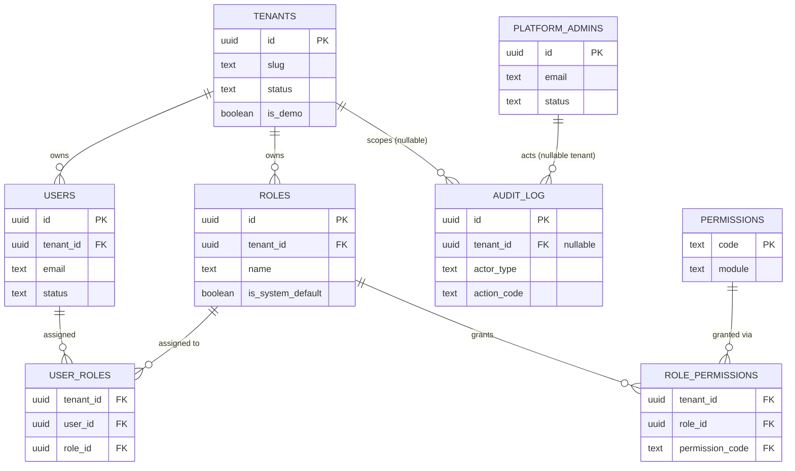

### Catalog

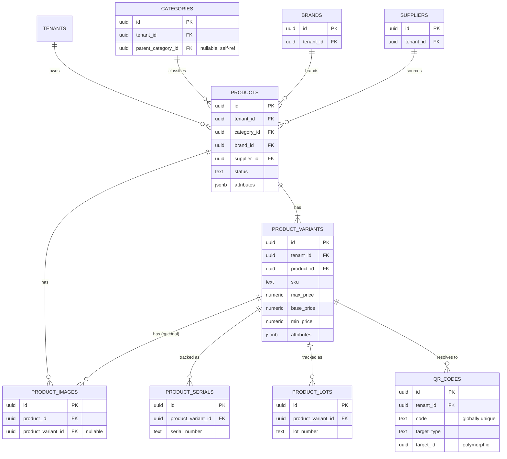

### Dynamic attributes (Prompt 02-B)

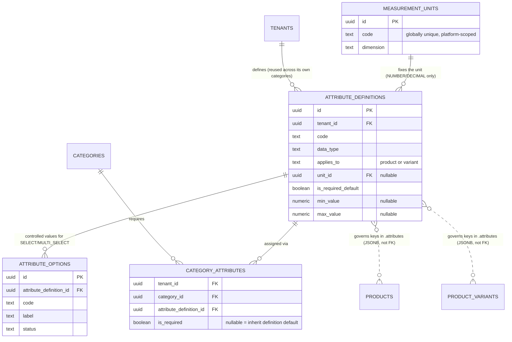

The two dashed `}o..o{` relationships are **not foreign keys** — they represent the governance
relationship this section exists to establish (an `attribute_definitions.code` corresponds to a JSONB
key), validated by application code, not enforced by the database schema itself. Every solid
relationship above it is a real FK.

### Inventory

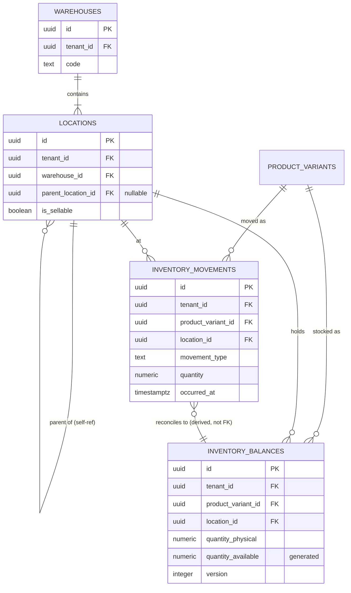

### Sales and notifications

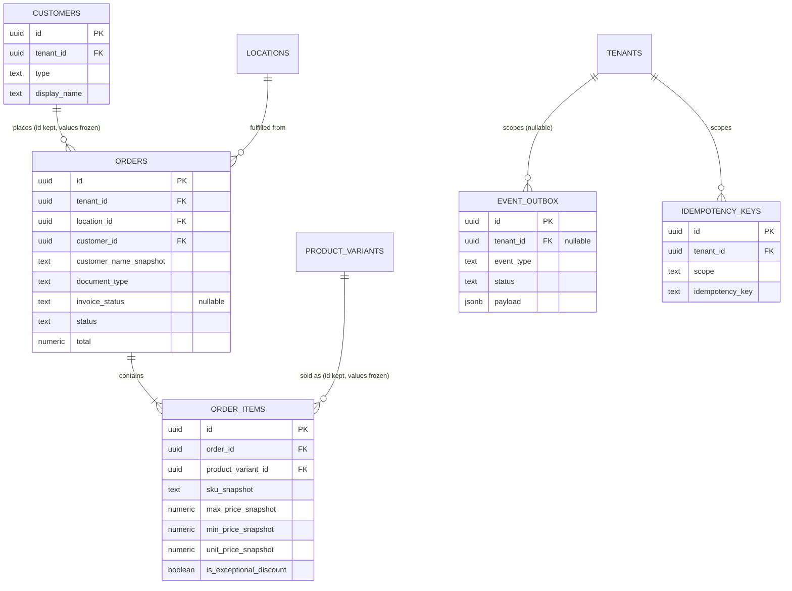

### Location authorization and inventory transfers (Prompt 02-A)

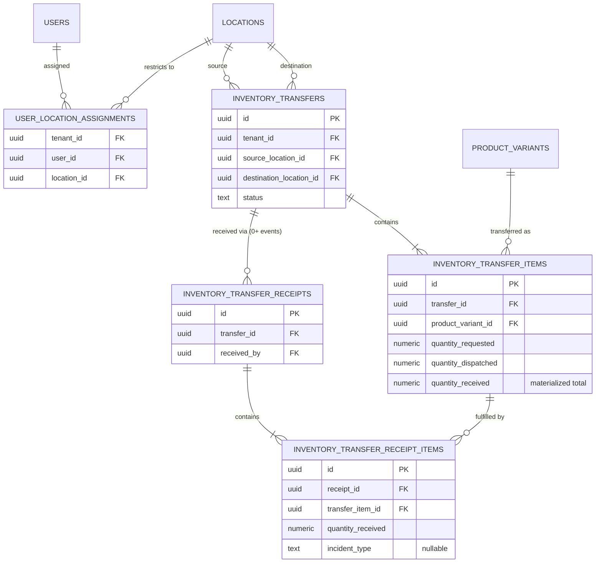

### Excel import pipeline (Prompt 02-B)

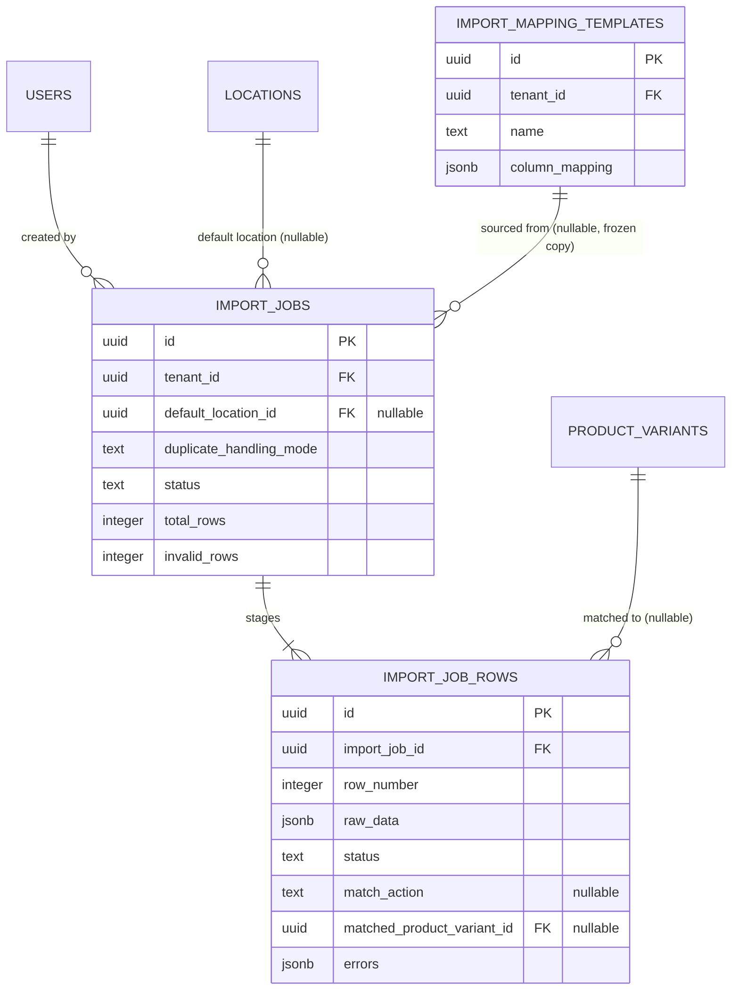

### Cart (Prompt 02-A)

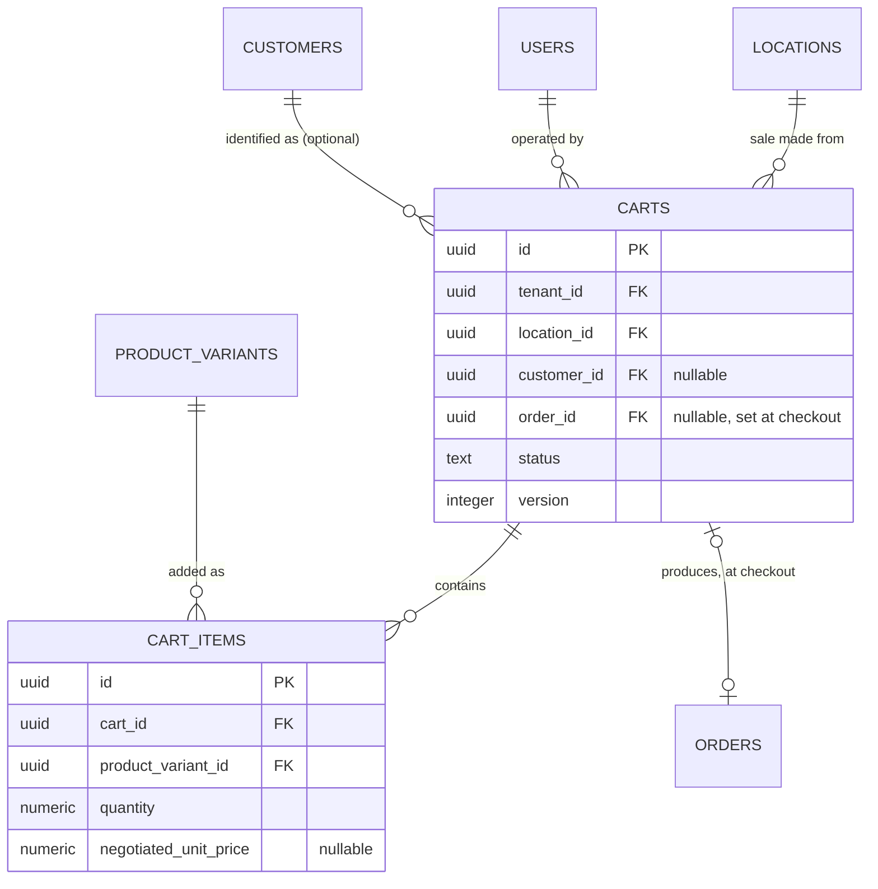

### Pricing and exceptional-discount approval (Prompt 02-A)

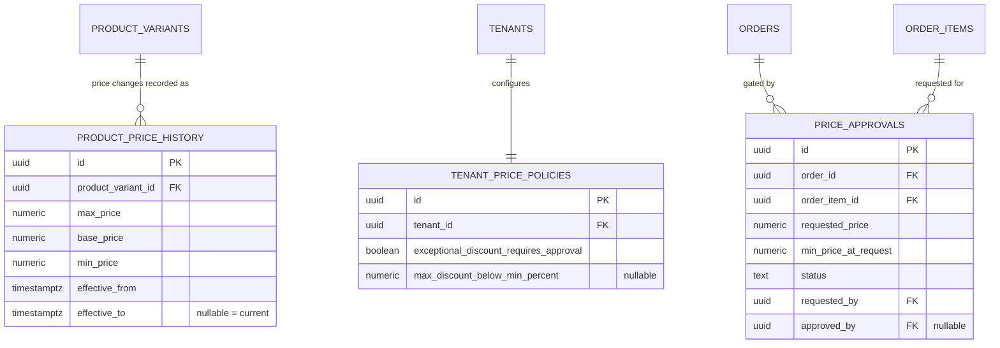

### Sales returns and disposition (Prompt 02-A)

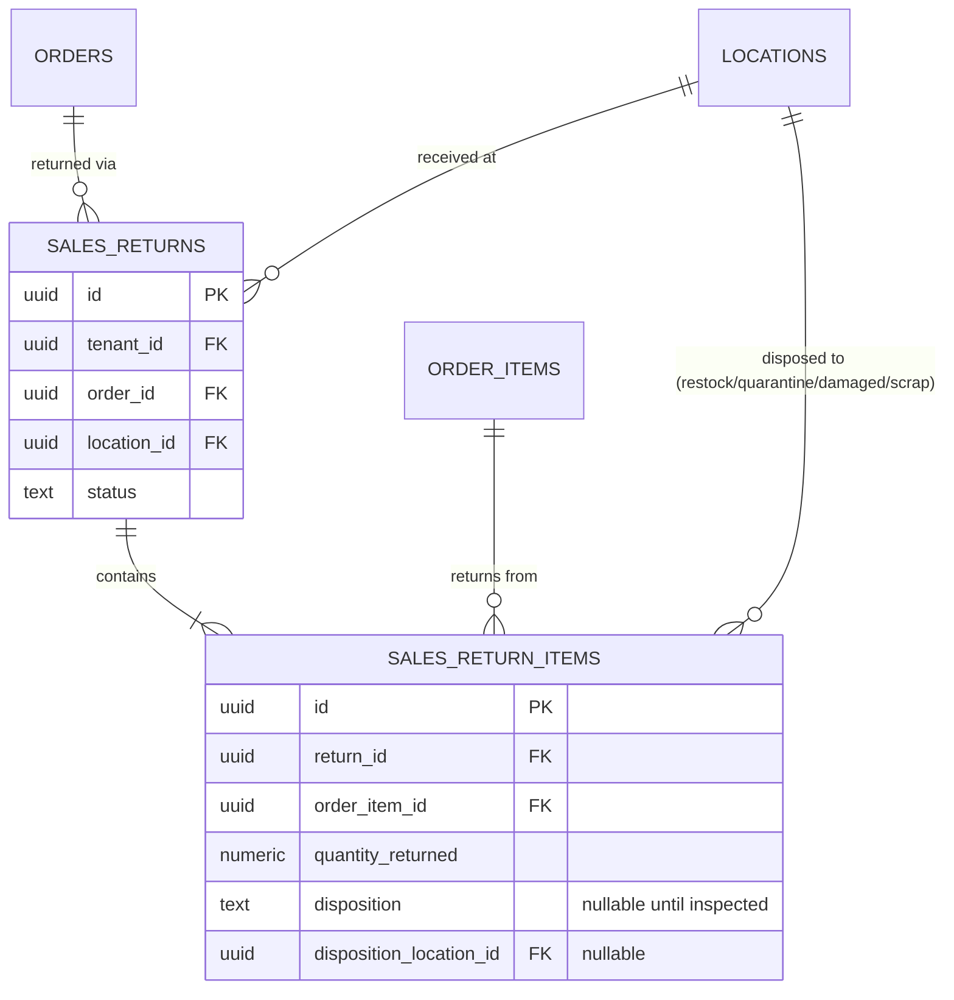

---

## Open decisions carried forward

Only what genuinely cannot be resolved at the database-design level, deferred to the phase that
actually needs the answer:

- **Order status workflow detail** (exact transition rules, who can transition what) — SALES domain
  logic, FASE 10. This document only fixes the `CHECK`-constrained set of status values.
- **`order_number` generation mechanism** (per-tenant sequence vs. counter table vs. other) — an
  implementation detail of FASE 10, doesn't affect the column/constraint shape defined here.
- **Multi-currency per tenant** — `orders.currency` assumes one currency per tenant; revisited only
  if a real multi-currency requirement appears.
- **`event_outbox` archival/retention window** for delivered events — an operational sizing decision,
  not a schema one; the table supports whatever retention policy is chosen later without a schema
  change.
- **Demo tenant reset cadence** (on-demand/scheduled/reset-on-login) — explicitly deferred to FASE 14
  per [ADR-0014](../decisions/0014-demo-tenant-strategy.md); this document only fixes the reset
  *mechanism*.
- **Cursor vs. offset pagination** for high-volume list endpoints (`inventory_movements`,
  `audit_log`) — an API-layer decision ([api.md#pagination-filtering-sorting-search](api.md#pagination-filtering-sorting-search)),
  not reopened here; the indexes in [§Indexes](#indexes) are chosen to support either outcome.
- **Audit trigger backstop** (DB-level triggers capturing changes even if application code forgets to
  write an audit entry) — left open in [ADR-0015](../decisions/0015-audit-log.md), unchanged here.

**Prompt 02-A additions:**

- **Cart abandonment cleanup cadence** (how often the cleanup job runs, exact `expires_at` duration) —
  an operational tuning decision, not a schema one; [§Cart](#cart) fixes the mechanism (hard delete of
  `abandoned` carts past `expires_at`), not the schedule.
- **Split disposition on a single sales-return line** (part of a returned line's quantity restocked,
  part scrapped) — deliberately not designed now; [§Sales returns](#sales-returns-and-disposition)
  fixes one disposition per `sales_return_items` row as a documented scope simplification, sufficient
  for what this prompt asks for.
- **Scrap/write-off accounting beyond "moved to a non-sellable location"** — `scrap` disposition stops
  at making the stock permanently non-sellable and traceable; a further financial write-off/disposal
  step (if the business needs one) is not designed here.
- **Per-role or per-category price-policy granularity** — `tenant_price_policies` is one row per
  tenant, not per role or per product category; if a tenant later needs "Supervisors can go lower than
  Vendedores" or "furniture has a different floor than appliances," that's a richer policy model not
  designed now (see [§Pricing](#pricing-history-tenant-policy-and-exceptional-discount-approval)).
- **Splitting one order's fulfillment across multiple locations** — `orders.location_id` is singular;
  an order pulling stock from more than one location is not designed
  ([§Orders](#orders-conceptual--sales-not-built-yet)).
- **`invoice_status` beyond `pending`/`issued`/`failed`** (e.g. a retry count, a link to an external
  invoice id/number) — kept to the three values this prompt's example needs; extended only when an
  actual external invoicing integration is scoped (explicitly out of scope per
  [ADR-0023](../decisions/0023-document-type-and-external-invoicing.md)).
- **A dedicated `PRICE_APPROVAL_RESOLVED` outbound notification** — [events.md](events.md) gains
  `PRICE_APPROVAL_REQUESTED` (so a supervisor is proactively notified there's something to act on);
  a symmetric "resolved" notification is not added now since this prompt's payload example shows
  approval status as one field within the sale notification itself, not a separate message — revisit
  if a concrete need for a resolution notification shows up.

**Prompt 02-B additions:**

- **Category-tree attribute inheritance** — deliberately not built; see
  [§Dynamic attributes](#dynamic-attributes-governance-for-the-catalog-jsonb)'s explicit reasoning.
  Revisit only if direct per-category assignment (already reuse-friendly at the definition level)
  proves insufficient in practice.
- **Curated/standardized attribute-code libraries per vertical** (so a targeted numeric-range index on
  one attribute code benefits every tenant in that vertical, not only tenants who happened to name it
  identically) — flagged as a known limitation in
  [§Dynamic attributes' search section](#dynamic-attributes-governance-for-the-catalog-jsonb), not
  designed.
- **Excel import sync/async threshold, batch size, max file size, and staging-row retention window** —
  all stated as illustrative defaults in [§Excel import pipeline](#excel-import-pipeline), tuning
  decisions for Prompt 03+/ops, not fixed here (same "not fixed here" precedent as rate-limit
  thresholds and the outbox retention window).
- **Automatic new-category/brand/supplier creation from an Excel row referencing one that doesn't yet
  exist** — the design surfaces this as a `warning` in preview (not silent, not blocked) but the exact
  UX/confirmation flow around it is an implementation detail for Prompt 03, not pinned at the schema
  level.
- **A dedicated `INVENTORY_IMPORT_COMPLETED` outbox event** (mirroring the audit-log entry, so a
  supervisor is notified via Telegram when a large import finishes) — plausible, natural, but not
  required by this prompt's explicit scope; not added to the [events.md](events.md) catalog now.

**Prompt 02-D confirmations (from the 02-C audit's M3/M5, explicitly kept POST-MVP, not implemented):**

- **M3 — cart-level range validation.** `cart_items.negotiated_unit_price` ([§Cart](#cart)) has no
  validation against `min_price`/`tenant_price_policies` at cart-mutation time — only the `>= 0` `CHECK`
  and, separately, the authoritative gate at checkout/`order_items` creation
  ([§Pricing](#pricing-history-tenant-policy-and-exceptional-discount-approval)). This means a vendor
  gets no in-cart feedback that a price will require approval until checkout — a UX completeness gap,
  not a data-integrity one (the final gate already holds). **Confirmed POST-MVP**, per this prompt's
  explicit instruction: the checkout-time gate is sufficient for MVP; earlier feedback is a UI/UX
  enhancement for a later pass, not a schema change.
- **M5 — serial-number uniqueness across unrelated verticals in one tenant.**
  `product_serials.UNIQUE (tenant_id, serial_number)` ([§Catalog](#catalog-products-variants-attributes),
  a Prompt 02 decision) is tenant-wide, not per-category — a tenant selling both motorcycles (VINs) and
  electronics (manufacturer serials) in the same tenant could, in principle, hit a coincidental
  collision between two unrelated numbering schemes. **Confirmed POST-MVP**: no structural change made:
  the collision risk is low in practice (real-world serial formats rarely collide by accident) and
  mitigable operationally (SKU/category-prefixed serials) without a schema change; revisit only if a
  real tenant actually hits this.
