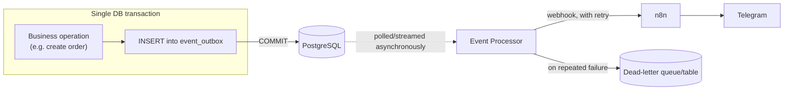

# Events and the Outbox

Related: [ADR-0010](../decisions/0010-outbox-pattern.md),
[ADR-0011](../decisions/0011-n8n-external-automation.md),
[ADR-0012](../decisions/0012-telegram-through-n8n.md).

## Why Outbox

Notifications are never sent as a side effect *inside* the same code path that performs a business
operation. If "create order" directly called out to n8n (or Telegram) before returning, then:

- A slow or down n8n would make order creation slow or fail, even though the order itself has
  nothing to do with whether a notification can currently be delivered.
- A crash between "the order was saved" and "the notification was sent" would either lose the
  notification silently, or (if the notification call happened first) notify about an order that
  then failed to save.

The **transactional outbox pattern** avoids both failure modes: the domain event is written to an
`event_outbox` table **in the same database transaction** as the business change. Either both the
order and the event are committed, or neither is — there is no window where one exists without the
other. Delivery to n8n is then a completely separate, asynchronous concern.

If n8n is down, the order still exists — it was already committed. The event sits in the outbox
until the Event Processor can deliver it. Business operations never block on, or fail because of,
notification delivery. See [ADR-0011](../decisions/0011-n8n-external-automation.md).

## Event Processor

A separate process/worker (not inline in the request path) that:

1. Reads undelivered rows from `event_outbox` (oldest first, or via `LISTEN`/`NOTIFY` for lower
   latency — `PENDING DECISION` on polling vs. `LISTEN`/`NOTIFY`, an implementation detail decided
   when this is built).
2. Calls the configured n8n webhook with the event payload.
3. Marks the row delivered on success, or increments a retry counter with backoff on failure.
4. After a configured maximum retry count, moves the event to a dead-letter state — it stops being
   retried automatically but is not deleted, so it can be inspected and manually replayed if
   needed.

Because the Event Processor is already decoupled from the request/response cycle and from the rest
of the backend's modules (see [modules.md](modules.md) — NOTIFICATIONS has no other module
depending on it), it is a natural first candidate if a module ever needs to be extracted into its
own deployable — see [scalability.md](scalability.md).

## Idempotency and retries

Each outbox event carries a stable `event_id` (not just an auto-increment row number). n8n's
webhook — and anything downstream of it — is expected to treat a redelivery of the same `event_id`
as a duplicate, not a new occurrence, since at-least-once delivery (not exactly-once) is what the
retry mechanism guarantees. Retries use exponential backoff with a capped maximum delay and a
capped maximum attempt count before an event is dead-lettered, so a persistently-down n8n does not
result in unbounded retry traffic.

## Event catalog (initial — extended as modules are built)

| Event | Emitted by | Payload (conceptual) |
| --- | --- | --- |
| `TENANT_CREATED` | CORE (SuperAdmin action) | tenant id, name |
| `USER_CREATED` | CORE | user id, tenant id |
| `INVENTORY_ADJUSTED` | INVENTORY | product id, warehouse/location id, delta, resulting balance |
| `LOW_STOCK` | INVENTORY | product id, warehouse/location id, current available stock, threshold |
| `ORDER_CREATED` | SALES (future) | order id, tenant id, customer id, totals |
| `ORDER_CANCELLED` | SALES (future) | order id, cancellation reason |

Every event payload includes `tenantId` (except platform-global events like `TENANT_CREATED`
itself) and the `correlationId` of the request that produced it (see
[api.md](api.md#correlation-id)), so a downstream n8n workflow — and any future debugging — can
trace an event back to the exact request that caused it.

## n8n and Telegram

n8n is external infrastructure, not a dependency the backend's domain logic knows about — the
backend calls a generic webhook URL with a generic event payload; it has no n8n-specific or
Telegram-specific code. Per [CLAUDE.md §7.4](../../CLAUDE.md#74-security) and
[ADR-0012](../decisions/0012-telegram-through-n8n.md):

- The backend never stores a Telegram bot token, in the database or anywhere else.
- The backend never imports a Telegram SDK or calls the Telegram API directly.
- The frontend never sees a Telegram token.
- n8n owns the entire Telegram integration: which chat/channel a notification goes to, message
  formatting, and the bot token itself (held in n8n's own credential store).

**Per-tenant notification configuration** (e.g. "this tenant wants low-stock alerts in their own
Telegram channel") is modeled as tenant-owned settings that identify *which n8n workflow/webhook
configuration* applies to that tenant — not the Telegram destination directly. The mapping from
"tenant X's low-stock events" to "tenant X's Telegram channel" lives inside n8n's own
configuration, keyed by a tenant identifier the backend already sends in the event payload. Exact
mechanism (one shared webhook with tenant routing inside n8n, vs. per-tenant webhook URLs) is a
`PENDING DECISION` made when tenant-configurable notifications are actually built (see
[roadmap.md](../roadmap/roadmap.md), later phase) — architecturally, either way keeps the backend
Telegram-agnostic.
