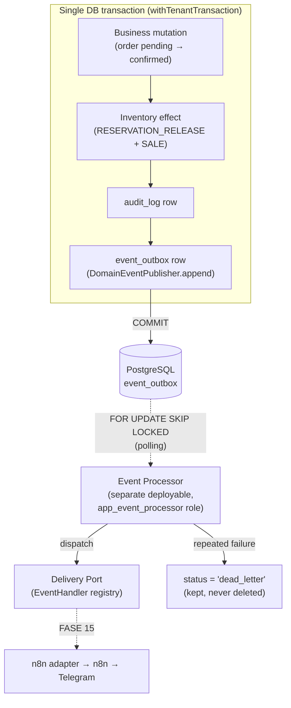

# Events and the Outbox

Related: [ADR-0010](../decisions/0010-outbox-pattern.md),
[ADR-0011](../decisions/0011-n8n-external-automation.md),
[ADR-0012](../decisions/0012-telegram-through-n8n.md),
[ADR-0029](../decisions/0029-import-worker-separation.md).

> **Status:** implemented in **FASE 14** — the transactional write path (`DomainEventPublisher` →
> `event_outbox`) and the **Event Processor** deployable (claim / retry / backoff / stale recovery /
> dead-letter). External delivery to **n8n / Telegram is NOT built** — that is FASE 15. The Event
> Processor ships with an empty delivery-handler registry, so it never marks any event delivered
> until FASE 15 registers a real adapter.

## Four distinct things — never conflated

| | Audit log | Domain event (outbox) | Application log | External notification |
| --- | --- | --- | --- | --- |
| **What** | "who did what", compliance record | a business fact that already happened | operational debug line | a Telegram/e-mail message |
| **Where** | `audit_log` table | `event_outbox` table | stdout / aggregator | n8n → Telegram |
| **Owner** | CORE | NOTIFICATIONS | ops | n8n (FASE 15) |
| **Write semantics** | best-effort (a failure never blocks the operation) | **transactional** — commits or rolls back with the business mutation | fire-and-forget | asynchronous, at-least-once |
| **Consumer** | a human running a query | the Event Processor, once | a log search | the tenant's staff |

The Event Processor **never** reads `audit_log`, `orders`, `inventory_movements`, or any domain
table to "discover what happened" — the producing module writes a self-describing event and the
processor works only from that.

## Why Outbox

Notifications are never sent as a side effect *inside* the code path that performs a business
operation. If "confirm order" called out to n8n before returning, a slow/down n8n would make order
confirmation slow or fail, and a crash between "the sale committed" and "the notification was sent"
would lose the notification (or notify about a sale that then rolled back).

The **transactional outbox pattern** removes both failure modes: the domain event is written to
`event_outbox` **in the same database transaction** as the business change. Either both commit or
neither does — there is no window where one exists without the other. Delivery is then a completely
separate, asynchronous concern.



If the delivery target is down, the sale still happened — it was committed. The event waits in the
outbox until the Event Processor can deliver it. Business operations never block on, or fail because
of, notification delivery.

## Event envelope

The `event_outbox.payload` column holds a **self-describing, versioned, JSON-serialisable
envelope** — the exact object that will be delivered to a consumer once FASE 15 exists. The row's
own columns (`event_type`, `aggregate_type`, `aggregate_id`, `correlation_id`, `tenant_id`,
`created_at`) are denormalised copies of envelope fields, kept for claiming and indexing.

| Field | Notes |
| --- | --- |
| `eventId` | `= event_outbox.id`. Generated once (UUIDv7, application-side), **never regenerated on retry**. A consumer dedupes on this. |
| `eventType` | `module.aggregate.action`, past tense — e.g. `sales.order.confirmed`. |
| `eventVersion` | integer, starts at `1`. A payload shape change **must** bump this (see [versioning](#event-versioning)). |
| `occurredAt` | ISO-8601 UTC — when the business fact happened. ≈ `created_at` (same transaction), semantically distinct. |
| `tenantId` | present for every tenant-scoped fact; `null` only for a platform-global event (none in FASE 14). |
| `aggregateType` / `aggregateId` | `order` / `price_approval` / `sales_return` and its id. |
| `correlationId` | the originating request's `Correlation-Id` (api.md#correlation-id), UUID-validated — `null` if the header was not UUID-shaped. |
| `actor` | `{ type: 'user' \| 'system', id }` — captured at the moment of the fact, never resolved later from `users`. |
| `data` | the typed, event-specific payload (below). |

Typed contracts live in
[`apps/api/src/common/events/domain-event.contracts.ts`](../../apps/api/src/common/events/domain-event.contracts.ts);
the catalog constants + current versions in
[`event-types.ts`](../../apps/api/src/common/events/event-types.ts). `Record<string, any>` is not a
contract.

## Event catalog

FASE 14 publishes only the SALES facts a known future integration needs. Other modules'
events (`INVENTORY_ADJUSTED`, `LOW_STOCK`, `TENANT_CREATED`, `USER_CREATED` — named in earlier
drafts of this doc as conceptual examples) are added to this table by the phase that has a real
consumer for them, not speculatively.

| `eventType` | v | Producer | Aggregate | Business transition | `data` (data-minimised — ADR-0028) |
| --- | --- | --- | --- | --- | --- |
| `sales.order.confirmed` | 1 | `OrdersService.confirm` | `order` | `pending → confirmed` (the physical sale commit) | order id/number, document type, invoice status, currency, subtotal/discountTotal/taxTotal/total, location id, placed-by user, `hasExceptionalDiscount`, customer snapshot (name/taxId/email/phone/address), lines (variant id, sku, name, qty, **unitPrice**, discountAmount, lineTotal) |
| `sales.order.cancelled` | 1 | `OrdersService.cancel` | `order` | `draft/pending → cancelled` | order id/number, document type |
| `sales.price_approval.requested` | 1 | `PriceApprovalsService.request` | `price_approval` | new `pending` request | approval/order/orderItem ids, order number, variant id, sku, name, qty, requestedPrice, **maxPriceAtRequest**, discountAmount, reason, requested-by user |
| `sales.price_approval.approved` | 1 | `PriceApprovalsService.resolve` | `price_approval` | `pending → approved` (CAS win) | approval/order/orderItem ids, status, resolved-by user, requested-by user |
| `sales.price_approval.rejected` | 1 | `PriceApprovalsService.resolve` | `price_approval` | `pending → rejected` (CAS win) | (as above) |
| `sales.return.requested` | 1 | `ReturnsService.create` | `sales_return` | new `→ requested` | return/order ids, order number, location id, reason, requested-by user, lines (orderItem id, variant id, sku, qtyReturned) |
| `sales.return.resolved` | 1 | `ReturnsService.resolve` | `sales_return` | `inspecting → resolved` (RETURN movements written) | return/order ids, location id, lines (orderItem id, variant id, qtyReturned, disposition, dispositionLocationId) |
| `sales.return.cancelled` | 1 | `ReturnsService.cancel` | `sales_return` | `requested/inspecting → cancelled` | return/order ids, status |

**Deliberately not events:** `return.inspected` (an internal re-inspection, no external meaning);
a `pending` order's creation (not a completed-sale fact — the meaningful event is
`sales.order.confirmed`).

### Data minimisation and PII

- `data` carries only what an approved consumer needs. **Never included:** `unit_cost` /
  `min_price` / `base_price` / `max_price` snapshots (ADR-0028 field-level pricing), password
  hashes, session tokens, JWTs, CSRF tokens, secrets, binary blobs, whole catalog/inventory
  snapshots.
- `sales.price_approval.requested` carries `maxPriceAtRequest` and `discountAmount` (both computed
  against the list ceiling) but **not** `minPriceAtRequest` — the notification's job is "there is a
  request to act on"; the approver opens the app, where their own `pricing.floor.view` decides what
  they see. The event is Telegram-agnostic and a Telegram channel is not an authorization boundary.
- `sales.order.confirmed` carries the customer snapshot (name/taxId/email/phone/address) — the
  minimum a "new sale" notification needs. That is PII; it is not logged (see
  [observability](#observability)).

## Event versioning

`eventType` + `eventVersion` together identify a contract. Bumping a payload's shape **must** bump
`eventVersion` and add a matching handler branch downstream — never silently change a v1 payload.
The Event Processor treats an event whose version it does not recognise as **terminal**
(`dead_letter`), not as something to retry or mis-process.

## Event Processor

A separate process/deployable (`apps/api/src/event-processor/main.ts`,
`pnpm --filter @saas-inventory/api worker:events:start`) — **not** the API, and **not** the Import
Worker (ADR-0029). It starts via `NestFactory.createApplicationContext(AppModule)` (no HTTP
listener, no port), connects as the dedicated `app_event_processor` Postgres role, and runs
`EventProcessorService.runOnce()` in a poll loop with graceful SIGTERM/SIGINT shutdown.

### Claiming

One atomic statement — a CTE with `FOR UPDATE SKIP LOCKED` feeding an `UPDATE ... RETURNING`
(`event-claim.repository.ts`):

```sql
WITH claimable AS (
  SELECT id, status FROM event_outbox
  WHERE event_type = ANY(:supportedTypes)        -- only types with a registered handler
    AND attempts < :maxAttempts
    AND (
      (status = 'pending' AND (claimed_at IS NULL
        OR claimed_at < now() - LEAST(:retryMaxMs, :retryBaseMs * power(:retryFactor, attempts))
                                * interval '1 ms'))
      OR (status = 'processing' AND claimed_at < now() - :staleClaimMs * interval '1 ms')
    )
  ORDER BY created_at
  FOR UPDATE SKIP LOCKED
  LIMIT :batchSize
)
UPDATE event_outbox e
SET status = 'processing', claimed_at = now(), claimed_by = :workerId,
    attempts = e.attempts + (CASE WHEN c.status = 'processing' THEN 1 ELSE 0 END)
FROM claimable c WHERE e.id = c.id
RETURNING e.id, e.tenant_id, e.event_type, e.attempts, e.created_at, e.payload;
```

- `FOR UPDATE SKIP LOCKED` is what makes multiple Event Processor instances safe: each skips rows
  another instance already locked. Horizontal scaling needs no separate distributed lock.
- **`event_type = ANY(:supportedTypes)`** — `supportedTypes` is the dispatcher's registered-handler
  set. In FASE 14 production that set is **empty**, so nothing is ever claimed and no event can be
  marked delivered before FASE 15.
- `claimed_at` doubles as the *last-attempt timestamp* — backoff is `claimed_at + delay(attempts)`,
  computed in SQL. **No schema column** is needed for retry scheduling (see
  [database.md#outbox](database.md#outbox)).
- The claim transaction is short; dispatch (and, from FASE 15, the webhook call) happens **after**
  it commits — a row lock is never held across a delivery.

### Retry / backoff / terminal

| Outcome | Effect |
| --- | --- |
| handler returned success | `status = 'delivered'`, `processed_at = now()`, `last_error = NULL` |
| handler threw (transient) | `attempts += 1`, `last_error` = sanitized message, `claimed_at = now()`; `status = 'pending'` unless `attempts ≥ maxAttempts` → `'dead_letter'` |
| unknown version / malformed envelope | `status = 'dead_letter'` immediately — retrying cannot help |
| worker crashed mid-dispatch | row stays `processing`; a later poll reclaims it once `claimed_at` is stale, incrementing `attempts`; `reapStale()` dead-letters it once `attempts ≥ maxAttempts` |

Backoff: `delay(attempts) = min(retryMaxMs, retryBaseMs · retryFactor^attempts)` — exponential,
capped, configurable (`EVENT_PROCESSOR_RETRY_*`). A `dead_letter` event is **never deleted**
(retention is an operational question for a later phase); it can be inspected and replayed manually
later.

### Configuration

`getOptionalEnvVar` + defaults, same convention as `IMPORT_WORKER_*` (see `.env.example`):
`APP_EVENT_PROCESSOR_DATABASE_URL`, `EVENT_PROCESSOR_POLL_INTERVAL_MS` (2000),
`EVENT_PROCESSOR_CLAIM_BATCH_SIZE` (50), `EVENT_PROCESSOR_STALE_CLAIM_MS` (300000),
`EVENT_PROCESSOR_MAX_ATTEMPTS` (10), `EVENT_PROCESSOR_RETRY_BASE_MS` (1000),
`EVENT_PROCESSOR_RETRY_MAX_MS` (3600000), `EVENT_PROCESSOR_RETRY_FACTOR` (2),
`EVENT_PROCESSOR_ID` (optional).

## Delivery semantics: at-least-once

The classic window: a handler succeeds, then the process crashes **before** the DB is marked
`delivered`. On restart the row is still `processing`; stale reclaim redelivers it — **with the same
`eventId`**.

- **Business side effects are exactly-once** — guaranteed by the transaction, the `SELECT … FOR
  UPDATE` state locks, and `idempotency_keys`. One `pending → confirmed` transition, one `SALE`, one
  `sales.order.confirmed` event, no matter how many times the client retries `POST
  /orders/:id/confirm` or how many requests race.
- **Outbox delivery is at-least-once** — never exactly-once. FASE 15 consumers **must** dedupe on
  `eventId`. This is documented here now so FASE 15 builds on it.

## Delivery Port

`EventHandler` (`event-delivery.port.ts`) is the abstraction between the Event Processor and
whatever forwards an event outward. FASE 15 implements an n8n-webhook adapter against it. FASE 14
registers **no** production handler — `EventProcessorModule` binds the `EVENT_HANDLERS` token to
`[]`. Behaviour with no handler: the event is **not claimed**, **not delivered**, **not
dead-lettered** — it waits, intact, for FASE 15. Tests register in-memory fakes; those are never
production adapters.

## Tenant suspension

The Event Processor processes **facts that already committed**. Unlike the Import Worker (which
runs *new* business mutations and therefore excludes suspended tenants from its claim query,
PROMPT 011-B), the Event Processor's claim query **does not** join `tenants` or filter on
`tenants.status`. Whether an outbound *notification* is delivered to a suspended tenant is a FASE 15
routing decision, not an outbox concern.

## Ordering

There is **no global ordering guarantee**. `ORDER BY created_at` in the claim query is
best-effort fairness (roughly oldest-first, UUIDv7-friendly), not a contract. With `SKIP LOCKED`,
multiple workers, and per-event retry/backoff, events for one aggregate can be delivered out of
order. Consumers must be idempotent and state-aware (which the `eventId` + the event's own
`status`/transition data allow).

## Security model

| Concern | Mechanism |
| --- | --- |
| **Producer authorization** | the business route's own guard chain (JwtAuthGuard → TenantGuard → CsrfGuard → PermissionsGuard). An event is only ever written as a side effect of an authorized mutation; there is no public outbox API. |
| **Outbox tenant isolation** | RLS. `app_tenant` (the producer's connection) has `SELECT, INSERT` on `event_outbox` filtered to its own `tenant_id`; a `prevent_tenant_id_change` trigger blocks re-homing a row. |
| **Processor authorization** | the dedicated `app_event_processor` role: `SELECT, UPDATE` on `event_outbox` only (one permissive cross-tenant policy), **no grant on any other table** — a compromised Event Processor cannot read `orders`/`customers`/`inventory`. It is not `BYPASSRLS` and cannot `SET ROLE`. |
| **Error sanitisation** | `last_error` and every log line pass through `sanitizeError` — bearer tokens, API keys, passwords, URL credentials and JWTs redacted, truncated to ~500 chars. |
| **External recipient authorization** | FASE 15. |

## Import Worker vs Event Processor

Same technical pattern (`FOR UPDATE SKIP LOCKED`, stale-claim recovery, polling), **never the same
deployable** (ADR-0029): different entry point, different Postgres role, different claim
repository, different table (`import_jobs` vs `event_outbox`). Neither reads the other's table; no
shared in-process state. A large import can never delay notification delivery and vice versa.

## FASE 15 boundary

Not built in FASE 14, and explicitly out of scope: n8n integration, the n8n webhook URL/secret,
Telegram (the backend never stores a bot token or calls Telegram — ADR-0012), external HTTP
delivery, per-tenant notification preferences / recipient routing, message templates, a manual
retry/replay admin tool, event-outbox retention/purge, and any frontend or reporting on events.

## n8n and Telegram (FASE 15 — unchanged design)

n8n is external infrastructure the backend's domain logic knows nothing about — the Event Processor
will call a generic webhook URL with the generic envelope above; no n8n-specific or Telegram-specific
code, no bot token in the database or anywhere else. Per-tenant notification configuration will be
modelled as tenant-owned settings identifying *which n8n workflow/webhook configuration* applies,
keyed by the `tenantId` already in every envelope — the mapping to a Telegram channel lives inside
n8n. Exact mechanism (one shared webhook with tenant routing vs. per-tenant URLs) is a
`PENDING DECISION` for FASE 15.
