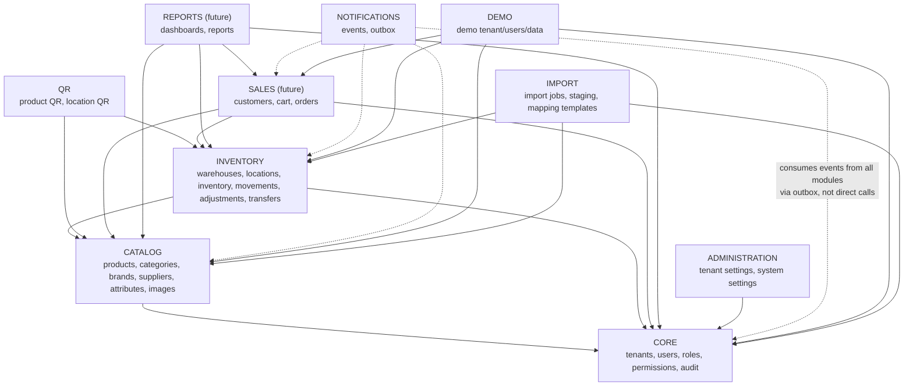
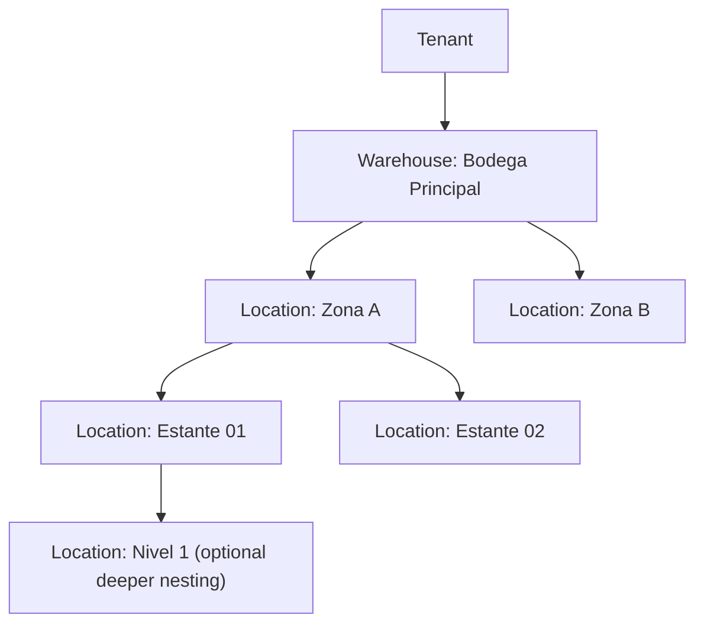
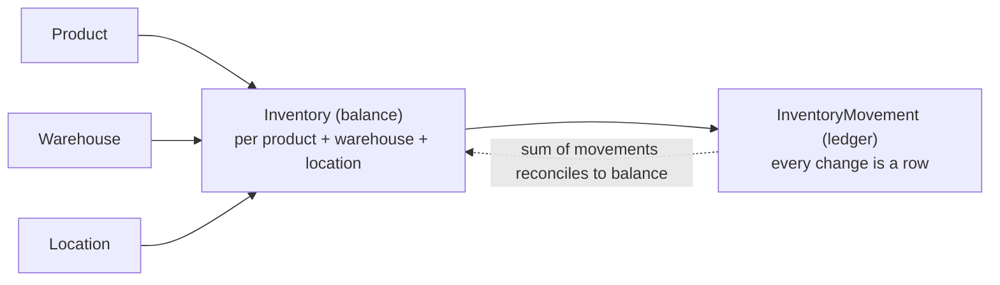
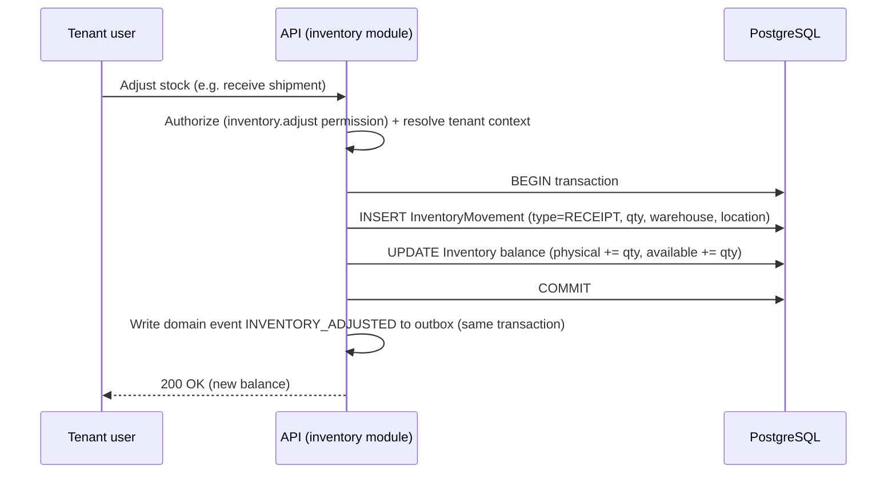
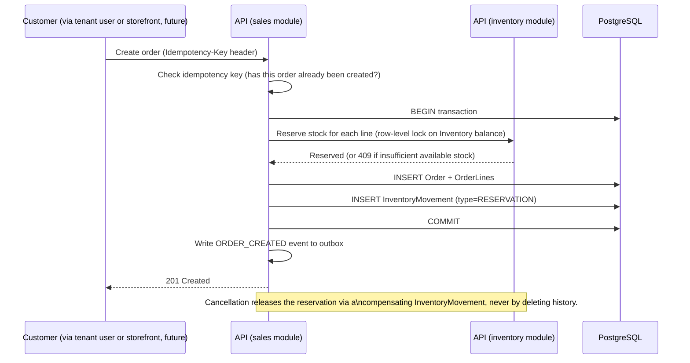

# Modules / Bounded Contexts

This defines the module map for the NestJS modular monolith (see [backend.md](backend.md)) and,
conceptually, for the domain model overall. Each module below is a **bounded context**: it owns
its data, exposes a narrow interface to other modules, and no other module reaches into its tables
directly.

None of these modules are implemented yet. This document defines responsibility, boundaries, and
dependency direction so implementation (starting with Prompt 02 — database design) has a map to
follow.

## Dependency rule

Dependencies point one way, shown top-to-bottom below. A module may depend on modules above it,
never below or sideways without going through an explicit interface. Cross-module communication
that isn't a direct synchronous call (e.g. "notify sales when stock changes") goes through domain
events on the [outbox](events.md), not a direct import.

## CORE

**Responsibility:** the identity and access substrate every other module depends on — who the
tenant is, who the user is, what they're allowed to do, and a record of what happened.

- `tenants` — the list of companies (global, no `tenant_id` on this table itself).
- `users` — tenant-scoped user accounts.
- `roles`, `permissions` — see [ADR-0009](../decisions/0009-rbac-permissions.md).
- `audit` — the audit log (see [Audit](#audit) below).

**Depends on:** nothing else (it is the foundation).

**Exposes to other modules:** tenant context resolution, permission checks, an audit-write
interface.

**Implemented in `apps/api/src/core/` (Prompt 05-A):** self-administration of the caller's own
tenant (`GET`/`PATCH /tenant`) and its users (`GET`/`POST /users`, `GET`/`PATCH /users/:id`), plus
read-only role listing for assignment (`GET /roles`) — reusing `auth/`'s `UsersRepository`/
`RolesRepository`/`TenantsPlatformRepository` rather than a parallel data-access layer. The
audit-write interface this section promises is `common/audit/audit-log.service.ts`, a thin insert
wrapper around the already-provisioned `audit_log` table. Role/permission CRUD (custom roles,
per-role permission toggling) is not implemented — see
[ADR-0031](../decisions/0031-role-assignment-escalation-prevention.md) and the roadmap for what's
deliberately out of this phase's scope.

## CATALOG

**Responsibility:** what a tenant sells — products and the taxonomy around them, including the
per-tenant/per-category dynamic attribute system that governs what a product's flexible data can
contain, and the bulk-onboarding path (Excel import) that populates the catalog and initial stock at
scale. Deliberately generic; see the product model design in
[database.md#catalog-products-variants-attributes](database.md#catalog-products-variants-attributes)
and [ADR-0017](../decisions/0017-product-variant-attribute-model.md) (Prompt 02); the attribute
governance layer in
[database.md#dynamic-attributes-governance-for-the-catalog-jsonb](database.md#dynamic-attributes-governance-for-the-catalog-jsonb)
and [ADR-0026](../decisions/0026-dynamic-attribute-system.md) (Prompt 02-B); and the import pipeline
in [database.md#excel-import-pipeline](database.md#excel-import-pipeline) and
[ADR-0027](../decisions/0027-staged-excel-import-pipeline.md) (Prompt 02-B).

- `products`, `product_variants`, `categories`, `brands`, `product_images`.
- `suppliers` — a passive reference/attribution entity ("who this product is sourced from"), placed
  here rather than under SALES or a not-yet-existing PURCHASING module; see
  [ADR-0019](../decisions/0019-suppliers-ownership.md) for why. No purchase-order/receiving workflow
  is in scope.
- `attribute_definitions`, `attribute_options`, `category_attributes`, `measurement_units` — the
  metadata that validates every product/variant's `attributes` JSONB; see
  [ADR-0026](../decisions/0026-dynamic-attribute-system.md).

**Implemented in `apps/api/src/catalog/`** (Prompt 06) — categories (+ the attribute-governance
assignment layer), `attribute_definitions`/`attribute_options` CRUD, products + variants (always
created together, per ADR-0017), the shared `AttributeValidationService` enforcing §Dynamic
attributes' governed-JSONB rules on every create/update (including category-change re-validation),
and `product_price_history` writes on every price change. `products.view`/`products.manage`/
`categories.view`/`categories.manage` (migration `0015`) plus the existing `catalog.attributes.manage`
gate it via the same `PermissionsGuard` every other module uses. **Not implemented in this phase**
(deliberately, each already scoped to its own module/phase elsewhere in this document): brands/
suppliers CRUD (schema-ready, assignable by id only), QR, the Excel IMPORT pipeline below (needs its
own Import Worker deployable, [ADR-0029](../decisions/0029-import-worker-separation.md)), and the
`price_approvals` exceptional-discount workflow (SALES-dependent, see below).

**Depends on:** CORE (tenant scoping, audit).

**Consumed by:** INVENTORY (a stock record refers to a product), SALES (a cart/order line refers to
a product), QR (a product can have a QR code), IMPORT (populates CATALOG data), REPORTS.

## INVENTORY

**Responsibility:** where stock physically is and how it moves, including stock moving *between*
locations and stock in transit. See [Inventory](#inventory-and-locations-summary) below and the
Inventory Flow diagram; full schema and concurrency design (row locking, idempotency) in
[database.md#inventory-warehouses-locations-balance-ledger](database.md#inventory-warehouses-locations-balance-ledger)
and [database.md#concurrency-strategy](database.md#concurrency-strategy) (Prompt 02); multi-location
transfers, in-transit representation, and location-scoped authorization in
[database.md#inventory-transfers-and-in-transit-stock](database.md#inventory-transfers-and-in-transit-stock)
and [database.md#location-scoped-authorization](database.md#location-scoped-authorization)
(Prompt 02-A, [ADR-0020](../decisions/0020-multi-location-inventory-transfers.md),
[ADR-0024](../decisions/0024-location-scoped-authorization.md)).

- `warehouses`, `locations` (hierarchical, `is_sellable`-flagged), `inventory_balances`,
  `inventory_movements`, `stock adjustments`, `inventory_transfers`/`inventory_transfer_items`/
  `inventory_transfer_receipts`/`inventory_transfer_receipt_items`, `user_location_assignments`.

**Depends on:** CORE, CATALOG.

**Consumed by:** SALES (reserving/committing stock for an order, receiving returned stock), QR (a
location can have a QR code), REPORTS.

## QR

**Responsibility:** generating and resolving QR codes that point at a product or a location. See
[api.md](api.md) for how a scanned QR resolves through the API.

**Depends on:** CATALOG (product QR), INVENTORY (location QR).

**Consumed by:** nothing depends on QR — it is a leaf module.

## SALES

**Responsibility:** the commerce flow — a vendor builds a cart, which becomes an order (with a
negotiated price, an invoice-or-sales-note choice, and a frozen customer snapshot), which consumes
inventory, and which may later be returned. Full schema in
[database.md#cart](database.md#cart), [database.md#orders-conceptual--sales-not-built-yet](database.md#orders-conceptual--sales-not-built-yet),
[database.md#pricing-history-tenant-policy-and-exceptional-discount-approval](database.md#pricing-history-tenant-policy-and-exceptional-discount-approval),
and [database.md#sales-returns-and-disposition](database.md#sales-returns-and-disposition)
(Prompt 02-A, [ADR-0021](../decisions/0021-sales-returns-disposition.md),
[ADR-0022](../decisions/0022-pricing-tiers-and-discount-approval.md),
[ADR-0023](../decisions/0023-document-type-and-external-invoicing.md)).

- `customers`, `carts`/`cart_items`, `orders`/`order_items` (FASE 12). `price_approvals`,
  `sales_returns`/`sales_return_items` — schema-ready, application behavior is FASE 13.

**Depends on:** CORE (tenant scoping, audit), CATALOG (reads `product_variants`/`products` directly
for price + sellability — SALES must validate a negotiated price against `min_price` server-side
even for a caller who cannot *see* it, ADR-0028), INVENTORY (`StockLedgerService` — the one stock
locking convoy; `LocationAuthorizationService` — ADR-0024; `LocationsRepository` /
`InventoryBalancesRepository`).

**Implemented in `apps/api/src/sales/` (FASE 12):**

- **Customers** — `GET/POST /customers`, `GET/PATCH /customers/:id`, search by
  displayName/taxId/email/phone. `taxId` (identification) is unique per tenant, never globally
  (`customers_tenant_id_tax_id_key`). Soft-deleted, never physically removed (historical orders
  still reference `customer_id`). `sales.customers.view`/`sales.customers.manage` (migration 0026).
- **Cart** — a singular `/cart` resource owned by the authenticated vendor (`carts.user_id`); one
  open cart per vendor (enforced in-service via `findOpenByUser` + a `pg_advisory_xact_lock`, not a
  new unique index). `GET /cart`, `POST /cart`, `PATCH /cart`, `POST/PATCH/DELETE /cart/items[/:id]`.
  No inventory is reserved by cart edits (database.md#cart's explicit design) — availability is a
  live read shown for guidance. `sales.carts.manage`.
- **Orders** — `GET /orders`, `GET /orders/:id`, `POST /orders` (checkout, `Idempotency-Key`
  required), `POST /orders/:id/confirm`, `POST /orders/:id/cancel`. Two-phase lifecycle:
  `POST /orders` validates everything under lock, freezes the customer + per-line price snapshots,
  writes a `RESERVATION` movement per line and creates the order `pending`; `confirm` writes
  `RESERVATION_RELEASE` + `SALE` per line (the inventory commit boundary) and moves to `confirmed`;
  `cancel` releases a still-`pending` reservation (`RESERVATION_RELEASE`) and moves to `cancelled` —
  a `confirmed` order can only be reversed by a sales return (FASE 13), never cancelled.
  `sales.orders.view`/`.create`/`.cancel`.
- **Document type** — `invoice` records `invoice_status = 'pending'` for a later external process;
  `sales_note` carries a NULL `invoice_status`. The platform never issues a fiscal document
  (ADR-0023). An `invoice` order additionally requires the customer to have taxId/email/phone/address.
- **Pricing** — a per-line negotiated price within `[min_price, max_price]` completes now; a price
  below `min_price` is an exceptional discount whose approval workflow is FASE 13 — FASE 12 rejects
  it in a controlled way (409), never silently bypassing the floor. Above `max_price` is always
  invalid (400). No `price_approvals` rows, no `tenant_price_policies` reads in this phase.

**Deliberately not built in FASE 12** (each scoped to a later phase): selling serialized/lot-tracked
variants (no approved `order_items` ↔ `product_serials`/`product_lots` linkage exists, and
`inventory_movements` has no serial/lot column — the same "not fully pinned" gap FASE 8/10 flagged;
FASE 12 rejects such lines with a controlled `422`); the `price_approvals` exceptional-discount
workflow and `sales_returns` (FASE 13); any `event_outbox` write (FASE 14); Telegram/n8n
(FASE 15); any frontend (FASE 16/17). Its exceptional-price approvals will notify a
supervisor/administrator via the same outbox → n8n → Telegram path as any other event
([events.md](events.md)), never a direct Telegram integration inside SALES itself.

## NOTIFICATIONS

**Responsibility:** turning domain events into outbound notifications without coupling any other
module to *how* a notification is delivered. See [events.md](events.md) in full and
[database.md#outbox](database.md#outbox) (Prompt 02) for the `event_outbox` table shape and the
`FOR UPDATE SKIP LOCKED` claiming pattern that lets multiple Event Processor instances share the
queue safely.

- `event_outbox` (the outbox table), delivery/retry bookkeeping.

**Depends on:** nothing (it only reads events written by other modules' transactions). The Event
Processor is a distinct process from IMPORT's Import Worker below (Prompt 02-D,
[ADR-0029](../decisions/0029-import-worker-separation.md)) — they share the same claiming pattern but
never the same deployable, so a large import can never delay a notification or vice versa.

**Consumed by:** nothing inside the backend — its only consumer is the external Event Processor
that forwards to n8n.

## REPORTS (future — not built in this phase)

**Responsibility:** read-side aggregation across CORE/CATALOG/INVENTORY/SALES for dashboards and
reports. Expected to be built as read-optimized queries (and, later, materialized views or a
read replica) rather than reusing the transactional write-path repositories — `PENDING DECISION`
on the exact approach, to be revisited when reporting is actually scoped.

## ADMINISTRATION

**Responsibility:** tenant-level configuration (business hours, notification preferences, branding
later, etc.) and system-level configuration that only a SuperAdmin can change.

**Depends on:** CORE.

**Implemented in `apps/api/src/administration/` (FASE 11):** tenant-level configuration —
`GET`/`PATCH /administration/tenant-settings` (timezone, business hours; `administration.settings.
view`/`.manage`, migration `0023`), backed by a new singleton-per-tenant `tenant_settings` table
(migration `0022`) — see
[database.md#administration-tenant-settings-and-platform-admin-sessions](database.md#administration-tenant-settings-and-platform-admin-sessions).
`notification_preferences`/`branding` are deliberately not built this phase: the former's mechanism
is an explicit `PENDING DECISION` [events.md](events.md#n8n-and-telegram) defers to the phase that
actually builds tenant-configurable notifications (FASE 15); the latter modules.md itself already
names "later." System-level administration — the SuperAdmin (`platform_admins`) authentication
mechanism ADR-0030/Prompt 04 deliberately left unbuilt, plus the one concrete system-level
capability this phase found grounded in the existing architecture (tenant lifecycle management:
`GET /platform/tenants`, `GET /platform/tenants/:tenantId`, `POST /platform/tenants/:tenantId/
suspend`, `POST /platform/tenants/:tenantId/activate`, `POST/GET /platform/auth/*`) — see
[ADR-0032](../decisions/0032-platform-admin-authentication.md) for the full authentication design
and [multi-tenancy.md#superadmin-vs-tenant](multi-tenancy.md#superadmin-vs-tenant) for why this is
structurally separate from CORE's tenant self-administration (Prompt 05-A) rather than an extension
of it. `TenantsPlatformRepository` (CORE/AUTH's existing repository) is reused as-is for the
tenant-status mutation — no second `tenants`-table repository was introduced. Platform-level
metrics/global configuration/"plans" — named as illustrative SuperAdmin capabilities in
multi-tenancy.md but with no concrete architectural definition anywhere — are deliberately not
built; see this phase's final report for the full scope-boundary rationale.

## DEMO

**Responsibility:** a fully isolated demo tenant — same isolation rules as any other tenant (see
[multi-tenancy.md](multi-tenancy.md)) — seeded with synthetic data for prospects/sales demos. See
[the demo strategy ADR](../decisions/0014-demo-tenant-strategy.md).

## IMPORT (Prompt 02-B, implemented FASE 10)

**Responsibility:** the guided, staged bulk-inventory-onboarding flow — dynamic Excel template
generation, upload, column mapping, validation, preview, and batched commit into CATALOG (products,
variants) and INVENTORY (initial stock, ledgered like any other movement). See
[database.md#excel-import-pipeline](database.md#excel-import-pipeline) and
[ADR-0027](../decisions/0027-staged-excel-import-pipeline.md). Large-import processing runs on a
**separate Import Worker process** from the NOTIFICATIONS module's Event Processor below — same
Postgres-backed claiming pattern, different deployable, resolved in Prompt 02-D; see
[ADR-0029](../decisions/0029-import-worker-separation.md) and
[database.md#large-imports](database.md#large-imports).

- `import_mapping_templates`, `import_jobs`, `import_job_rows`.

**Depends on:** CORE (tenant scoping, audit), CATALOG (creates/updates products, variants, and reads
`attribute_definitions`/`category_attributes` to validate rows and generate templates), INVENTORY
(writes `inventory_movements`/`inventory_balances` for initial stock, through INVENTORY's own
concurrency-safe write path — never touching INVENTORY's tables directly from CATALOG code). Shaped
like DEMO above — a module whose entire purpose is populating other modules' data — rather than folded
into CATALOG, specifically so CATALOG itself keeps its single, simple `Catalog --> Core` dependency
edge and IMPORT carries the (legitimate, narrower) multi-module dependency instead.

**Consumed by:** nothing depends on IMPORT — like QR, it is a leaf module.

**PROMPT 011-B** closed a real gap: the Import Worker never passes through `TenantGuard` (it is a
background process, not an HTTP path), so nothing previously stopped it from claiming or continuing
to process a job belonging to a tenant a SuperAdmin had since suspended. `ImportWorkerClaimRepository`'s
claim query now excludes any job whose tenant is not `active`; `ImportValidationService`/
`ImportExecutionService` re-check the same live status before starting each batch of an already-claimed
job. Either check leaves the job in its current, resumable status (never `failed`, never falsely
finalized to `completed`) — see [security.md#tenant-isolation](security.md#tenant-isolation) for
the full design and [database.md#row-level-security](database.md#row-level-security) for the one
narrow grant (`GRANT SELECT (id, status) ON tenants TO app_import_worker`, migration 0025) this
required.

## Inventory and locations summary

Full detail: [database.md](database.md) (conceptual model) and the Inventory Flow diagram below.
Locations are a hierarchy under a warehouse, not a fixed two- or three-level scheme:

A `location` has a nullable `parent_location_id` (self-referencing), so the tree can be as shallow
or as deep as a tenant's real layout requires — "zone / shelf / level" is an example depth, not a
fixed schema. Each location can carry a QR code (see QR module) and a status (active/inactive).

Inventory itself is **never** a single `quantity` column on `products`. It is:

`Inventory` holds the current balance (fast reads); `InventoryMovement` is the append-only ledger
that produced that balance (traceability, auditability, and the ability to reconstruct history).
The balance additionally distinguishes:

- **Physical stock** — what is actually on the shelf.
- **Reserved stock** — held against an in-progress cart/order, not yet committed.
- **Committed stock** — allocated to a confirmed order not yet fulfilled/shipped.
- **Available stock** — physical minus reserved minus committed; what can be sold right now.

## Inventory flow (conceptual)

The event write happens in the **same database transaction** as the inventory change — see
[events.md](events.md#why-outbox) for why.

## Order flow (conceptual — SALES not implemented yet)

> **Implemented in FASE 12** — heading kept for anchor stability. The diagram below is the
> checkout half; FASE 12 splits it into a `pending` (reservation) phase and a `confirm` (commit)
> phase, and never creates a `price_approvals` row (below-`min_price` is rejected until FASE 13).
> See [SALES](#sales) and
> [database.md#fase-12-application-behavior](database.md#fase-12-application-behavior).

Concurrency is handled with row-level locking (`SELECT ... FOR UPDATE`) on the `Inventory` balance
row(s) being reserved against, inside a single transaction — two simultaneous orders for the last
unit of stock cannot both succeed. Idempotency is handled via a client-supplied `Idempotency-Key`
(see [api.md](api.md#idempotency)) so a retried request (e.g. after a timeout) does not create a
duplicate order.

**Prompt 02-A:** an order carries a negotiated price per line, frozen at the moment of sale, plus the
customer's chosen document type (invoice/sales note) and a frozen snapshot of their contact details —
see [database.md#orders-conceptual--sales-not-built-yet](database.md#orders-conceptual--sales-not-built-yet).
If any line's price falls below the product's authorized minimum, order confirmation is additionally
gated on that line's `price_approvals` request being resolved — see
[database.md#pricing-history-tenant-policy-and-exceptional-discount-approval](database.md#pricing-history-tenant-policy-and-exceptional-discount-approval).
Before an order exists at all, the customer's selections live in a `cart` — see
[database.md#cart](database.md#cart).

## Audit

Every module that mutates tenant data writes to the CORE audit log. What gets audited (initial
list — extended as modules are built):

- Authentication events: login success/failure, logout, password change, token refresh.
- Authorization failures (attempted access denied by a guard) above a noise threshold.
- User/role/permission changes.
- Tenant lifecycle (created, activated, deactivated) — SuperAdmin actions.
- Inventory adjustments and transfers (dispatch, receipt, including incidents/discrepancies).
- Order creation and cancellation (once SALES exists).
- Exceptional price-discount requests and their approval/rejection.
- Sales returns and their disposition (restock/quarantine/damaged/scrap).
- Any SuperAdmin action touching a specific tenant.

Each entry captures **who** (actor + whether SuperAdmin or tenant user), **what** (action code),
**when** (timestamp), **where** (tenant_id, correlation ID, IP if applicable), **on what** (entity
type + ID), and **before/after** state where the action is a mutation. See
[ADR-0015](../decisions/0015-audit-log.md).
