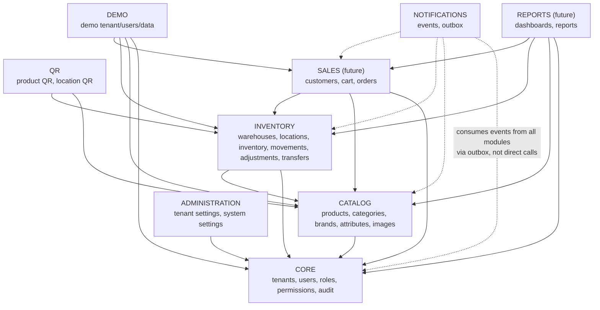
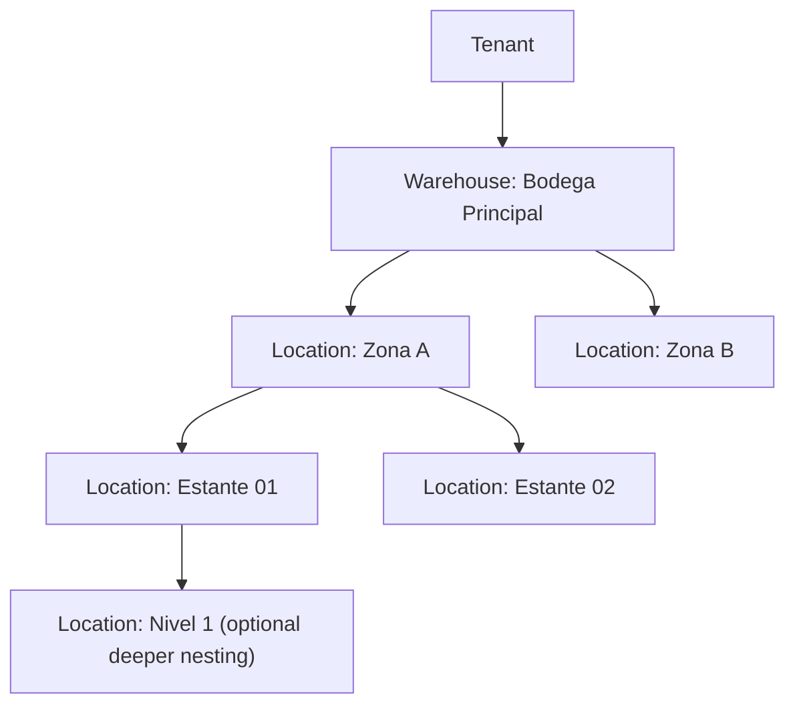
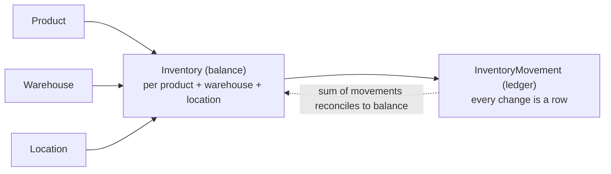
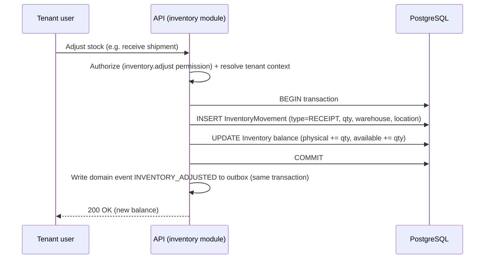
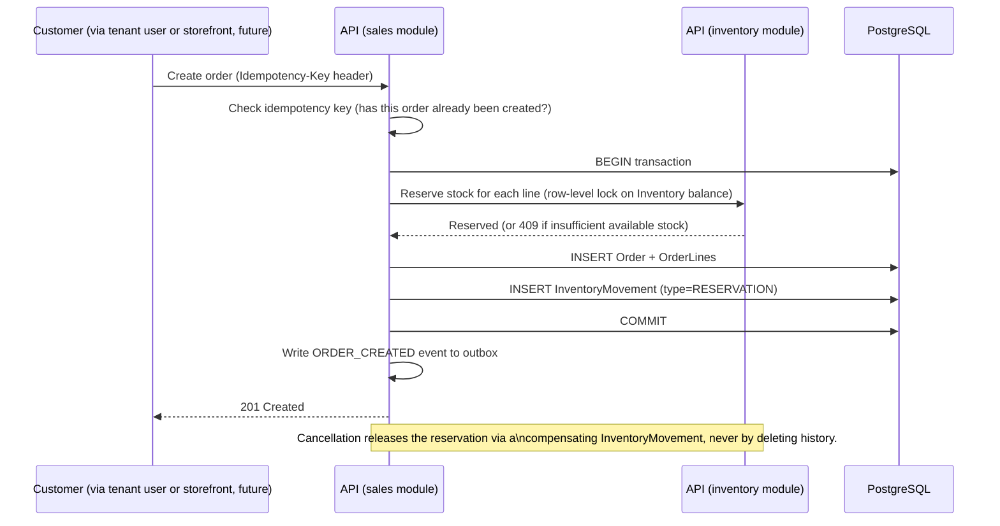

# Modules / Bounded Contexts

This defines the module map for the NestJS modular monolith (see [backend.md](backend.md)) and,
conceptually, for the domain model overall. Each module below is a **bounded context**: it owns
its data, exposes a narrow interface to other modules, and no other module reaches into its tables
directly.

None of these modules are implemented yet. This document defines responsibility, boundaries, and
dependency direction so implementation (starting with Prompt 02 — database design) has a map to
follow.

## Dependency rule

Dependencies point one way, shown top-to-bottom below. A module may depend on modules above it,
never below or sideways without going through an explicit interface. Cross-module communication
that isn't a direct synchronous call (e.g. "notify sales when stock changes") goes through domain
events on the [outbox](events.md), not a direct import.

## CORE

**Responsibility:** the identity and access substrate every other module depends on — who the
tenant is, who the user is, what they're allowed to do, and a record of what happened.

- `tenants` — the list of companies (global, no `tenant_id` on this table itself).
- `users` — tenant-scoped user accounts.
- `roles`, `permissions` — see [ADR-0009](../decisions/0009-rbac-permissions.md).
- `audit` — the audit log (see [Audit](#audit) below).

**Depends on:** nothing else (it is the foundation).

**Exposes to other modules:** tenant context resolution, permission checks, an audit-write
interface.

## CATALOG

**Responsibility:** what a tenant sells — products and the taxonomy around them. Deliberately
generic; see [ADR](../decisions) list has no dedicated "product model" ADR because the product
model is a database-design concern, not an architecture-level one — it's addressed in Prompt 02.

- `products`, `categories`, `brands`, `product attributes`, `product images`.

**Depends on:** CORE (tenant scoping, audit).

**Consumed by:** INVENTORY (a stock record refers to a product), SALES (a cart/order line refers to
a product), QR (a product can have a QR code), REPORTS.

## INVENTORY

**Responsibility:** where stock physically is and how it moves. See
[Inventory](#inventory-and-locations-summary) below and the Inventory Flow diagram.

- `warehouses`, `locations` (hierarchical), `inventory` (balances), `inventory movements`,
  `stock adjustments`, `transfers`.

**Depends on:** CORE, CATALOG.

**Consumed by:** SALES (reserving/committing stock for an order), QR (a location can have a QR
code), REPORTS.

## QR

**Responsibility:** generating and resolving QR codes that point at a product or a location. See
[api.md](api.md) for how a scanned QR resolves through the API.

**Depends on:** CATALOG (product QR), INVENTORY (location QR).

**Consumed by:** nothing depends on QR — it is a leaf module.

## SALES (future — not built in this phase)

**Responsibility:** the commerce flow — a customer builds a cart, which becomes an order, which
consumes inventory.

- `customers`, `cart`, `orders`.

**Depends on:** CORE, CATALOG, INVENTORY.

This module is designed conceptually now (see
[Order flow](#order-flow-conceptual--sales-not-implemented-yet)) but not implemented.

## NOTIFICATIONS

**Responsibility:** turning domain events into outbound notifications without coupling any other
module to *how* a notification is delivered. See [events.md](events.md) in full.

- `events` (the outbox table), delivery/retry bookkeeping.

**Depends on:** nothing (it only reads events written by other modules' transactions).

**Consumed by:** nothing inside the backend — its only consumer is the external Event Processor
that forwards to n8n.

## REPORTS (future — not built in this phase)

**Responsibility:** read-side aggregation across CORE/CATALOG/INVENTORY/SALES for dashboards and
reports. Expected to be built as read-optimized queries (and, later, materialized views or a
read replica) rather than reusing the transactional write-path repositories — `PENDING DECISION`
on the exact approach, to be revisited when reporting is actually scoped.

## ADMINISTRATION

**Responsibility:** tenant-level configuration (business hours, notification preferences, branding
later, etc.) and system-level configuration that only a SuperAdmin can change.

**Depends on:** CORE.

## DEMO

**Responsibility:** a fully isolated demo tenant — same isolation rules as any other tenant (see
[multi-tenancy.md](multi-tenancy.md)) — seeded with synthetic data for prospects/sales demos. See
[the demo strategy ADR](../decisions/0014-demo-tenant-strategy.md).

## Inventory and locations summary

Full detail: [database.md](database.md) (conceptual model) and the Inventory Flow diagram below.
Locations are a hierarchy under a warehouse, not a fixed two- or three-level scheme:

A `location` has a nullable `parent_location_id` (self-referencing), so the tree can be as shallow
or as deep as a tenant's real layout requires — "zone / shelf / level" is an example depth, not a
fixed schema. Each location can carry a QR code (see QR module) and a status (active/inactive).

Inventory itself is **never** a single `quantity` column on `products`. It is:

`Inventory` holds the current balance (fast reads); `InventoryMovement` is the append-only ledger
that produced that balance (traceability, auditability, and the ability to reconstruct history).
The balance additionally distinguishes:

- **Physical stock** — what is actually on the shelf.
- **Reserved stock** — held against an in-progress cart/order, not yet committed.
- **Committed stock** — allocated to a confirmed order not yet fulfilled/shipped.
- **Available stock** — physical minus reserved minus committed; what can be sold right now.

## Inventory flow (conceptual)

The event write happens in the **same database transaction** as the inventory change — see
[events.md](events.md#why-outbox) for why.

## Order flow (conceptual — SALES not implemented yet)

Concurrency is handled with row-level locking (`SELECT ... FOR UPDATE`) on the `Inventory` balance
row(s) being reserved against, inside a single transaction — two simultaneous orders for the last
unit of stock cannot both succeed. Idempotency is handled via a client-supplied `Idempotency-Key`
(see [api.md](api.md#idempotency)) so a retried request (e.g. after a timeout) does not create a
duplicate order.

## Audit

Every module that mutates tenant data writes to the CORE audit log. What gets audited (initial
list — extended as modules are built):

- Authentication events: login success/failure, logout, password change, token refresh.
- Authorization failures (attempted access denied by a guard) above a noise threshold.
- User/role/permission changes.
- Tenant lifecycle (created, activated, deactivated) — SuperAdmin actions.
- Inventory adjustments and transfers.
- Order creation and cancellation (once SALES exists).
- Any SuperAdmin action touching a specific tenant.

Each entry captures **who** (actor + whether SuperAdmin or tenant user), **what** (action code),
**when** (timestamp), **where** (tenant_id, correlation ID, IP if applicable), **on what** (entity
type + ID), and **before/after** state where the action is a mutation. See
[ADR-0015](../decisions/0015-audit-log.md).
