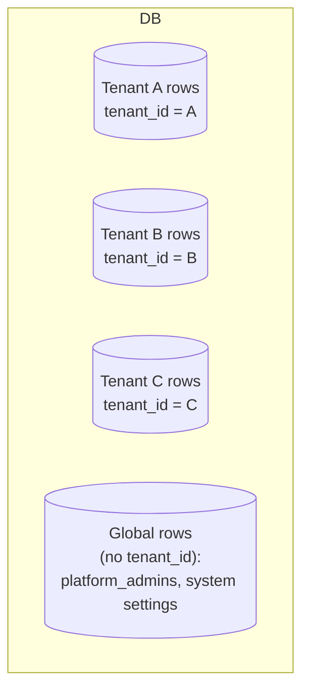
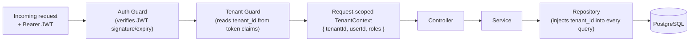
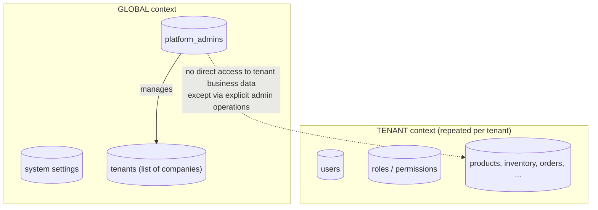

# Multi-Tenancy

Related: [ADR-0003](../decisions/0003-single-database-multi-tenant.md),
[ADR-0004](../decisions/0004-tenant-isolation-strategy.md).

## Model

One PostgreSQL database, many tenants (companies). Every tenant-owned table carries a `tenant_id`
column. There is no schema-per-tenant and no database-per-tenant.

**Why single-database over schema-per-tenant or database-per-tenant:** see
[ADR-0003](../decisions/0003-single-database-multi-tenant.md). In short — schema/DB-per-tenant
does not scale operationally past a few hundred tenants (migrations, connection pools, backups all
multiply per tenant) and this platform's growth target (see
[scalability.md](scalability.md)) needs to comfortably reach thousands of tenants on one deployed
database.

## Tenant context: where it comes from

**The tenant is never trusted from anything the client controls.** Not the request body, not a
query string parameter, not a path segment, not an arbitrary header. This applies identically to the
Flutter mobile app ([mobile.md#multi-tenant-mobile](mobile.md#multi-tenant-mobile)) — a client is a
client, regardless of platform; nothing below is web-specific.

The only source of truth for "which tenant is this request for" is the **authenticated session**:

1. The client authenticates (see [security.md](security.md) for the auth flow).
2. The API issues a token (JWT) whose claims include the user's `tenant_id` (or, for a SuperAdmin,
   no `tenant_id` — see [SuperAdmin vs tenant](#superadmin-vs-tenant) below).
3. On every subsequent request, a **Tenant Guard** (a NestJS guard that runs before any
   controller handler) reads `tenant_id` from the verified token — never from the request payload —
   and attaches it to a per-request context object.
4. Every service/repository call that touches tenant-owned data receives that context and is
   required to filter by it.

If a request body or query string happens to also contain a `tenantId`-shaped field for some
reason, it is either rejected by DTO whitelisting (see [security.md](security.md)) or explicitly
ignored — it is never read as the operative tenant.

## Enforcement layers (defense in depth)

Tenant isolation is enforced at more than one layer, so that a bug in any single layer does not
result in cross-tenant data exposure:

1. **Guard layer** — the Tenant Guard rejects any request without a resolvable tenant context
   (except explicitly public or SuperAdmin-only routes). **It also rejects a resolvable tenant
   that is not currently `active`** (PROMPT 011-A) — `tenants.status` is read fresh from
   PostgreSQL on every request via `TenantsPlatformRepository`, never trusted from the JWT (a
   claim would freeze the tenant's operability at token-issuance time). This is a distinct
   concern from isolation: it governs *whether* a tenant may operate at all, not which rows it
   may see — see [security.md](security.md#tenant-isolation) for the full enforcement design and
   [database.md#core-tenants-users-platform-admins](database.md#core-tenants-users-platform-admins)
   for `tenants.status`'s values (`active`/`suspended`/`archived`). **It applies the identical
   live-read check to the requesting user's own `users.status`** (PROMPT 011-B), and the Import
   Worker — the one tenant-scoped write path with no HTTP request and therefore no Tenant Guard at
   all — enforces the tenant-status half of this same rule independently, in its own claim query
   and batch loop (see [security.md](security.md#tenant-isolation)).
2. **Repository/data-access layer** — every query against a tenant-owned table includes
   `WHERE tenant_id = :tenantId` (or the ORM-level equivalent). This is a repository-level
   convention, not something left to individual call sites to remember — see
   [backend.md](backend.md) for how the repository layer is shaped to make omitting it hard to do
   by accident.
3. **Database layer (designed in Prompt 02, implemented starting Prompt 03)** — PostgreSQL
   Row-Level Security (RLS) policies as a last-resort backstop, so that even a query that forgot the
   `tenant_id` filter cannot read or write another tenant's rows. **Status: RLS timing is decided —
   enabled from the first migration that creates each tenant-owned table, not deferred** — see
   [ADR-0004](../decisions/0004-tenant-isolation-strategy.md) and
   [database.md#row-level-security](database.md#row-level-security) for the full design (session
   variable set via `SET LOCAL`/`set_config`, the `app_tenant`/`app_platform`/`app_event_processor`/
   `app_public_resolver` role split, and how this stays safe under connection pooling). RLS is
   additive hardening on top of layers 1–2, not a replacement for them.
4. **Database layer — tenant-aware referential integrity.** Every foreign key between two
   tenant-owned tables is a composite `(tenant_id, x_id) REFERENCES x(tenant_id, id)`, not a bare
   `x_id REFERENCES x(id)`. This closes a failure mode RLS alone does not: RLS constrains which rows
   a query can see/write, but does not by itself verify that a *referenced* row belongs to the same
   tenant as the row referencing it. See
   [ADR-0018](../decisions/0018-tenant-aware-referential-integrity.md) and
   [database.md#tenant-aware-referential-integrity](database.md#tenant-aware-referential-integrity).

## Cross-tenant access: what "wrong" looks like

A cross-tenant access bug is any of:

- A query missing a `tenant_id` filter on a tenant-owned table.
- Trusting a client-supplied tenant identifier for anything other than display purposes.
- An entity ID (e.g. a product ID) being accepted from one tenant's request and resolved against
  another tenant's row because the lookup didn't also filter by `tenant_id`.
- A background job / cron / admin script that iterates tenants without re-establishing tenant
  context per iteration.

Every PR touching tenant-scoped data is expected to be reviewed against this list — see
[CLAUDE.md §7.9](../../CLAUDE.md#79-definition-of-done) and
[../security/threat-model.md](../security/threat-model.md).

## SuperAdmin vs tenant

SuperAdmin is a **platform-level** identity, not a role inside a tenant. A SuperAdmin does not
belong to any company and must not be modeled as "a tenant user with elevated permissions" —
that would make it possible for a tenant-isolation bug to accidentally grant SuperAdmin-shaped
access to a tenant user, or vice versa.

**Decision: SuperAdmin identities live in a separate table (`platform_admins`), not in the
tenant-scoped `users` table.** This is a conscious redundancy: it means the *type* of the
authenticated principal is structurally distinct, not just a flag, so "is this a SuperAdmin"
can never be confused with "is this a tenant user with `role = admin`".

Consequences of this split:

- A SuperAdmin's JWT carries a distinct token type/claim (e.g. `context: "global"`) rather than a
  `tenant_id`. The Tenant Guard treats `context: "global"` as "no tenant scope" and routes it to
  SuperAdmin-only endpoints; it does **not** grant blanket access to every tenant's data.
- SuperAdmin capabilities are explicit, narrow endpoints (list companies, create/activate/deactivate
  a company, view platform-level metrics, manage global configuration/plans) — not "log in as any
  tenant user" by default. Any future "impersonate a tenant for support" capability is a separate,
  audited, explicitly-scoped feature, not an implicit consequence of being a SuperAdmin — `PENDING
  DECISION` on whether/how impersonation is built at all.
- SuperAdmin actions are audited the same as tenant actions (see
  [modules.md](modules.md#audit) and [ADR-0015](../decisions/0015-audit-log.md)).

See [ADR-0004](../decisions/0004-tenant-isolation-strategy.md) for the formal record of this
decision. **Implemented FASE 11** — see [ADR-0032](../decisions/0032-platform-admin-authentication.md)
for the concrete mechanism (`auth/platform-auth.controller.ts`, `common/decorators/platform-only.
decorator.ts`) and [modules.md#administration](modules.md#administration) for the tenant-lifecycle
capability (list/suspend/activate a company) this phase actually built. Platform-level metrics and
global configuration/plans remain unbuilt — no concrete architectural definition exists for them yet.

## Administrative / cross-tenant queries

Some legitimate operations need to see across tenants (platform metrics, billing aggregation
later, support tooling). These are:

- Only reachable through SuperAdmin-scoped endpoints, never through tenant-scoped endpoints with a
  "just don't filter this time" escape hatch.
- Built as explicit aggregate/read paths, not as the tenant-scoped repository with the tenant
  filter turned off — so the "normal" repository path is never given a way to accidentally skip
  isolation.
- Audited like any other administrative action.

**Prompt 02-A note — a different, narrower dimension:** location-scoped authorization
(`user_location_assignments`, see [database.md#location-scoped-authorization](database.md#location-scoped-authorization))
restricts which of a *tenant's own* locations a user may operate on — it is not a tenant-isolation
mechanism and must not be confused with one. A location-authorization bug (an employee touching another
location belonging to the *same* tenant) never crosses the tenant boundary this document exists to
protect; it is reviewed and enforced independently, at the RBAC/guard layer, not via RLS or the
tenant-context mechanisms described above.

## What is *not* tenant-scoped

A small set of tables are intentionally global and have no `tenant_id`: `platform_admins`,
`tenants` (the list of companies itself), and system-wide configuration. These are exactly the
tables the SuperAdmin context is allowed to touch directly.
