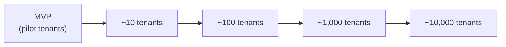

# Scalability

Related: [ADR-0001](../decisions/0001-modular-monolith.md).

## Principle: don't over-design for scale that isn't here yet

The platform starts as a **modular monolith** (one deployable NestJS application, one PostgreSQL
database) precisely because that is the simplest architecture that can correctly serve the actual
current requirement — see [ADR-0001](../decisions/0001-modular-monolith.md). Microservices solve
problems (independent scaling of specific hot paths, independent team ownership, independent
deploy cadence per service) this platform does not have yet, at the cost of problems it would
immediately acquire (distributed transactions instead of a single DB transaction for tenant
isolation and inventory consistency, network calls where a function call would do, far more
operational surface area for a small deployment). Introducing that cost before the benefit is
needed is the mistake this document is explicitly designed to avoid.

## Growth path

| Stage | Expected pressure | Response |
| --- | --- | --- |
| MVP / ~10 tenants | None yet — this is a correctness and product-fit phase, not a load phase. | Single small Postgres instance, single API container, no caching beyond what Redis already provides for rate limiting/sessions. |
| ~100 tenants | Read load on list/report endpoints; connection count. | Add indexes as real query patterns emerge (see [database.md](database.md)); add read-through caching (Redis) for hot, mostly-static reads (e.g. category trees); connection pooling (PgBouncer or the ORM's own pool) if connection count becomes a limit. |
| ~1,000 tenants | Write contention on hot tables (e.g. `InventoryMovement` insert volume across many tenants); background job volume (Event Processor throughput). | Vertical scaling of the database first (it is the simplest lever); consider a read replica for reporting/dashboard queries so they don't compete with transactional writes (see [modules.md#reports-future--not-built-in-this-phase](modules.md#reports-future--not-built-in-this-phase)); scale the API horizontally behind the reverse proxy (the API is already stateless — session state lives in the token/Redis, not in-process — so this requires no redesign). |
| ~10,000 tenants | A specific module's load profile diverges sharply from the rest (e.g. notification/event volume, or reporting query cost) in a way vertical scaling and read replicas no longer absorb. | This is the point to revisit extracting a *specific* module — see [When to split a module out](#when-to-split-a-module-out) — not a wholesale microservices rewrite. |

Numbers above are directional (order-of-magnitude planning, not a committed capacity model) —
actual thresholds depend on tenant size/activity, which isn't known yet.

## What scales without redesign

Because the API is stateless (no in-process session state) and the modular-monolith module
boundaries already match future service boundaries (see
[backend.md](backend.md#style-modular-monolith)), the following require no architectural change,
only more resources:

- Running multiple API container replicas behind the reverse proxy.
- Adding a Postgres read replica for read-heavy paths.
- Adding Redis capacity for caching/rate-limiting.

## When to split a module out

A module is a candidate for extraction into its own deployable **only when a concrete, measured
need exists** — not preemptively. Signals that would justify it:

- The module's load profile is genuinely independent (e.g. the Event Processor handling a burst of
  notification volume that has nothing to do with API request load) and scaling the whole monolith
  to absorb it wastes resources on the rest of the system.
- The module needs a different deployment cadence or failure-isolation boundary (e.g. the Event
  Processor being redeployed/restarted should never affect API request handling — it already runs
  as a logically separate concern per [events.md](events.md#event-processor), making it the most
  likely first candidate if/when this happens).

Because module boundaries already enforce "no other module reaches into this module's tables or
internals directly" (see [modules.md](modules.md#dependency-rule)), extraction at that point is a
matter of moving the module's code to its own deployable and replacing its in-process calls with
network calls — not a redesign of the domain model or a renegotiation of tenant isolation, since
isolation is already enforced per-request via tenant context, not via which process happens to be
running.

## Caching

Redis (already part of the Prompt 00 infrastructure) is available from day one for: rate-limiting
counters, refresh-token/session bookkeeping (see [security.md](security.md#authentication)), and,
as load justifies it, read-through caches for expensive or frequently-read, rarely-changed data.
Cache invalidation strategy per use case is decided when that specific cache is introduced, not
speculatively now.
