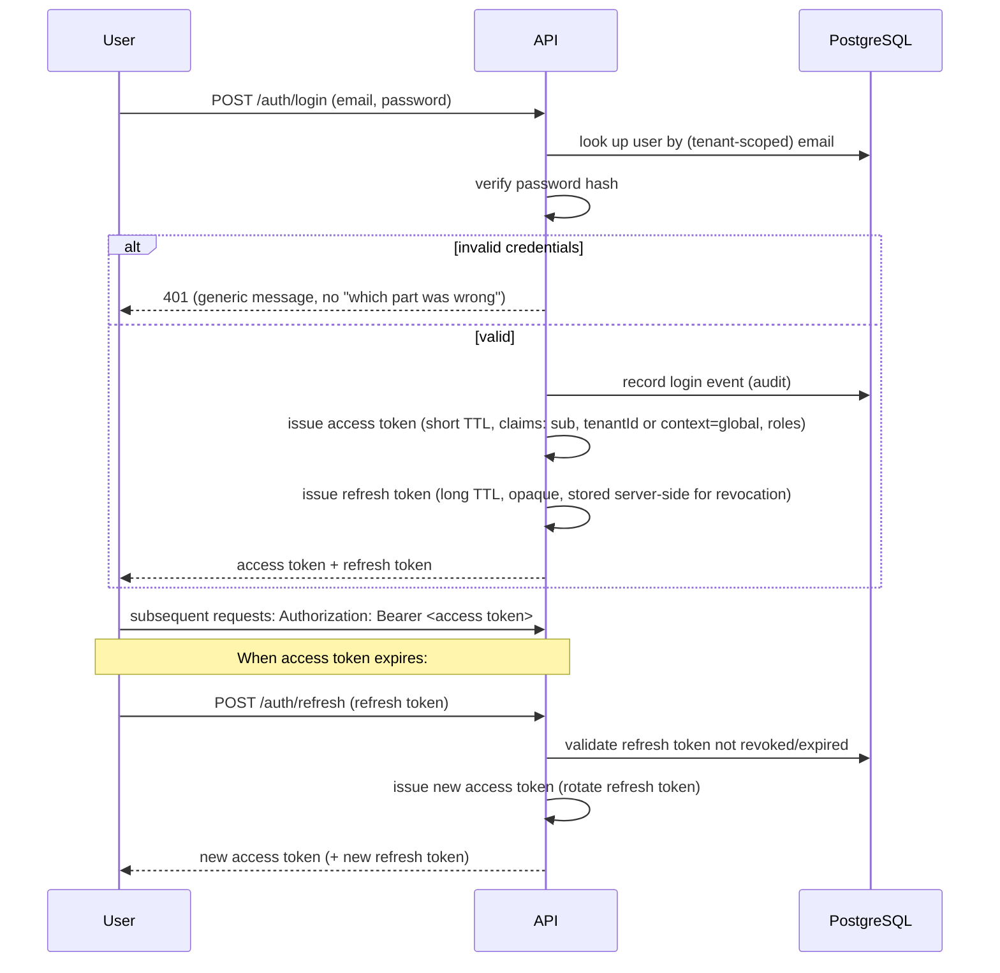

# Security Architecture

This is the architecture-level security design. See also
[SECURITY.md](../../SECURITY.md) (policy/process), [CLAUDE.md §7.4](../../CLAUDE.md#74-security)
(non-negotiable rules), and [../security/threat-model.md](../security/threat-model.md) (threats
mapped to mitigations and priority). Nothing here is implemented yet.

## Authentication

Credentials are verified by the API; the API issues a short-lived **access token** (JWT) and a
longer-lived **refresh token**. Passwords are never stored in plain text or reversibly
encrypted — hashed with a modern, slow hash designed for passwords (Argon2id or bcrypt;
exact choice is an implementation detail decided in FASE 4, both are acceptable, Argon2id is
preferred where available). How the access token is carried to the browser (httpOnly cookie vs.
bearer token in memory) is a `PENDING DECISION` — see [frontend.md](frontend.md#authentication-and-route-protection).

**Refresh tokens** are tracked server-side (so a specific session can be revoked — e.g. on
password change or "log out everywhere") and rotated on use (a used refresh token is invalidated
immediately, so a stolen-then-reused refresh token is detectable). Exact revocation storage
(Redis vs. a Postgres table) is an implementation choice for FASE 4.

## Authorization: RBAC + permissions

See [ADR-0009](../decisions/0009-rbac-permissions.md) and
[modules.md#core](modules.md#core). A user has one or more roles; a role is a named bundle of
granular permission strings (`products.view`, `inventory.adjust`, ...). A tenant's Administrator
can toggle which permissions a role grants, from a fixed, system-defined catalog of possible
permissions — tenants customize *which* permissions a role has, they do not invent new permission
strings, which keeps the permission set checkable by the code that enforces it.

Every route that isn't explicitly public declares the permission(s) it requires; a Permission
Guard checks the authenticated user's effective permissions (derived from their role(s)) against
that declaration before the controller runs — see [api.md#request-flow](api.md#request-flow).
Authorization is always re-checked server-side on every request; the frontend hiding a button is a
UX nicety, never the enforcement (per [CLAUDE.md §7.6](../../CLAUDE.md#76-frontend)).

## Tenant isolation

Covered in full in [multi-tenancy.md](multi-tenancy.md): tenant context derived only from the
verified token, enforced at the guard layer, the repository layer, and (planned) via PostgreSQL
RLS as defense-in-depth. Cross-tenant access is treated as a critical-severity class of bug — see
the [threat model](../security/threat-model.md).

## CSRF

Relevant primarily if the session-transport decision (see
[frontend.md](frontend.md#authentication-and-route-protection)) lands on cookies: a
cookie-authenticated browser will automatically attach credentials to any request, including one
triggered by a malicious third-party page, unless mitigated. If cookies are used, mitigation is
`SameSite=Strict` (or `Lax` with care) plus a double-submit or synchronizer CSRF token on
state-changing requests. If the bearer-token-in-memory approach is used instead, CSRF risk is
substantially reduced (a third-party page cannot read the token to attach it), which is one of the
factors weighed in that `PENDING DECISION`.

## CORS

The API's CORS configuration (already scaffolded in `apps/api/src/main.ts`) allows only the
origins listed in `CORS_ORIGINS` — never a wildcard `*` in production. Credentials (cookies) are
only allowed cross-origin for explicitly trusted origins.

## Rate limiting and brute-force protection

See [api.md#rate-limiting](api.md#rate-limiting). Login and other credential-checking endpoints
get a tighter limit keyed by IP + attempted identifier (not just IP alone, so distributed
low-and-slow attempts against one account are still caught) with backoff, independent of the
general per-tenant API rate limit. Exact thresholds are a tuning decision made when auth is built,
not fixed here.

## Input validation, SQL injection, XSS

- **Input validation:** every endpoint validates its input via a DTO (`class-validator`), with
  unknown fields rejected (`whitelist`/`forbidNonWhitelisted`, already configured) — see
  [backend.md](backend.md#cross-cutting-concerns).
- **SQL injection:** all database access goes through Drizzle's parameterized query builder — no
  string-concatenated SQL. Any case that genuinely needs raw SQL uses parameterized placeholders,
  never string interpolation of user input.
- **XSS:** React escapes rendered content by default; the frontend does not use
  `dangerouslySetInnerHTML` (or equivalent) on anything derived from user/tenant-supplied content
  without a specific, reviewed reason. A Content-Security-Policy header (see
  [Secure headers](#secure-headers)) is a second layer.

## SSRF

Any feature where the backend fetches a URL supplied (directly or indirectly) by a tenant —
notably the outbound webhook call to n8n, and any future "tenant configures their own webhook
URL" feature — validates the target is not a private/internal address (no `localhost`, no RFC1918
ranges, no cloud-metadata endpoints) before making the request. The n8n webhook URL itself is
platform configuration (`N8N_WEBHOOK_URL`), not tenant-supplied, which limits this risk for the
outbox path specifically; the general rule applies to any future feature that does accept a
tenant-supplied URL.

## File upload security

Product images (and any future upload) are validated on: content-type (checked against actual
file content, not just the declared header), size limit, and file extension allow-list. Uploaded
files are stored in object storage (S3-compatible — see `.env.example`'s `S3_*` variables from
Prompt 00), never on the API container's local filesystem, and served from a separate
domain/subdomain or via signed URLs where appropriate, so a malicious uploaded file cannot execute
in the context of the main application origin.

## Secrets management

Per [CLAUDE.md §7.4](../../CLAUDE.md#74-security) and [SECURITY.md](../../SECURITY.md): no
secrets in the frontend, in Git, or in logs; each environment has its own secrets; the Telegram
bot token specifically never reaches the backend at all (see [events.md](events.md#n8n-and-telegram)).
Production secrets are injected via environment variables from outside version control (see
[../deployment/docker.md](../deployment/docker.md)); a dedicated secret manager is adopted if/when
the deployment target supports one — `PENDING DECISION`, not required for the current Docker
Compose deployment shape.

## Logging and audit

Structured logs include `correlationId` and `tenantId` where applicable, never secrets or full
sensitive payloads (see [backend.md](backend.md#cross-cutting-concerns)). The audit log
(distinct from operational logs — see [modules.md#audit](modules.md#audit) and
[ADR-0015](../decisions/0015-audit-log.md)) is the durable, queryable record of who did what,
kept regardless of operational log retention.

## Backups

Deferred to the database phase — see [database.md](database.md) and
[../../SECURITY.md#backups](../../SECURITY.md). No backup strategy is assumed until there is a
schema to back up.

## Encryption

- **In transit:** TLS terminated at the reverse proxy (Caddy, automatic HTTPS) — see
  [../deployment/docker.md](../deployment/docker.md); internal container-to-container traffic
  stays inside the Docker network.
- **At rest:** relies on the underlying disk/volume encryption of the deployment host by default.
  Column-level encryption for specific sensitive fields (if any turn out to need it beyond normal
  DB access controls) is a `PENDING DECISION`, evaluated per-field when such a field exists —
  nothing in the current scaffold stores data sensitive enough to need it yet.

## Secure headers

`@fastify/helmet` is already wired into `apps/api/src/main.ts` (Prompt 00), providing standard
protections (`X-Content-Type-Options`, `X-Frame-Options`, a baseline CSP, etc.). A tightened,
application-specific Content-Security-Policy is defined once the frontend's actual asset/script
origins are known, rather than guessed now.

## Dependency scanning

CI (`.github/workflows/ci.yml`) runs install/lint/typecheck/test/build on every PR; a dependency
audit step (`pnpm audit` or equivalent, potentially Dependabot/Renovate for update PRs) is added
as part of hardening — `PENDING DECISION` on exact tooling, tracked for FASE 15 in the
[roadmap](../roadmap/roadmap.md).

## Docker security

Per [SECURITY.md](../../SECURITY.md#docker-security) and already reflected in the Prompt 00
scaffold: PostgreSQL and Redis are never published on production ports (see
`docker-compose.prod.yml`), containers run as non-root where the base image supports it, and no
real secret values live in compose files or images.
