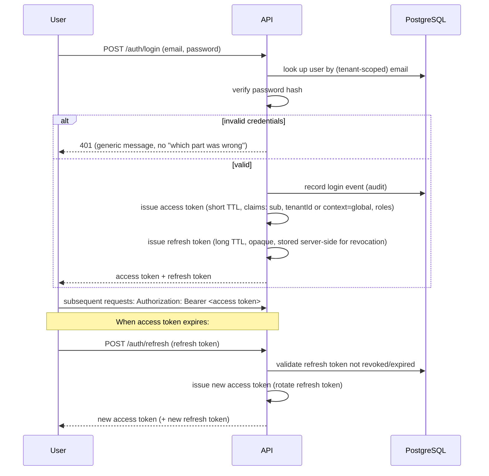

# Security Architecture

This is the architecture-level security design. See also
[SECURITY.md](../../SECURITY.md) (policy/process), [CLAUDE.md §7.4](../../CLAUDE.md#74-security)
(non-negotiable rules), and [../security/threat-model.md](../security/threat-model.md) (threats
mapped to mitigations and priority). Nothing here is implemented yet.

## Authentication

Credentials are verified by the API; the API issues a short-lived **access token** (JWT) and a
longer-lived **refresh token**. Passwords are never stored in plain text or reversibly
encrypted — hashed with Argon2id (`apps/api/src/auth/password/password.service.ts`), with
configurable cost parameters (`ARGON2_MEMORY_COST_KIB`/`ARGON2_TIME_COST`/`ARGON2_PARALLELISM`),
resolved in Prompt 04 per [ADR-0030](../decisions/0030-authentication-foundation.md). How the
access token is carried to the browser is resolved the same way — an httpOnly cookie; see
[frontend.md](frontend.md#authentication-and-route-protection).

**Refresh tokens** are tracked server-side (so a specific session can be revoked — e.g. on
password change or "log out everywhere") and rotated on use (a used refresh token is invalidated
immediately, so a stolen-then-reused refresh token is detectable — presenting an already-revoked
token revokes every active token for that user, per
[threat-model.md#stolen--replayed-jwt](../security/threat-model.md#stolen--replayed-jwt)).
Resolved in Prompt 04 ([ADR-0030](../decisions/0030-authentication-foundation.md)): revocation
storage is a Postgres table (`auth_refresh_tokens`, RLS-enabled, tenant-owned — migration `0013`),
not Redis, so the schema's existing isolation/audit guarantees apply directly. Tokens are opaque
(not JWTs) and stored only as an HMAC hash, never the raw value. These issuance/rotation/
revocation rules are transport-independent and apply unchanged to the Flutter mobile app — see
[mobile.md#auth-on-mobile](mobile.md#auth-on-mobile) for mobile's specific transport/storage answer
(bearer token in OS-level secure storage), which does not reopen or change
[frontend.md](frontend.md#authentication-and-route-protection)'s still-pending web
cookie-vs-bearer decision.

## Authorization: RBAC + permissions

See [ADR-0009](../decisions/0009-rbac-permissions.md) and
[modules.md#core](modules.md#core). A user has one or more roles; a role is a named bundle of
granular permission strings (`products.view`, `inventory.adjust`, ...). A tenant's Administrator
can toggle which permissions a role grants, from a fixed, system-defined catalog of possible
permissions — tenants customize *which* permissions a role has, they do not invent new permission
strings, which keeps the permission set checkable by the code that enforces it.

Every route that isn't explicitly public declares the permission(s) it requires; a Permission
Guard checks the authenticated user's effective permissions (derived from their role(s)) against
that declaration before the controller runs — see [api.md#request-flow](api.md#request-flow).
Authorization is always re-checked server-side on every request; the frontend hiding a button is a
UX nicety, never the enforcement (per [CLAUDE.md §7.6](../../CLAUDE.md#76-frontend)).

**Location-scoped authorization (Prompt 02-A)** is a second, independent check layered on top of RBAC
for location-sensitive actions (receiving a transfer, adjusting stock at a specific location): holding
the permission is necessary but not sufficient — the user must also be authorized for that specific
location, or hold no location restrictions at all. See
[database.md#location-scoped-authorization](database.md#location-scoped-authorization) and
[ADR-0024](../decisions/0024-location-scoped-authorization.md). This is a business-authorization
control, not a tenant-isolation one — it never permits crossing into another tenant's data.

**Concrete permission codes for the Prompt 02-A/02-B surface** (transfers, exceptional-discount
approval, attribute/category configuration, Excel import, location assignment) are enumerated in
[database.md's RBAC section](database.md#new-permission-codes-for-prompt-02-a02-b-capabilities-prompt-02-d) —
closed in Prompt 02-D so no critical operation ships without a defined authorization checkpoint.

**Tenant/user/role administration (Prompt 05-A)** adds `core.tenant.update`/`core.users.read`/
`core.users.create`/`core.users.update`/`core.roles.read`/`core.roles.assign` (database.md's table,
same section). Role assignment carries its own rule beyond the ordinary permission check:
`core.roles.assign` is never sufficient for a user to change their *own* role or status — that block
is unconditional, checked in `UsersService` before any permission lookup — see
[ADR-0031](../decisions/0031-role-assignment-escalation-prevention.md) for the full reasoning
(including why no role hierarchy is introduced). `GET /tenant` and `GET /users`/`GET /users/:id` are
tenant-scoped exactly like every other endpoint in this document — a foreign-tenant id resolves as
"not found," never as a distinguishable "found but forbidden."

**Tenant configuration (FASE 11)** adds `administration.settings.view`/`administration.settings.manage`
(database.md's table, same section) — `GET`/`PATCH /administration/tenant-settings`, tenant-scoped
exactly like every other endpoint in this document.

**Platform-admin (SuperAdmin) authentication (FASE 11)** — a second, structurally independent
authentication mechanism from everything above, never sharing a code path or a permission catalog
entry with tenant RBAC. See [ADR-0032](../decisions/0032-platform-admin-authentication.md) for the
full design: a distinct JWT payload shape (`context: 'global'`, never `tenantId`), a distinct
server-tracked refresh-token table (`platform_admin_refresh_tokens`), and distinct, non-overlapping
session cookies (`platform_access_token`/`platform_refresh_token`/`platform_csrf_token`). `POST
/platform/auth/login` has no counterpart registration endpoint — a platform admin is provisioned
out-of-band (`database/seeds/platform-admin.ts`, opt-in, never part of the default demo seed), never
through a public endpoint, closing the P0 privilege-escalation risk a self-service SuperAdmin
signup would otherwise be (see [threat-model.md#privilege-escalation](../security/threat-model.md#privilege-escalation)).
`GET /platform/tenants`, `POST /platform/tenants/:tenantId/suspend`/`activate` are gated by
`@PlatformOnly()` alone — never by `@RequirePermissions()` — so no tenant RBAC configuration
(`core.roles.assign` and everything it can grant) can ever reach a platform-level capability.

**Tenant suspension is enforced live, on every request, not frozen into the JWT (PROMPT 011-A).**
`tenants.status` (`active`/`suspended`/`archived`) is never a token claim — a claim would freeze
the tenant's operability at token-issuance time, leaving a suspended tenant fully operable for the
remainder of its access token's TTL. Instead, `TenantGuard` (`common/guards/tenant.guard.ts`) reads
`tenants.status` fresh, via `TenantsPlatformRepository`, on every tenant-scoped request — the single
central point every route not marked `@Public()`/`@PlatformOnly()` passes through, so no controller
re-implements this check. `AuthService.login()` already rejected a non-`active` tenant before this
fix; `AuthService.refresh()` now does too, checked the same way, so a refresh token minted while
active cannot outlive a later suspension either — deliberately left un-revoked when rejected (no
forced logout, no token blacklist): reactivation (`tenants.status` back to `active`) makes both the
existing refresh token and any not-yet-expired access token work again on their own, on the very
next request, since the guard's check is a live read, not a cached or one-time decision. Suspending
one tenant has no effect on any other tenant's sessions, isolation (RLS), or the platform-admin
identity's own ability to keep managing it — `@PlatformOnly()` routes never resolve a tenant context
at all, so they are structurally unaffected by any tenant's status.

**The identical live-read principle applies to `users.status` (PROMPT 011-B), and to the Import
Worker's own execution path.** `login()`/`refresh()`/`me()` already re-fetched the user and checked
`status === 'active'` on every one of those calls, but nothing previously re-checked it for an
already-issued access token's ordinary tenant-scoped requests — `TenantGuard` now does, via
`UsersRepository.findById(tx, tenantId, userId)` (tenant- *and* user-id-scoped, which is also what
structurally guarantees a user can never resolve against a different tenant than the one in its own
token), inside the same transaction that already loads effective permissions — one extra indexed
lookup, not a new query shape. A disabled user's still-valid token stops working from the very next
request the same way a suspended tenant's does, and is left un-revoked, so reactivation restores it
immediately, with no forced re-login. Separately, the Import Worker (`apps/api/src/import-worker/`)
never passes through `TenantGuard` at all — it is a background process, not an HTTP path — so it
needed its own, independent enforcement: `ImportWorkerClaimRepository`'s claim query now excludes
any job whose tenant is not `active` (a `JOIN tenants ... AND t.status = 'active'`, locking only
`import_jobs` rows via `FOR UPDATE OF ij` so this read can never block a platform-admin
suspend/activate call), and `ImportValidationService`/`ImportExecutionService` re-check the same
live status before starting every batch of an already-claimed job — never mid-batch, never
aborting work already committed, only preventing the *next* batch from starting. Either check
leaves the job in its current, resumable, non-terminal status (never `failed`, never falsely
finalized to `completed`) — see [modules.md#import](modules.md#import-prompt-02-b) for the full
worker-side design.

**Field-level authorization (Prompt 02-D)** — route-level permission checks are not always enough:
`cost` and `min_price` need to be withheld from an authenticated caller who lacks the specific
permission for them, even though that caller is otherwise authorized to view the product. See
[ADR-0028](../decisions/0028-field-level-price-authorization.md) for the two-layer mechanism (a
permission-aware repository query projection, plus an allow-list response DTO) — deliberately not "the
frontend just doesn't show it," per this document's existing rule that authorization is enforced
server-side.

## Tenant isolation

Covered in full in [multi-tenancy.md](multi-tenancy.md): tenant context derived only from the
verified token, enforced at the guard layer, the repository layer, PostgreSQL RLS (enabled from the
first migration, not deferred — see [database.md#row-level-security](database.md#row-level-security))
and tenant-aware composite foreign keys (see
[database.md#tenant-aware-referential-integrity](database.md#tenant-aware-referential-integrity)) as
defense-in-depth. Cross-tenant access is treated as a critical-severity class of bug — see
the [threat model](../security/threat-model.md).

## CSRF

Relevant because the session-transport decision
([frontend.md](frontend.md#authentication-and-route-protection), Prompt 04,
[ADR-0030](../decisions/0030-authentication-foundation.md)) is cookies: a cookie-authenticated
browser automatically attaches credentials to any request, including one triggered by a malicious
third-party page, unless mitigated. Mitigation is `SameSite=Lax` plus a double-submit CSRF token
(`csrf_token` cookie + `X-CSRF-Token` header, `common/guards/csrf.guard.ts`) on every
state-changing request — implemented, not just planned, since `SameSite` alone is not treated as
sufficient. Login/register are exempt (`@SkipCsrf()`) since no session cookie exists yet to
protect at that point. A request authenticated via `Authorization: Bearer` instead of a cookie
(the mobile transport) is exempt from this check by construction — a third-party page cannot make
a browser attach an arbitrary header, so CSRF does not apply to that transport.

## CORS

The API's CORS configuration (already scaffolded in `apps/api/src/main.ts`) allows only the
origins listed in `CORS_ORIGINS` — never a wildcard `*` in production. Credentials (cookies) are
only allowed cross-origin for explicitly trusted origins.

## Rate limiting and brute-force protection

See [api.md#rate-limiting](api.md#rate-limiting). Login and register are limited by IP + attempted
identifier (not just IP alone, so distributed low-and-slow attempts against one account are still
caught), independent of the general per-tenant API rate limit (not yet needed — no business
endpoints exist yet). Implemented in Prompt 04 via `@nestjs/throttler`, in-memory, single API
instance — a shared (Redis) store is the documented follow-up for horizontal scaling, per
[api.md#rate-limiting](api.md#rate-limiting).

## Input validation, SQL injection, XSS

- **Input validation:** every endpoint validates its input via a DTO (`class-validator`), with
  unknown fields rejected (`whitelist`/`forbidNonWhitelisted`, already configured) — see
  [backend.md](backend.md#cross-cutting-concerns).
- **SQL injection:** all database access goes through Drizzle's parameterized query builder — no
  string-concatenated SQL. Any case that genuinely needs raw SQL uses parameterized placeholders,
  never string interpolation of user input.
- **XSS:** React escapes rendered content by default; the frontend does not use
  `dangerouslySetInnerHTML` (or equivalent) on anything derived from user/tenant-supplied content
  without a specific, reviewed reason. A Content-Security-Policy header (see
  [Secure headers](#secure-headers)) is a second layer.

## SSRF

Any feature where the backend fetches a URL supplied (directly or indirectly) by a tenant —
notably the outbound webhook call to n8n, and any future "tenant configures their own webhook
URL" feature — validates the target is not a private/internal address (no `localhost`, no RFC1918
ranges, no cloud-metadata endpoints) before making the request. The n8n webhook URL itself is
platform configuration (`N8N_WEBHOOK_URL`), not tenant-supplied, which limits this risk for the
outbox path specifically; the general rule applies to any future feature that does accept a
tenant-supplied URL.

## File upload security

Product images (and any future upload) are validated on: content-type (checked against actual
file content, not just the declared header), size limit, and file extension allow-list. Uploaded
files are stored in object storage (S3-compatible — see `.env.example`'s `S3_*` variables from
Prompt 00), never on the API container's local filesystem, and served from a separate
domain/subdomain or via signed URLs where appropriate, so a malicious uploaded file cannot execute
in the context of the main application origin.

**Excel import (Prompt 02-B)** extends this same rule to a new file type, with two additions specific
to spreadsheet files: the extension allow-list accepts `.xlsx` only — never legacy `.xls`, and
critically never macro-enabled `.xlsm`, closing off macro execution as an attack vector structurally
rather than by scanning for malicious macro content; and the parser reads cell **values** only, never
evaluating formulas as live/executable. The generated downloadable error report
([database.md#excel-import-pipeline](database.md#excel-import-pipeline)) sanitizes any user-supplied
cell content it echoes back (neutralizing a leading `=`/`+`/`-`/`@`) before writing it into a new
spreadsheet, closing the classic CSV/Excel formula-injection path where a malicious input value, once
echoed into a file an administrator later opens, executes a formula in *their* spreadsheet application.

## Secrets management

Per [CLAUDE.md §7.4](../../CLAUDE.md#74-security) and [SECURITY.md](../../SECURITY.md): no
secrets in the frontend, in Git, or in logs; each environment has its own secrets; the Telegram
bot token specifically never reaches the backend at all (see [events.md](events.md#n8n-and-telegram)).
Production secrets are injected via environment variables from outside version control (see
[../deployment/docker.md](../deployment/docker.md)); a dedicated secret manager is adopted if/when
the deployment target supports one — `PENDING DECISION`, not required for the current Docker
Compose deployment shape.

## Logging and audit

Structured logs include `correlationId` and `tenantId` where applicable, never secrets or full
sensitive payloads (see [backend.md](backend.md#cross-cutting-concerns)). The audit log
(distinct from operational logs — see [modules.md#audit](modules.md#audit) and
[ADR-0015](../decisions/0015-audit-log.md)) is the durable, queryable record of who did what,
kept regardless of operational log retention.

## Backups

Deferred to the database phase — see [database.md](database.md) and
[../../SECURITY.md#backups](../../SECURITY.md). No backup strategy is assumed until there is a
schema to back up.

## Encryption

- **In transit:** TLS terminated at the reverse proxy (Caddy, automatic HTTPS) — see
  [../deployment/docker.md](../deployment/docker.md); internal container-to-container traffic
  stays inside the Docker network.
- **At rest:** relies on the underlying disk/volume encryption of the deployment host by default.
  Column-level encryption for specific sensitive fields (if any turn out to need it beyond normal
  DB access controls) is a `PENDING DECISION`, evaluated per-field when such a field exists —
  nothing in the current scaffold stores data sensitive enough to need it yet.

## Secure headers

`@fastify/helmet` is already wired into `apps/api/src/main.ts` (Prompt 00), providing standard
protections (`X-Content-Type-Options`, `X-Frame-Options`, a baseline CSP, etc.). A tightened,
application-specific Content-Security-Policy is defined once the frontend's actual asset/script
origins are known, rather than guessed now.

## Dependency scanning

CI (`.github/workflows/ci.yml`) runs install/lint/typecheck/test/build on every PR; a dependency
audit step (`pnpm audit` or equivalent, potentially Dependabot/Renovate for update PRs) is added
as part of hardening — `PENDING DECISION` on exact tooling, tracked for FASE 15 in the
[roadmap](../roadmap/roadmap.md).

## Docker security

Per [SECURITY.md](../../SECURITY.md#docker-security) and already reflected in the Prompt 00
scaffold: PostgreSQL and Redis are never published on production ports (see
`docker-compose.prod.yml`), containers run as non-root where the base image supports it, and no
real secret values live in compose files or images.
