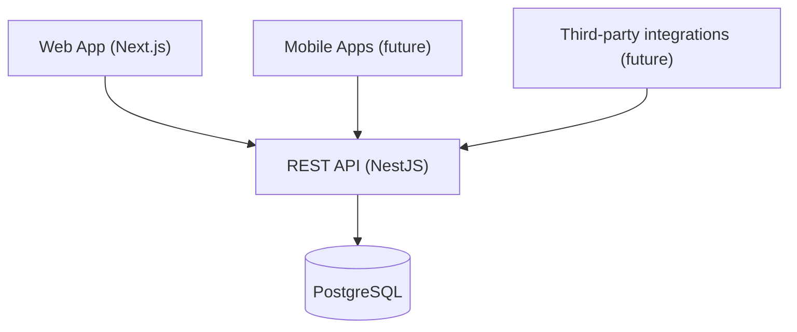
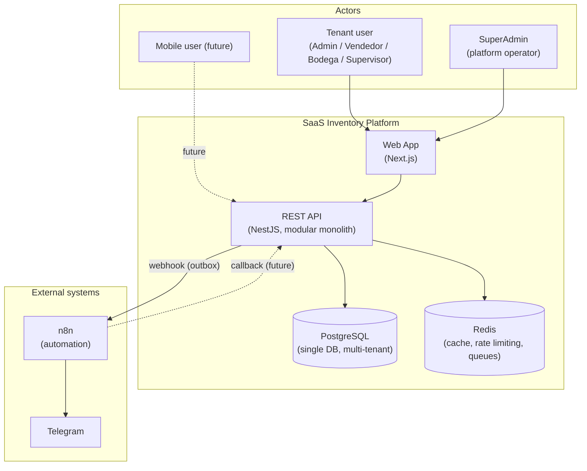
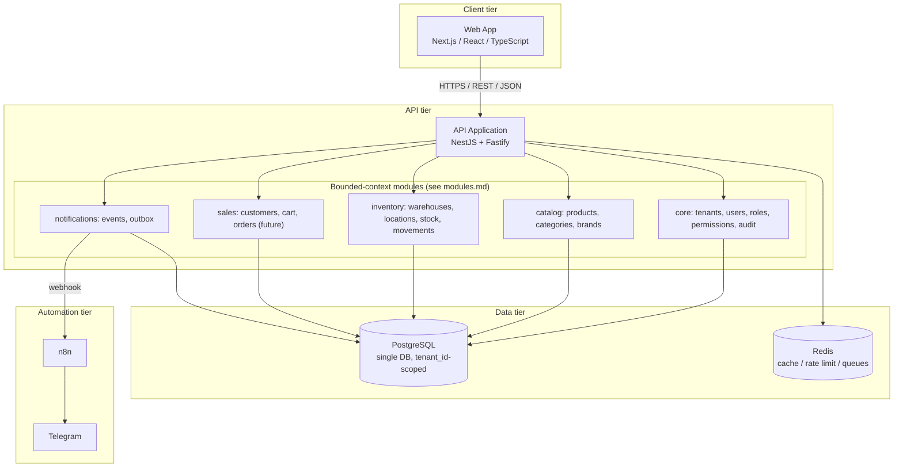

# System Overview

## Purpose

SaaS Inventory is a multi-tenant enterprise management platform, launching with inventory
management for businesses selling white goods, furniture, appliances, and similar physical
products. The domain model and architecture are deliberately generic — not "inventory software
with multi-tenancy bolted on" — so that later phases can add sales, purchasing, invoicing,
accounting, CRM, and mobile apps on the same foundation without a rewrite.

This document is the entry point into `docs/architecture/`. It defines vocabulary and the overall
shape of the system; each other document goes deeper into one concern.

| Document | Concern |
| --- | --- |
| [multi-tenancy.md](multi-tenancy.md) | Tenant isolation, SuperAdmin vs tenant context |
| [modules.md](modules.md) | Bounded contexts, module boundaries, dependencies |
| [backend.md](backend.md) | NestJS modular-monolith internal architecture |
| [frontend.md](frontend.md) | Next.js application architecture |
| [database.md](database.md) | PostgreSQL conventions (conceptual, pre-schema) |
| [api.md](api.md) | REST API contract conventions |
| [events.md](events.md) | Outbox pattern, event catalog, n8n integration |
| [security.md](security.md) | Security architecture |
| [scalability.md](scalability.md) | Growth path from MVP to many tenants |
| [../security/threat-model.md](../security/threat-model.md) | Threat model |
| [../decisions/](../decisions/) | ADRs — the *why* behind each choice below |

## Core principle

Every client — the Next.js web app today, native mobile apps later, and any future integration —
talks to PostgreSQL through exactly one path: the REST API. No client is ever given database
credentials or a direct connection.

The API is the single contract and the single enforcement point for authorization and tenant
isolation (see [multi-tenancy.md](multi-tenancy.md)). This is non-negotiable — see
[CLAUDE.md](../../CLAUDE.md) §7.2–7.3 and [ADR-0005](../decisions/0005-rest-api.md).

## System context

Actors and external systems the platform talks to. Items marked *(future)* are named here only to
show where the boundary sits — they are not built yet.

Notice the arrow direction from the platform to n8n: the backend calls out via webhook, it never
receives inbound calls from Telegram or holds a Telegram token. See
[events.md](events.md) and [ADR-0011](../decisions/0011-n8n-external-automation.md).

## Container diagram

## Deployment shape

Development and production both run as Docker containers behind a reverse proxy; see
[../deployment/docker.md](../deployment/docker.md) for the deployment architecture diagram and
[ADR-0013](../decisions/0013-docker-deployment.md) for the reasoning.

## Architectural style

The backend is a **modular monolith**, not microservices, until there is a concrete, measured
reason to split something out. See [scalability.md](scalability.md) and
[ADR-0001](../decisions/0001-modular-monolith.md).

## Status

Architecture defined at the level needed to start database design (Prompt 02) and subsequent
module implementation. No business tables, endpoints, or functionality exist yet — see
[docs/roadmap/roadmap.md](../roadmap/roadmap.md).
