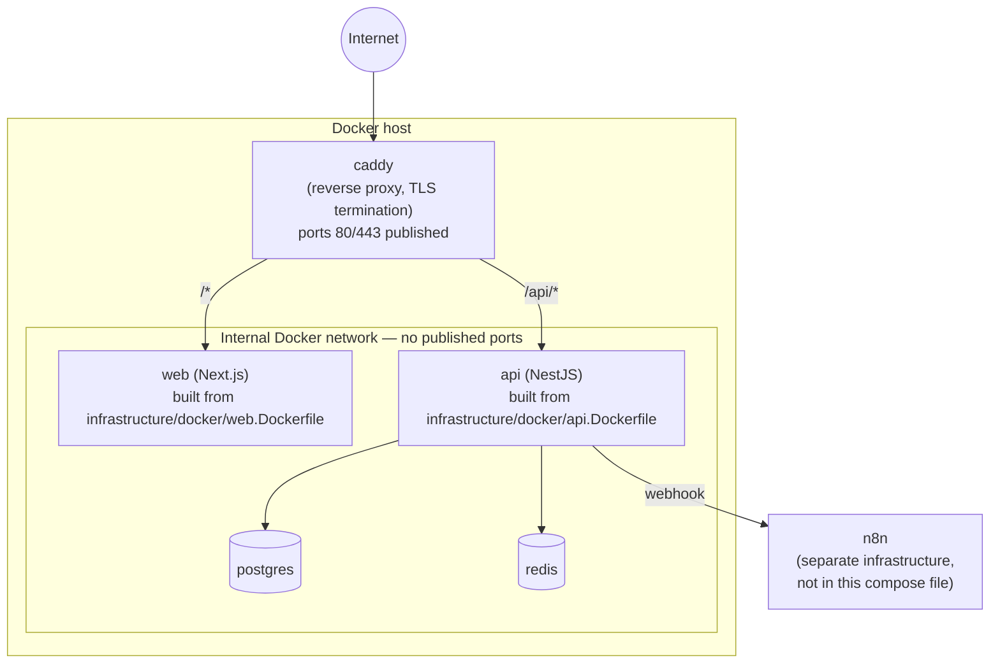

# Docker strategy

## Files

- [docker-compose.dev.yml](../../docker-compose.dev.yml) — local development: `postgres`, `redis`,
  `api`, `web`. The app services run via `pnpm dev` against a bind-mounted repo for fast iteration
  (no image build required). Postgres/Redis are bound to `127.0.0.1` only, for local convenience.
- [docker-compose.prod.yml](../../docker-compose.prod.yml) — production: `postgres`, `redis`,
  `api`, `web`, `caddy`. `api` and `web` are built from the multi-stage Dockerfiles in
  [infrastructure/docker/](../../infrastructure/docker/). Postgres and Redis publish **no** ports —
  they are reachable only from other containers on the compose network. `caddy` is the only
  service exposed on `80`/`443` and reverse-proxies `/api/*` to `api` and everything else to `web`.

## n8n

n8n is treated as separate infrastructure, not a service in either compose file here — it is not
coupled to the backend's build or lifecycle. The backend only needs `N8N_WEBHOOK_URL` and
`N8N_WEBHOOK_SECRET` to call out to it; it never receives or stores the Telegram bot token, which
n8n owns exclusively.

## Secrets

Neither compose file contains real secret values. Required secrets (`POSTGRES_PASSWORD`,
`JWT_SECRET`, `JWT_REFRESH_SECRET`, `N8N_WEBHOOK_SECRET`, ...) are read from the environment via
`${VAR:?set VAR}`, which makes `docker compose` fail fast with a clear error if a required secret
is missing, instead of silently starting with an empty value. Production secrets are provided
through the deployment environment (e.g. an `.env` file outside version control, or a secret
manager), never hardcoded in the compose files.

## Networking

- Dev: `api`/`web` reach Postgres/Redis by service name (`postgres`, `redis`) on the default
  compose network; the app ports are also published to localhost for direct access from the host.
- Prod: only `caddy` is published externally. `postgres` and `redis` are never exposed publicly,
  per [SECURITY.md](../../SECURITY.md).

## Deployment architecture

Only `caddy` is reachable from outside the Docker host. `web` and `api` are reachable only via
Caddy; `postgres` and `redis` are reachable only from `api`, never published and never reachable
from `web` or the internet, per [multi-tenancy.md](../architecture/multi-tenancy.md) and
[SECURITY.md](../../SECURITY.md) — the frontend has no path to the database that doesn't go
through the API.

## Status

This is infrastructure scaffolding. `docker-compose.dev.yml`/`docker-compose.prod.yml` and the
Dockerfiles have not been run end-to-end (no Docker runtime is available in this environment) —
the API's own build/boot was validated directly with Node during Prompt 00 (see its final report),
but the containerized path itself is exercised in the Infrastructure phase (FASE 2 of the
[roadmap](../roadmap/roadmap.md)).
